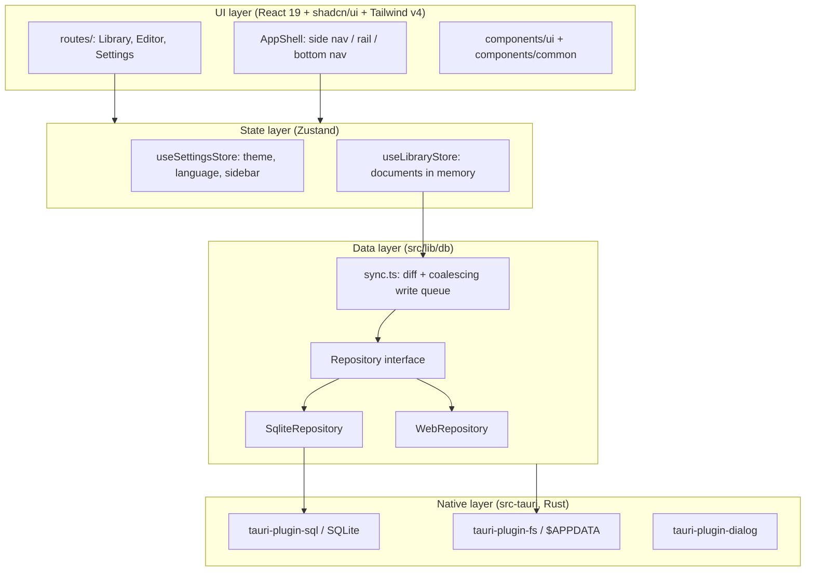

# System Architecture (`docs/architecture.md`)

## Shared-core architecture and verified scope

[ADR 0013](decisions/0013-shared-typst-core-pdf-html.md) is implemented through core-owned preparation and Rust/WASM pulldown-cmark parsing inside Typst, producing shared DocumentIR and source provenance. PDF owns direct IR-to-Typst/page layout; HTML owns independent React/TSX/Tailwind rendering, offline math/assets and its viewer. There is no JavaScript Markdown parser in the common pipeline. Core owns 43 six-file component packages / 78 schema tags.

The app syncs core+pdf+html directly. `formatex-typ/` is a generated core+pdf standalone distribution, including an embedded-WASM one-file bundle. Its local tools work after relocation without sibling checkouts; sync builds current core WASM first. Source documents/assets remain external. Dependencies install at the workspace root using the root lockfile; four npm workspaces include `@formatex/typ`, while the PDF backend has no npm package.

HTML document content is static SSR. The engine-owned runtime hydrates the React viewer shell; arbitrary component events/state and live variable/DSL reactivity are not implemented. Native services finish fonts/assets and compile graphics, rather than own HTML layout. Config uses shared keys plus `typ`/`html` namespaces, with paged keys under `typ` and copy-button under `html.code`.

Verified gates: parser 9 passed; frontend 373 passed; native 66 passed/5 ignored; typecheck and production build pass; lint has nine existing warnings. The 24 PDF theme/feel matrix and mobile compile pass, selected PDF pages and 360/768/1280 px HTML layouts were inspected, and isolated one-file/custom-package/relocated tooling checks pass. [The plan](tasks/shared-core-pdf-html-plan.md) separates this evidence from full component-property, mapping/diagnostic/export and real Android interactive UI acceptance. [Performance measurements](shared-core-performance-2026-11-12.md) are stage-specific, not end-to-end latency.

The remaining sections describe the app layers and retain some restored-baseline compile details; the source ownership above and the active plan define the shared-core route.

The post-migration regression checkpoint separately verifies nested PDF flex realization, custom references/citations, ordered-marker boundaries and lexical inline direction. The app's real Vite worker excludes HTML renderer TSX from React Fast Refresh to avoid its injected `window` preamble. `predev`/`prebuild`/`pretest`/`pretypecheck` sync engine inputs before commands; this is not a watcher, and native embedded changes require rebuilding. Current regression gates pass (parser 11; native 68/five ignored; frontend 372/two skipped plus one real integration; typecheck/build). The latest CLI PDF matrix passes 25 cases (24 desktop theme/feel plus mobile-20-9) without warnings; inspected mobile cards/pills are correct. This is page-format verification, not real Android interaction; see [the regression checkpoint](tasks/shared-core-pdf-html-plan.md#17-post-migration-regression-checkpoint-2026-11-12).

The word-provenance mapping upgrade is in development ([ADR 0014](decisions/0014-preview-word-source-geometry.md)): PDF preview annotations become native `PageMap.sources` geometry, while HTML reverse navigation resolves a DOM word range. Both directions prefer shared source provenance and use block/context search only where exact geometry is absent. Initial scope is ordinary text/rich descendants; raw code, math and generated labels retain fallback. Preview annotations are internal and absent from exports/`markers=0`; tests and visual gates remain open.

Most built-in `html.tsx` files currently delegate to `renderBuiltin(node, context)`; the corresponding JSX/behavior still lives centrally in `formatex-html/src/components.tsx`. Package folders are editable extension points with shared contracts, but this is not completed per-component JSX ownership. Extracting each built-in renderer into its own package remains open; custom package TSX already uses the independent renderer API.

## 1. Layers



Rules of the layers: pages and components talk to **stores**; stores never await storage; `sync.ts` is the only code that moves data between a store and the `Repository`; only `src/lib/db/tauriBackend.ts` imports Tauri plugins for data.

### Editor and compile path

```
EditorWorkspace ── useEditorStore ── ProjectFs ── $APPDATA/documents/<id>/  (config.toml, *.md, images/)
      │                  │                                  ▲
      │                  └─ compileProject() ── invoke ── compile_project ── ProjectWorld ┘
      └─ CodeEditor ── completion.ts ◄── engine/tags.json        (typst 0.15, engine embedded in the binary)
```

The tags come from the **component library** (`components.rs`): built-in components plus the user's, a registry generated from them, and the schema computed by compiling the engine's `tools/schema.typ` ([ADR 0007](decisions/0007-component-library.md)).

The editor autosaves to the project folder; the native Typst engine ([ADR 0005](decisions/0005-native-typst-engine.md)) reads the same folder and returns SVG pages and diagnostics; export is PDF. In a browser the compiler is unavailable (`CompilerUnavailableError`) until a WebAssembly build exists. See [features/editor.md](features/editor.md).

### HTML preview and standalone export

The live HTML pipeline (`previewHtml` → `preview_html` → `render_preview_html`) keeps a separate incremental `ProjectWorld` slot through `kept_world_for`, so refreshing it cannot replace the world's paged-preview state. `latestTaskQueue.ts` coalesces edits into one latest pending snapshot while a build is running, including across preview remounts, and adapts its delay between 120 and 250 ms. HTML mode skips the hidden paged build; switching back requests pages for the latest source. Decision: [ADR 0012](decisions/0012-incremental-html-preview.md).

`html_export.rs::preview_fonts` caches reusable full WOFF faces by weak `FontStore` identity, required families and italic need; new font stores after import/reload invalidate previous entries. `fontKey` identifies the CSS, which is omitted from a preview response when the frontend already has it. The standalone Export path still subsets and embeds fonts for a portable file. This distinction keeps export preparation out of repeated live edits without changing document syntax or `[html]` settings.

`HtmlPreview` and `htmlFrame.ts` (`splitHtml`, `initialFrame`, `frameBridge`) keep a sandboxed iframe mounted. Parent and frame validate the source window and a per-document token before applying `fxPatch` main-content updates and optional font CSS. Scroll, viewer controls and the font node survive ordinary edits; `fx-content-updated` refreshes outline and copy controls. A changed viewer signature triggers a full reload, as do custom scripts in main content or Raw Typst output without `main.fx-doc`. This preserves initialization of custom interactive documents. Browser/WebView paint and device interaction checks remain separate from native compiler measurements.

### Independent HTML rendering and math

The current shared-core route passes DocumentIR to `formatex-html`; component implementations live in `html.tsx`/`html.css` with shared JSON contracts. `alert`, `box`, `badge`, `kbd`, `code`, `theorem`, `exercise`, `fig`, `grid` and `steps` render from their own packages and are no longer drawn by `renderBuiltin`. Standard Markdown is rendered in `formatex-html/src/markdown.tsx` with the PDF heading, list, table, quote, fence and equation options. The remaining built-ins still delegate to `renderBuiltin`. Text/structure render as native elements; intended graphics and Typst-only components use SVG supplied by host services. React hydrates the viewer shell; document content is static SSR, without arbitrary component event/state or live variable/DSL hydration.

`[html] math` selects native MathML or offline KaTeX HTML+MathML generated during asynchronous `renderHtml`. The HTML package owns its math CSS/fonts/license and viewer runtime build; it ships no reader-side KaTeX bootstrap/compiler. Native font finishing retains exact requested-family resolution, subsetting/caches and browser-compatible font delivery. See [the HTML engine README](../../formatex-html/README.md), [editor](features/editor.md) and [fonts](features/fonts.md). The preceding retained-world/iframe notes describe baseline scheduling mechanisms; the active plan records verification of the shared-core bridge separately.

## 2. Routing

- **Library:** TanStack Router, code-based routes in [`src/router.tsx`](../src/router.tsx): `/`, `/editor/$documentId`, `/settings`.
- **History:** [`src/lib/history.ts`](../src/lib/history.ts) uses **memory history** inside the Tauri app (WebView URLs and the Android back stack do not mix) and **browser history** on the web (real URLs, reload, back button).
- **Shell:** the root route renders [`AppShell`](../src/components/layout/AppShell.tsx). A route can set `staticData: { fullscreen: true }` to be a full-screen environment with no navigation (the editor).
- **Android back button:** [`src/lib/androidBack.ts`](../src/lib/androidBack.ts) maps it to `history.back()`, and exits on the first screen.

## 3. State

- **Settings** ([`useSettingsStore`](../src/stores/useSettingsStore.ts)): theme preference, language, sidebar. Persisted to localStorage (`formatex_app_settings`) through [`safeStorage`](../src/lib/safeStorage.ts), which never throws and reports quota errors.
- **Domain data** ([`useLibraryStore`](../src/stores/useLibraryStore.ts)): documents, in memory. Persisted by `sync.ts`, not by the store.
- Stores are small and focused; components select the slice they need (`useStore((s) => s.x)`) to avoid re-renders.

## 4. Persistence

Details: [features/storage.md](features/storage.md) and [ADR 0003](decisions/0003-storage-and-database-architecture.md).

```
SQLite  formatex.db   (tauri-plugin-sql, app config dir)
├── meta        key / value (schema_version, ...)
└── documents   id, title, main_file, created_at, updated_at   (the library row of a project)
Files   $APPDATA/
├── documents/<id>/      the project: config.toml, main.md, images/, ... (ProjectFs)
└── fonts/               fonts the user imported
localStorage (UI preferences only): language, theme, sidebar
```

## 5. Internationalization

- `i18next` + `react-i18next`, set up in [`src/i18n/index.ts`](../src/i18n/index.ts). Languages are declared in [`languages.ts`](../src/i18n/languages.ts) with their direction; `applyLanguageSettings` sets `<html dir lang>`.
- Keys are **type-checked** against `en.json` ([`i18next.d.ts`](../src/i18n/i18next.d.ts)); a test checks `fa.json` and `en.json` have identical keys and placeholders.
- Details: [features/i18n-and-theming.md](features/i18n-and-theming.md).

## 6. Theming

Light / dark / system. Tokens are CSS variables in [`src/index.css`](../src/index.css); the `dark` class on `<html>` swaps them. `initTheme()` runs before React renders so the first paint is already correct.

## 7. Platforms

[`src/lib/platform.ts`](../src/lib/platform.ts) is the only place that knows where the app runs (`android`, `ios`, `desktop`, `web`). Native-only code is imported dynamically behind `isTauri()`. See [ADR 0004](decisions/0004-responsive-layout-and-platforms.md).
