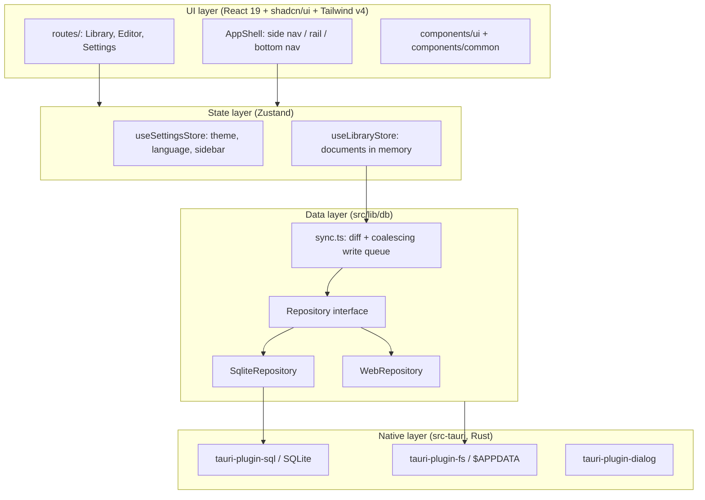

# System Architecture (`docs/architecture.md`)

## 1. Layers



Rules of the layers: pages and components talk to **stores**; stores never await storage; `sync.ts` is the only code that moves data between a store and the `Repository`; only `src/lib/db/tauriBackend.ts` imports Tauri plugins for data.

### Editor and compile path

```
EditorWorkspace ── useEditorStore ── ProjectFs ── $APPDATA/documents/<id>/  (config.toml, *.md, images/)
      │                  │                                  ▲
      │                  └─ compileProject() ── invoke ── compile_project ── ProjectWorld ┘
      └─ CodeEditor ── completion.ts ◄── engine/tags.json        (typst 0.15, engine embedded in the binary)
```

The tags come from the **component library** (`components.rs`): built-in components plus the user's, a registry generated from them, and the schema computed by compiling the engine's `tools/schema.typ` ([ADR 0007](decisions/0007-component-library.md)).

The editor autosaves to the project folder; the native Typst engine ([ADR 0005](decisions/0005-native-typst-engine.md)) reads the same folder and returns SVG pages and diagnostics; export is PDF. In a browser the compiler is unavailable (`CompilerUnavailableError`) until a WebAssembly build exists. See [features/editor.md](features/editor.md).

## 2. Routing

- **Library:** TanStack Router, code-based routes in [`src/router.tsx`](../src/router.tsx): `/`, `/editor/$documentId`, `/settings`.
- **History:** [`src/lib/history.ts`](../src/lib/history.ts) uses **memory history** inside the Tauri app (WebView URLs and the Android back stack do not mix) and **browser history** on the web (real URLs, reload, back button).
- **Shell:** the root route renders [`AppShell`](../src/components/layout/AppShell.tsx). A route can set `staticData: { fullscreen: true }` to be a full-screen environment with no navigation (the editor).
- **Android back button:** [`src/lib/androidBack.ts`](../src/lib/androidBack.ts) maps it to `history.back()`, and exits on the first screen.

## 3. State

- **Settings** ([`useSettingsStore`](../src/stores/useSettingsStore.ts)): theme preference, language, sidebar. Persisted to localStorage (`formatex_app_settings`) through [`safeStorage`](../src/lib/safeStorage.ts), which never throws and reports quota errors.
- **Domain data** ([`useLibraryStore`](../src/stores/useLibraryStore.ts)): documents, in memory. Persisted by `sync.ts`, not by the store.
- Stores are small and focused; components select the slice they need (`useStore((s) => s.x)`) to avoid re-renders.

## 4. Persistence

Details: [features/storage.md](features/storage.md) and [ADR 0003](decisions/0003-storage-and-database-architecture.md).

```
SQLite  formatex.db   (tauri-plugin-sql, app config dir)
├── meta        key / value (schema_version, ...)
└── documents   id, title, main_file, created_at, updated_at   (the library row of a project)
Files   $APPDATA/
├── documents/<id>/      the project: config.toml, main.md, images/, ... (ProjectFs)
└── fonts/               fonts the user imported
localStorage (UI preferences only): language, theme, sidebar
```

## 5. Internationalization

- `i18next` + `react-i18next`, set up in [`src/i18n/index.ts`](../src/i18n/index.ts). Languages are declared in [`languages.ts`](../src/i18n/languages.ts) with their direction; `applyLanguageSettings` sets `<html dir lang>`.
- Keys are **type-checked** against `en.json` ([`i18next.d.ts`](../src/i18n/i18next.d.ts)); a test checks `fa.json` and `en.json` have identical keys and placeholders.
- Details: [features/i18n-and-theming.md](features/i18n-and-theming.md).

## 6. Theming

Light / dark / system. Tokens are CSS variables in [`src/index.css`](../src/index.css); the `dark` class on `<html>` swaps them. `initTheme()` runs before React renders so the first paint is already correct.

## 7. Platforms

[`src/lib/platform.ts`](../src/lib/platform.ts) is the only place that knows where the app runs (`android`, `ios`, `desktop`, `web`). Native-only code is imported dynamically behind `isTauri()`. See [ADR 0004](decisions/0004-responsive-layout-and-platforms.md).
