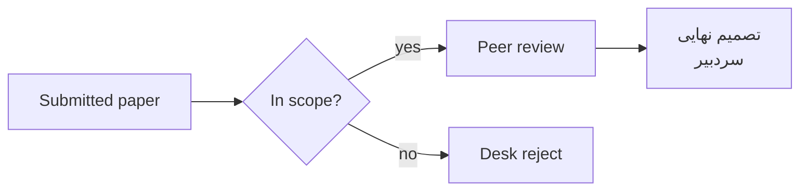
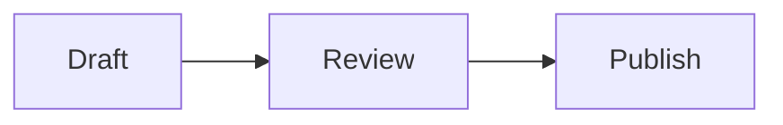

---
# Per-document settings (YAML). Quote any text containing `{`, `:` or `#`.

# theme: zinc                        # overrides config.toml for this document
dir: auto                            # each block follows its own language, whatever config.toml says

header:
  style: line                      # minimal | line | band | double
  start: "Bilingual Typst Template"
  center: "{section}"
  end: "Page {page} of {pages}"
  dir: auto                        # rtl | ltr | auto
  skip-first-page: false
  # logo: images/logo.svg

cover:
  type: "User Guide"
  title: "Bilingual Typst Research Template"
  subtitle: "Markdown in, typeset PDF out: Persian and English side by side"
  # institution: "نام دانشگاه"
  # faculty: "نام دانشکده"
  # author: "نام نویسنده"
  # supervisor: ["دکتر الف", "دکتر ب"]
  date: "October 2026"
  frame: true
  dir: auto

footer:
  style: plain
  start: ""
  end: "— {page} —"
  digits: en
  
---

<toc dir="ltr" break="true"></toc>

## Overview

Write in Markdown, get a typeset PDF. The template handles Persian (RTL) and English (LTR) side by side: every paragraph, heading, list, table, label and figure picks its own direction from its first letter, so you never set it by hand.

On top of standard Markdown it adds HTML-like tags for figures, drawings, file trees, data charts, alerts, boxes, grid layouts, alignment, steps, progress bars and ratings, pros and cons, draft notes, official letters, exercises and quizzes, code listings, diff comparisons, keys and badges, footnotes, lists of figures, tables and code, numbered equations, citations, cross-references and theorem blocks. It also adds a configurable cover page, page header, eight color themes and three overall "feels".

```text
doc_en.md  ──(cmarker)──▶  main.typ + src/  ──(typst)──▶  main.pdf
```

---

## Requirements

- **Typst** 0.15 or newer (tested with 0.15.1).
- **Packages**, downloaded automatically on first compile:
  - `cmarker` 0.1.10 renders the Markdown.
  - `mitex` 0.2.7 handles LaTeX math.
  - `fontawesome` 0.6.2 and `lucide` 0.1.0 provide icons.
  - `cetz` 0.5.2 renders drawings.
  - `lilaq` 0.6.0 renders data plots.
  - `mmdr` 0.2.2 renders Mermaid diagrams.
- **Fonts** must be installed on the system. The fonts each feel uses by default:

  | Feel | Latin | Persian |
  |------|-------|---------|
  | `formal` | New Computer Modern (bundled with Typst) | XB Niloofar |
  | `standard` | Inter | IRANSans |
  | `friendly` | Lexend | Pelak |

  Code always uses **Anonymous Pro**, unless `[font] code` sets another font. Run `typst fonts` to see which fonts Typst can find. Any of them can be swapped in through `[font]`.

---

## Files

| File | Role |
|------|------|
| `doc_en.md` | This guide, in English. Compiled by default when `config.toml` has no `source`. |
| `doc_fa.md` | The same guide in Persian. |
| `main.typ` | Entry point (a few lines). Renders the Markdown through the preprocessors in `src/preprocess/` and the tags in `components/`. |
| `components/<name>.typ` | One Typst file per component (its tags and code). |
| `src/lib/` | Helpers shared by several components. |
| `src/kit.typ` | What a component imports (`#import "/src/kit.typ": *`): the prelude and every helper library of `src/lib/`. |
| `tools/` | `build-all.mjs` (every theme × feel), `gen-registry.mjs` (rebuilds `components/_registry.typ` from the component files), `bundle.mjs` (one-file build, `dist/formatex.typ`) and `export-schema.mjs` (`dist/tags.json`: every tag with its attributes and allowed values, for editor autocomplete). |
| `src/core.typ`, `src/page.typ`, `src/conf.typ`, `src/prelude.typ` | The template: `core` (config, themes, feels, fonts, direction), `page` (page, header, footer, cover), `conf` (styling of code, quotes, tables, headings), `prelude` (what every file imports). |
| `src/themes.typ` | The eight color palettes. |
| `config.toml` | Project-wide settings: source file, numbering, theme, feel, page size, columns, fonts, tables, equations. The header, footer, cover and bibliography live in each Markdown file's front matter. |
| `examples/references.bib` | BibTeX entries used by `<cite>` and `<bibliography>`. |
| `examples/demo.md` | Full feature test: every component, table option, code case, theorem kind, reference and citation form. Build it with `node tools/build-all.mjs --source examples/demo.md` to check all themes and feels. |
| `code-dark.tmTheme` | Syntax-highlighting theme used automatically on dark themes. |
| `images/` | Images. Paths in Markdown are relative to this folder's parent (the project root). |
| `examples/` | `demo.md` (the feature test) and the files it uses: code for `<code src>`, Markdown for `<include>`, `references.bib`. |

---

## Building

### Single PDF

Run from the project root:

```powershell
typst compile main.typ                                  # -> main.pdf with config.toml settings
typst compile main.typ --input theme=dracula            # override the theme for this build
typst compile main.typ --input feel=friendly            # override the feel
typst compile main.typ --input header-style=band        # override the header style
typst compile main.typ --input page=mobile              # phone-sized pages
typst compile main.typ --input cover=false              # drop (or force with true) the cover page
typst compile main.typ --input todo=hide                # final version: no draft notes
typst compile main.typ --input answers=end              # answers collected under <answers> (or hide / show)
typst compile main.typ demo.pdf --input source=examples/demo.md  # render another Markdown file for this build
typst compile main.typ "page-{p}.png" --ppi 80          # one PNG per page, for quick checks
typst watch main.typ                                    # rebuild on every save
```

`--input` options can be combined. They override both `config.toml` and the document's front matter, and never modify either.

The Markdown file that gets compiled is set by `source` at the top of `config.toml` (default `doc_en.md`). Change it there to make another file the default, e.g. `source = "thesis.md"`. The path is relative to `main.typ`. `--input source=...` still overrides it for a single build. The output PDF is always named after the `.typ` file (`main.pdf`) unless you give an output path.

### All themes and feels: `tools/build-all.mjs`

`tools/build-all.mjs` compiles every combination of the 8 themes and 3 feels, 24 PDFs in total. Files are named `<source>-<theme>-<feel>.pdf` and written to `out/`:

```text
out/doc_en-paper-formal.pdf   out/doc_en-paper-standard.pdf   out/doc_en-paper-friendly.pdf
out/doc_en-sepia-formal.pdf   ...                             out/doc_en-dracula-friendly.pdf
```

```powershell
node tools/build-all.mjs                                    # all 24
node tools/build-all.mjs --themes paper                      # paper in all three feels
node tools/build-all.mjs --themes paper,nord --feels formal   # selected combinations only
node tools/build-all.mjs --no-cover                           # without the cover page
node tools/build-all.mjs --source examples/demo.md                    # out/demo-<theme>-<feel>.pdf
node tools/build-all.mjs --out-dir pdfs                       # another output folder
```

| Parameter | Default | Meaning |
|-----------|---------|---------|
| `--themes` | all eight | Themes to build (comma-separated). |
| `--feels` | all three | Feels to build (comma-separated). |
| `--source` | `source` from `config.toml` (else `doc_en.md`) | Markdown file to render. Its name is used as the file prefix. |
| `--out-dir` | `out` | Output folder, created if missing. |
| `--no-cover` | off | Passes `cover=false`. |

The script switches to its own folder first, so it can be started from anywhere. It prints `ok` or `FAILED` for each file. At the end it lists the combinations that failed and exits with code 1 if any did.

If Windows refuses to run scripts because of the execution policy:

```powershell
node tools/build-all.mjs
```

A PDF that is open in a viewer may be locked by Windows, and compiling over it fails. Close it first.

---

## Configuration

Settings come from two places:

| Where | Scope | Holds |
|-------|-------|-------|
| `config.toml` | Every document in the project | Headings (numbering and look), theme, feel, page size, margins, text direction, columns, draft notes and answers, fonts, list, table, equation and chat defaults |
| Front matter at the top of each `.md` | That document only | Page header, footer, cover page, bibliography, and overrides of anything in `config.toml` |

`--input` options on the command line override both.

### Front matter (per document)

A Markdown file can start with a YAML block between two `---` lines. It must be the very first thing in the file:

```yaml
---
theme: ocean                 # overrides config.toml for this document only
feel: friendly

header:
  style: line
  start: "Bilingual Typst Template"
  end: "Page {page} of {pages}"

cover:
  type: "User Guide"
  title: "Bilingual Typst Research Template"
  date: "October 2026"
---

## First section
...
```

- **Merging:**
  - The front matter is merged over `config.toml`: tables are merged key by key, and anything else is replaced.
  - For example, `font: {latin: Lexend}` changes only the Latin font and keeps `config.toml`'s other font settings.
  - The same goes for `heading:`: any of its keys (`numbering`, `number-suffix`, `underline`, `fill`, `max-level`, `color`) can be set for one document, and the rest come from `config.toml`. An empty value (`color:`) means the default.
- **Turning parts on:** a document gets a header only if it has a `header:` table, and a cover only if it has a `cover:` table. Inside either one, `enabled: false` turns it off again.
- **Not printed:** the front matter is stripped before rendering. A document without front matter simply has no header and no cover.
- **Quoting:**
  - Quote any text that contains `{`, `: ` or ` #`, e.g. `end: "Page {page} of {pages}"`.
  - Without quotes, YAML reads `{` as the start of a table and `#` as the start of a comment.
- **Comments and lists:** `#` starts a comment. Lists can be written as `["A", "B"]` or as `- A` lines.
- **Examples:** `doc_en.md` (English cover and header), `doc_fa.md` (Persian cover and header) and `examples/demo.md` (Persian band header and Persian cover).

The rest of this section describes each setting. The `config.toml` ones use TOML syntax: there, top-level keys (`source`, `theme`, `feel`, `page`, `columns`, `todo`, `answers`) must come **before** any `[table]`. `source` can only be set in `config.toml` or with `--input`, not in front matter, because it decides which file's front matter is read.

### Heading numbering

```toml
[heading]
numbering = true
number-prefix = ""    # text before the number
number-suffix = "."   # text after the number
```

- `number-prefix`: text before the number: `"("` with `number-suffix = ")"` gives «(۱) مقدمه». Default `""`. Like the suffix, only the headings themselves show it.
- `number-suffix`: `""` gives «۱ مقدمه», `"."` gives «۱. مقدمه», `" -"` gives «۱ - مقدمه». Default `""`. It applies to the headings themselves; the table of contents, `<ref>` and the page header's `{section-number}` show the bare number.
- The old top-level `heading-numbering = true` still works when `[heading] numbering` is not set.
- Headings start at `##`. Numbering skips the unused level, so headings are numbered `1` and `1.1`, not `0.1`.
- Numbering is continuous across the document.
- Persian headings get Persian digits (`۱.۲`); English headings get Latin digits.
- When numbering is on, **don't type numbers into headings**. Write `## Introduction`, not `## 1. Introduction`.

### Heading look

```toml
[heading]
underline = true   # rule below the heading
fill = true        # tinted background
max-level = 2      # levels that get this look
color = ""         # base color: preset, hex, or "" for the theme's heading color
```

| Key | Effect | Default |
|-----|--------|---------|
| `underline` | A rule in the base color below the heading | `false` |
| `fill` | A light tint of the base color behind the heading | `false` |
| `max-level` | Deepest level styled, counted like the numbers: with headings starting at `##`, `1` = sections (`۱`), `2` = also subsections (`۱.۱`) | `2` |
| `color` | Base for the text, rule and tint: `purple`, `blue`, `teal`, `green`, `yellow`, `red`, `pink`, or a hex color | the theme's `heading` color |

- With `fill`, the heading gets padding on all sides; with only `underline`, extra space just between the text and the rule.
- Without a `[heading]` section, or with both `underline` and `fill` off, headings look as before (colored text only).
- Corner rounding of the background follows the feel (`formal` square). With `underline` on, the bottom corners are always square so the rule stays straight.
- Every key here and in Heading numbering can be overridden per document in front matter; the keys you leave out keep their `config.toml` values:

  ```yaml
  heading:
    numbering: false
    underline: true
    fill: false
    max-level: 1
    color: teal
  ```

- **Per heading:** put the same keys in the `{...}` at the end of a heading line, next to its `#id` or on their own, as space-separated `key=value` pairs in any order:

  ```markdown
  ## Summary {#sec-summary fill=true underline=false color=purple}
  ## Acknowledgements {numbering=false}
  ## Preface {numbering=false toc=false}
  ### Appendix note {number-suffix="." color="#0f766e"}
  ```

  | Key | Values |
  |-----|--------|
  | `numbering` | `true` / `false`. An unnumbered heading doesn't use up a number; the next one continues the count. |
  | `number-prefix` | Text before the number, quoted if it has spaces |
  | `number-suffix` | Text after the number, quoted if it has spaces |
  | `toc` | `true` / `false`. `toc=false` leaves this heading out of `<toc>` (and out of the page header's `{section}`); the heading itself stays in the text. |
  | `underline`, `fill` | `true` / `false`. Setting either one styles this heading even below `max-level`. |
  | `color` | A preset or a hex color, as above |

  - The rest of the document is unaffected. The table of contents and the page header show the heading with its own number, unless it has `toc=false`.
  - `max-level` is not a per-heading key: it only decides which levels take the shared look.
  - Unknown keys or values are compile errors. A `{...}` with anything other than `#id` and `key=value` (for example `## Sets {x}`) stays in the title as text.

### Theme

```toml
theme = "paper"
```

| Theme | Type | Look |
|-------|------|------|
| `paper` | light | White page, charcoal text, navy headings, blue accent, soft gray rules |
| `sepia` | light | Warm cream page, brown text and accents |
| `ocean` | light | Pale blue page, deep blue headings, cyan accent |
| `sage` | light | Professional light green: soft sage-white page, forest-green headings, emerald accent |
| `midnight` | dark | GitHub-dark style, blue accent |
| `nord` | dark | Nord palette, frost-blue headings |
| `zinc` | dark | Tailwind/shadcn zinc: near-black page, neutral grays; like `paper`, only the accent is blue |
| `dracula` | dark | Dracula palette, purple headings, pink accent |

Each theme defines `bg`, `fg`, `heading`, `muted`, `accent`, `secondary`, `rule`, `code-bg` and `code-stroke`. `accent` colors what must stand out (links, references, the quote bar). `secondary` is for soft background tints: table header rows and highlighted code lines. It equals `accent` in every theme except `zinc`, where it is gray. On dark themes, code highlighting switches to `code-dark.tmTheme` automatically. The seven <a href="#color-presets">color presets</a> used by `<alert>` and `<box>` are tinted from the active theme, so they fit every theme. Hex colors are used as given on light themes and toned down on dark ones.

### Page size

```toml
page = "a4"   # a4 | mobile
```

| Size | Page | Use |
|------|------|-----|
| `a4` | 210 × 297 mm, default margins | Print and desktop reading |
| `mobile` | 110 × 245 mm, 7 mm side margins; the header's `center` item is hidden | Reading on a phone: text fills the screen without zooming |

Override per build with `--input page=mobile`, or per document with `page: mobile` in the front matter.

### Margins

```toml
margin = "narrow"   # narrow | normal | wide
```

| Value | Sides | Top / bottom |
|-------|-------|--------------|
| `narrow` | 15 mm | 18 mm |
| `normal` | about 25 mm (Typst's default) | about 25 mm |
| `wide` | 35 mm | 30 mm |

- Only for `a4`; the `mobile` page keeps its own small margins.
- Default `normal`. Override per document with `margin: wide` in the front matter, or per build with `--input margin=wide`.

### Scale

```toml
scale = 100   # percent
```

- Enlarges or shrinks everything on the page together: text, headings, math, code, tables, paddings, corner rounding and rules. The page size and margins stay the same, so a smaller scale fits more on each page.
- Default `100`. For example, `90` packs more onto each page and `115` prints larger.
- Override per document with `scale: 110` in the front matter, or per build with `--input scale=110`.
- Lengths you give in `cm`, `mm` or `%` (image sizes, for example) are physical and don't change. Plain point values on attributes (`padding="8"`, `radius="6"`) scale like the rest.

### Text direction (`dir`) {#dir-setting}

```toml
dir = "auto"   # auto | rtl | ltr
```

| Value | Effect |
|-------|--------|
| `auto` | Default. Every paragraph, heading, list, table cell, quote, caption, alert and badge takes its direction from its own first letter (see <a href="#text-direction">Text direction</a>). |
| `rtl` | Everything is right to left, English text included: paragraphs, headings (their numbers in Persian digits), lists, tables (the column order flips) and their cells, quotes, figure, table and code captions with their label («شکل ۱»), alerts, boxes, steps, badges, the entries of `<toc>`, `<lof>` and `<lot>`, and the bibliography. |
| `ltr` | The same, left to right (Latin digits, "Figure 1"). |

- **Always left to right:** code blocks and inline code. Labels in `<cetz>` drawings, Mermaid diagrams and `<kbd>` keys keep their own direction.
- **Page furniture:** the page header, footer and cover follow `dir` when their own `dir` is `auto`.
- **Columns:** in a multi-column document with `column-dir = "auto"`, the column order follows `dir` too.
- **Where to set it:** usually per document in the front matter (`dir: rtl`). `--input dir=ltr` overrides it for one build. To change the direction of only part of a document, use <a href="#dir-tag">`<dir>`</a>.
- Any other value is a compile error.

### Columns

```yaml
---
columns: 2        # in a document's front matter (or `columns = 2` in config.toml)
column-dir: rtl   # which column fills first
---
```

- The text flows in that many columns.
- `column-dir` sets the column order: `rtl` fills the right column first, `ltr` the left one, `auto` follows the document's language. Default in `config.toml`: `rtl`. Override per build with `--input column-dir=ltr`.
- `<toc>`, `<lof>` and `<lot>` that use `break` stay one column, on their own pages. Lists written next to each other (only blank lines between) share those pages. Without `break` they flow in the columns like normal text.
- The cover page stays one column, and `<docheader>` spans all columns at the top of its page.
- Tables with `width=full` and full-width blocks take the width of one column.
- The `mobile` page size always uses one column.
- Override per build with `--input columns=2`. Default `1`.

### Draft notes and answers (`todo`, `answers`) {#todo-answers-setting}

```toml
todo = "show"      # show | hide
answers = "show"   # show | hide | end
```

| Key | Value | Effect |
|-----|-------|--------|
| `todo` | `show` | Default. Every <a href="#todo-section">`<todo>`</a> note and the `<todos>` list are printed. |
| | `hide` | All of them are removed (inline notes, note blocks, figure placeholders and the `<todos>` list): the final version. |
| `answers` | `show` | Default. Each <a href="#exercise-section">`<answer>`</a> appears under its question in a green-tinted box (in `formal`: a dashed rule and a muted "Answer" / «پاسخ» label), and the correct `<choices>` option is highlighted (green marker, bold text). |
| | `hide` | Answers and highlights are left out: a question sheet. |
| | `end` | Nothing under the questions; `<answers></answers>` prints all answers together («پاسخ‌ها» / "Answers"). |

- Both are top-level keys: in `config.toml` put them before any `[table]`.
- Override per document in the front matter (`answers: hide`) or per build with `--input todo=hide` / `--input answers=end`. One source then gives the draft, the final version, the question sheet and the answer key.
- Any other value is a compile error.

### Feel

```toml
feel = "standard"   # formal | standard | friendly
```

The feel sets the default corner rounding of every rounded element, and the default fonts:

| Element | `formal` | `standard` | `friendly` |
|---------|----------|------------|------------|
| Code block | 0 | 6pt | 14pt |
| Inline code | 0 | 2pt | 4pt |
| Code language badge, `<badge>` | 0 | 4pt | 9pt |
| `<kbd>` key caps | 0 | 4pt | 4pt |
| `<alert>` | 0 | 8pt | 16pt |
| Boxed theorem blocks | 0 | 6pt | 14pt |
| `<box>` | 0 | 6pt | 14pt |
| `` | 0 | 6pt | 16pt |
| Cover frame | 0 | 10pt | 24pt |
| `band` header | 0 | 6pt | 14pt |
| Heading background (`[heading]`) | 0 | 5pt | 10pt |
| Mermaid nodes and subgraphs (edge labels like badges) | 0 | 6pt | 14pt |
| Tables | Academic rules (top, header, bottom) | Light rounded frame, tinted bold header, thin row lines | Rounded card, colored bold header, striped rows |
| Page header | Always `line` style (rule below) | Document's `style` | Document's `style` |
| `<steps>` markers | Outlined squares, thin line | Tinted rounded squares | Tinted circles, thin line (same colors as `standard`) |
| `<progress>` | Thin square bars with an outlined track, square dots | Slightly rounded bars and dots | Thicker pill-shaped bars, round dots |
| `<compare>` columns | No fill, a colored rule above each column, plain ✓ / ✗ | Tinted panels with a thin border | Stronger tint, no border, larger corners, circled ✓ / ✗ |
| `<letter>` | Plain labels, plain rule, number block without a frame | Number block in a thin frame, accent labels | Tinted number block, thicker rounded rule |
| `<exercise>` | No frame; bold head in the heading color, ending with a period | Light accent-tinted card | The same card, rounder |
| `<choices>` markers | Plain text: "a)" | Letter in a small rounded square | Letter in a circle |
| Fonts | New Computer Modern + XB Niloofar | Inter + IRANSans | Lexend + Pelak |

`formal` has no rounded corners anywhere. In `standard` and `friendly`, boxed theorem blocks draw their colored side bar as a rounded pill inset from the edges, so the bar follows the rounded corners instead of being cut off. An explicit `radius` attribute on a tag always overrides the feel.

### Fonts

```toml
[font]
latin = "Lexend"           # English text (default: the feel's font)
persian = "Ray"            # Persian text (default: the feel's font)
code = "Anonymous Pro"     # code blocks and inline code
```

- Missing keys fall back to their defaults.
- Each character comes from the first font that has it, with the Latin font tried before the Persian one. A Persian font that also contains Latin letters therefore doesn't change English text.

### Paragraphs

```toml
[paragraph]
justify = false        # true = both edges of every line flush with the margins
letter-spacing = 0     # extra space between letters, % of the font size
line-spacing = 100     # gap between lines, % of the normal gap
word-spacing = 100     # width of spaces, % of the font's normal space
```

| Key | Effect | Default |
|-----|--------|---------|
| `justify` | `true`: every line except a paragraph's last fills the whole width, flush on both sides. `false`: lines end ragged on the end side. Tables and code are never justified. | `false` |
| `letter-spacing` | Space added between letters. `2` is slightly looser, `-2` slightly tighter. | `0` |
| `line-spacing` | Gap between lines of a paragraph. `150` is airier, `80` tighter. | `100` |
| `word-spacing` | Width of the spaces between words. `85` gives tighter text. | `100` |

- **Where it applies:** body text, lists, quotes, table cells, captions and headings. Code blocks and inline code keep their own spacing and are never justified.
- **Persian text:** with `letter-spacing`, joined letters stay joined; the space only appears where letters don't connect anyway.
- **Scale:** the values are relative to the font size, so they follow `scale` automatically.
- **Per document:** override any key in front matter:

  ```yaml
  paragraph:
    justify: true
    line-spacing: 120
  ```

  Invalid values (a `justify` other than `true` / `false`, a spacing that isn't a number) are compile errors.

### Lists (`[list]`)

```toml
[list]
numbers = "auto"   # auto | fa | en | fatxt | rome | abc | abjad | alefba
suffix = "."
```

Numbers, their suffix, the bullets and the indent of every list. Each key and the per-list `{...}` options line are described in <a href="#lists-section">Lists</a>. Override per document with `list:` in the front matter.

### Chat (`[chat]`)

```toml
[chat]
style = "auto"     # auto | transcript | assistant | bubbles
ai-name = ""       # "" = «هوش مصنوعی» / "AI"
frame = true
```

Defaults for every `<chat>`: look, names, icons, colors, frame and bubble width. Each key is described in <a href="#chat-section">Chat</a>. Override per document with a `chat:` map in the front matter; attributes on a `<chat>` tag win over both.

### Page header (front matter)

```yaml
header:
  style: line                       # minimal | line | band | double
  start: "پژوهش اقیانوس‌شناسی"      # start side (right in RTL)
  center: ""
  end: "صفحه {page} از {pages}"
  dir: auto                         # rtl | ltr | auto (the document's dir, else from the header text)
  skip-first-page: true             # no header on page 1 (default true)
  # logo: images/logo.svg           # shown before the start text
  # enabled: false                  # keep the settings but hide the header
```

| Style | Look |
|-------|------|
| `minimal` | Text only |
| `line` | Text with a rule below |
| `band` | Shaded strip (rounded per the feel) |
| `double` | Accent bar above, rule below |

The `formal` feel always uses `line`, whatever `style` says, so formal documents never get a rounded or shaded header. `--input header-style=...` still overrides it for one build.

The `start`, `center` and `end` texts can contain these placeholders:

| Placeholder | Value |
|-------------|-------|
| `{page}` | Current page number |
| `{pages}` | Total pages (the cover is not counted) |
| `{section}` | Current top-level section: the first one starting on the page, otherwise the last one before it |
| `{section-number}` | That section's number (empty when numbering is off) |

- When the document has numbered headings, `{section}` only looks at those, so unnumbered titles such as the bibliography's do not hide the real sections.
- A cell that uses `{section}` or `{section-number}` stays empty on pages before the first section (e.g. the table of contents), instead of printing a lone `.`.
- Page numbers in RTL header text use Persian digits. `digits: fa` or `digits: en` forces one kind.
- A cell made only of placeholders takes its direction from the section title.
- Start a cell with an RLM character (U+200F) to force RTL.

### Page footer (front matter)

Without `footer:` each page shows a plain page number at the bottom center. With it, the footer is built like the header, from the same placeholders:

```yaml
footer:
  style: line                 # plain | line (rule above)
  start: "{section}"          # start side (right in RTL)
  center: ""
  end: "— {page} —"
  digits: fa                  # fa | en | auto (Persian when the text is RTL)
  dir: auto                   # rtl | ltr | auto (the document's dir, else from the footer text)
  skip-first-page: false      # no footer on page 1 (default false)
  # enabled: false            # no footer and no page number at all
```

- Every key is optional; `footer: { center: "صفحه {page} از {pages}" }` is enough.
- `start` and `end` sit on the sides only when both are set. Otherwise everything is centered: `end: "— {page} —"` alone gives a centered page number.
- A cell made only of placeholders (`"{page}"`) has no letters, so set `digits: fa` for Persian digits.
- The cover never gets a footer.
- Only the main file's front matter counts; footers in included files are ignored.

### Cover page (front matter)

```yaml
cover:
  # logo: images/logo.svg
  institution: "نام دانشگاه"
  faculty: "نام دانشکده"
  department: ""
  type: "گزارش پژوهشی"             # e.g. پایان‌نامه کارشناسی ارشد
  title: "عنوان پژوهش"
  subtitle: ""
  author: "نام نویسنده"             # or a list: ["A", "B"], one per line
  supervisor: "نام استاد راهنما"
  advisor: ""
  date: "مهر ۱۴۰۵"
  frame: true                      # border around the page
  dir: auto                        # rtl | ltr | auto (the document's dir, else from title and institution)
  # enabled: false                 # keep the settings but hide the cover
```

- The cover is its own page, with no header and no page number. Page 1 is the page after it.
- Empty fields are left out.
- The labels for author, supervisor and advisor follow the cover's direction: «نگارش / استاد راهنما / استاد مشاور» in Persian, "Author / Supervisor / Advisor" in English.

### Bibliography (front matter)

```yaml
bibliography:
  file: references.bib
  style: ieee              # any Typst/CSL style: apa, chicago-author-date, harvard-cite-them-right, ...
  title: "منابع"
  dir: auto                # auto = each entry follows its own language; ltr | rtl
```

- These settings belong to each document, so they live only in its front matter, not in `config.toml`.
- Every key is optional. Without them: `examples/references.bib`, `ieee`, «منابع», and the document's `dir` (`auto` unless forced).
- Attributes on the `<bibliography>` tag override them.
- Only the main file's front matter counts, as with the header.

---

## Text direction

By default (`dir = "auto"`), direction is **automatic**. Every paragraph, heading, list, table cell, figure, theorem block and drawing label takes its direction from its **first letter**:

- An Arabic-script (Persian) letter makes it RTL, with Persian digits in numbering.
- Any other letter makes it LTR.
- Code and math are skipped when looking for the first letter.
- Content with no letters at all (e.g. a list of formulas) inherits the direction of the previous block.

Invisible directional marks count as the first letter and override detection:

| Mark | Effect |
|------|--------|
| RLM `U+200F` (or `&rlm;`), ALM `U+061C` | Force RTL |
| LRM `U+200E` (or `&lrm;`) | Force LTR |

A Persian paragraph or heading that starts with an English word comes out LTR. To keep it RTL, start it with an RLM: `‏Python در ...`, `## ‏Python و ...`. In list items, put the mark **after** the marker (`- ‏Python ...`); a mark before `-` or `1.` breaks the list.

Quotes put their bar on the start side. Generated labels follow the language of the paragraph they sit in:
- figure numbers: «شکل ۱» / "Figure 1";
- references: «قضیه ۲» / "Theorem 2".

To force one direction on the whole document instead, set <a href="#dir-setting">`dir`</a> to `rtl` or `ltr`. To force it on one part, wrap that part in <a href="#dir-tag">`<dir>`</a>.

---

## Standard Markdown

All of these work as usual:
- headings, bold, italic, lists, block quotes (`>`) and horizontal rules (`---`);
- links, inline code and fenced code blocks;
- inline math `$...$` and display math `$$...$$`, written in LaTeX syntax;
- tables.

- **Lists** can be numbered with Persian digits too (`۱.`), and their numbers, bullets and indent are configurable (see <a href="#lists-section">Lists</a>).
- **Tables** are centered. Align a column with its separator: `:---` left, `---:` right, `:---:` center. Their look follows the feel, and options can be set per table (see below).
- **Code blocks** get line numbers; empty lines at the end of a block are dropped. A block with a language (` ```python `) also gets a badge in its top corner with the language name and icon.
  - Aliases such as `py`, `js`, `ts`, `sh`, `yml` and `md` work.
  - An unknown language shows its fence name with a generic icon.
  - To add a language, extend `code-languages` and `code-language-aliases` in `src/core.typ`.
  - A ` ```mermaid ` block is drawn as a diagram instead (see <a href="#mermaid-diagrams">Mermaid diagrams</a>).
- **Comments** `<!-- ... -->` are dropped, over one line or many (see <a href="#comments">Comments</a>).
- **Citations** in Pandoc form, `[@key]`, also work.
- **Footnotes** can be written with standard Markdown syntax (`[^label]` and `[^label]: ...`) or with inline `<fn>` tags (see <a href="#footnotes">Footnotes</a> below).

### Comments {#comments}

`<!-- ... -->` is a comment: it is removed before anything else reads the text, so it never reaches the PDF. Use it for notes to yourself, and to switch off a whole section without deleting it.

```markdown
A visible sentence <!-- a note in the middle of a line --> goes on.

<!-- A note on its own line. -->

<!--
## Draft section {#draft}

Everything up to the closing mark is skipped: headings, tables, lists,
equations, components and `<include>` lines.
-->
```

- **Multi-line:** a comment runs from `<!--` to the next `-->`, over as many lines as needed. Comments do not nest, so the first `-->` ends it.
- **Safe to comment out:** the content is dropped before the `{#id}`, `{...}` option lines and the other rewrites run, and a commented-out `<include src="...">` is not followed (the file need not even exist).
- **Whole lines:** a line that holds only comment text disappears completely, so a comment between two lines of a paragraph does not split it.
- **Left as written:** a `<!--` inside a fenced code block or inline code is just text, so it can be shown in examples like this one. Do not put `-->` in the text of a comment you want to end later.
- **Not for the front matter:** the YAML header uses its own `#` comments (see Front matter under Configuration).

### Footnotes {#footnotes}

The template supports both standard Markdown footnote syntax and flexible inline `<fn>` HTML tags, with full bidirectional font, direction, and numeral formatting.

```markdown
Standard Persian footnote[^fn-fa] and English footnote[^fn-en].

[^fn-fa]: این یک پاورقی توضیحی به زبان فارسی است.
[^fn-en]: This is an explanatory footnote in English.

Bilingual term translations: <fn en="Artificial Intelligence">هوش مصنوعی</fn> and machine learning<fn en="Machine Learning"></fn>.
Inline Persian note on an English term: transformer<fn fa="معماری شبکه عصبی مبتنی بر خودتوجهی"></fn>.
Custom text note: <fn text="Additional explanatory detail">concept</fn> or inline <fn>Direct footnote body</fn>.
```

| Syntax / Tag | Usage |
|--------------|-------|
| `[^label]` + `[^label]: ...` | Standard Markdown footnote. Definitions can appear anywhere (e.g. at the bottom of the section or file), with multi-line continuations indented by 4 spaces. |
| `<fn en="...">word</fn>` | Attach an English footnote (typeset LTR in the Latin font) to a word. Body is optional. |
| `<fn fa="...">word</fn>` | Attach a Persian footnote (typeset RTL in the Persian font) to a word. Body is optional. |
| `<fn text="...">word</fn>` | Footnote with custom text, detecting direction automatically. |
| `<fn>note text</fn>` | Direct inline footnote (alias: `<footnote>`). |

- **Bidirectional numbering:** Footnote marker numbers automatically use Persian digits (`۱`, `۲`, ...) in RTL contexts and Latin digits (`1`, `2`, ...) in LTR contexts.
- **Direction detection:** Footnote entry bodies at the bottom of the page automatically detect their own text direction (`rtl` or `ltr`), ensuring English notes remain LTR and Persian notes remain RTL regardless of the document's global direction.
- **Attributes on `<fn>`:** `en`, `fa`, `text`, and `dir` (`"rtl"`, `"ltr"`, `"auto"`).

### Including other Markdown files

Split a long document into files and pull them in where they belong:

```markdown
## Introduction

<include src="chapters/intro.md"></include>

<include src="chapters/method.md" />
```

- **Same as one file:** the line is replaced by the file's text before rendering. Heading numbering, the table of contents, figure, table and equation numbers, `{#id}`s and `<ref>` all continue across files and work in both directions.
- **Front matter is ignored.** Only the main file's settings count (theme, header, cover, ...). An included file may keep its own front matter, for example for compiling it alone.
- **Paths** are relative to the project root, like image paths. A path starting with `./` or `../` is relative to the file that contains the `<include>` instead (`<include src="./part.md">` next to it). Nested includes work.
- **Placement:** the tag must be on its own line with blank lines around it. An `<include>` inside a paragraph or list is a compile error, and so is a loop (`a.md` → `b.md` → `a.md`). Inside fenced code blocks it is left as text.
- Headings in an included file are not shifted: write them at the level they should have in the main document.

### Numbered equations

End a display equation with `{#id}` to number it and make it a `<ref>` target:

```markdown
$$e^{i\pi} + 1 = 0$$ {#eq-euler}

$$
\sum_{k=1}^{n} k^2 = \frac{n(n+1)(2n+1)}{6}
$$ {#eq-squares}

طبق <ref to="eq-euler"></ref> ...
```

- The number sits at the end of the line: on the left in Persian text, on the right in English. Its digits follow the language of the text before it: «(۱)» or "(1)".
- `<ref>` prints «رابطهٔ (۱)» or "Equation (1)".
- `{#id}` goes on the line with the closing `$$`, or alone on the line right after it. Inside fenced code blocks it is left alone.
- Which equations get a number is set in `config.toml`:

  ```toml
  [equation]
  numbering = "labelled"   # labelled (only {#id}) | all | none
  ```

---

### Table options

Put a `{...}` line directly above a table (a blank line in between is fine):

```markdown
{width=full caption="فونت‌های هر حالت" #tbl-fonts}
| Feel | Latin | Persian |
|------|-------|---------|
| `formal` | New Computer Modern | XB Niloofar |
```

| Option | Values | Default |
|--------|--------|---------|
| `width` | `auto`: as wide as the content. `full`: the full text width. | `[table] width` |
| `align` | `center`, `left`, `right`, `start`, `end`: where an `auto`-width table sits | enclosing `<align>`, else `[table] align` |
| `caption` | Text shown above the table. Quote it if it has spaces. | none |
| `#id` | Target for `<ref>`, same id rules as headings | none |
| `span` | `column`: stays in its text column. `all`: in a multi-column document, spans every column. | `[table] span`, else `column` |
| `head-align` | Text alignment of the header row: `center`, `left`, `right`, `start`, `end`. Overrides the column colons of the separator row (`:---`, `---:`). | the colons, else the style's default |
| `body-align` | The same for all other rows. | the colons, else the style's default |

- **Spanning tables:** with `span=all` and `columns` above 1, the table floats to the top or bottom of the nearest page that has room, across all columns, and the text flows around it. Use it for tables too wide for one column:

  ```markdown
  {span=all caption="Semantic rules" #tbl-rules}
  ```

  - `width` then measures against the whole text width, so `width=full` fills the page from margin to margin.
  - In a one-column document (or on the `mobile` page) `span` has no effect.
- **Defaults for every table** come from `config.toml` (or a document's front matter):

  ```toml
  [table]
  width = "full"     # full | auto
  align = "center"   # center | left | right
  span = "column"    # column | all
  ```

  Without a `[table]` section, tables are `auto`, centered and stay in their column.
- **Full-width columns** are sized like a browser does:
  - If the content fits, every column grows in proportion to its natural width.
  - Otherwise narrow columns keep their width, and wide ones share the rest and wrap.
- **Numbering:** a table with a `caption` or an `#id` becomes a numbered table. The label follows the caption's language: «جدول ۱» or "Table 1". `<ref to="tbl-fonts">` prints «جدول ۱» or "Table 1", following the surrounding paragraph's language.
- **Syntax:**
  - Options are space-separated `key=value` pairs, in any order.
  - Markdown inside `caption` is not parsed.
  - Unknown options or values are compile errors.
- **Ignored lines:** a `{...}` line that isn't followed by a table or a list (see <a href="#lists-section">Lists</a>), or that is inside a fenced code block, is left as normal text.

### Lists {#lists-section}

Bulleted (`-`, `*`, `+`) and numbered (`1.`, `1)`) lists work as in any Markdown. Numbered items can also be written with Persian digits: `۱.` or `۲)` (Arabic-Indic `١` too) make a real numbered list, exactly like `1.`:

```markdown
۱. جمع‌آوری داده
۲. پاک‌سازی داده
۳. تحلیل نتایج
```

Rendered:

۱. جمع‌آوری داده
۲. پاک‌سازی داده
۳. تحلیل نتایج

- **Merging:** as in any Markdown, two numbered lists separated only by a blank line become one list. Put a paragraph or a `{...}` options line between them to keep them apart.
- Only `.` and `)` after the number make an item; `۱-` is plain text. Inside fenced code blocks nothing is converted.

**Settings for every list** come from `[list]` in `config.toml`:

```toml
[list]
numbers = "auto"              # auto | fa | en | fatxt | rome | abc | abjad | alefba
prefix = ""                   # text before the number
suffix = "."                  # text after the number
marker = "disc,circle,dash"   # bullets, one per nesting level
indent = "1em"                # extra indent of every list
```

| Key | Values | Default |
|-----|--------|---------|
| `numbers` | `auto`: Persian digits (۱ ۲ ۳) in an RTL list, Latin (1 2 3) in an LTR one; the list's direction comes from its first letter, or from a forced `dir`. `fa`: ۱ ۲ ۳. `en`: 1 2 3. `fatxt`: Persian number words (یک، دو، سه، … بیست و یک, up to the thousands). `rome`: I II III. `abc`: a b c. `abjad`: الف ب ج د ه و ز … (28 letters). `alefba`: الف ب پ ت … (32 letters). Past the last letter, `abjad` and `alefba` go on in Persian digits. | `auto` |
| `prefix` | Text right before the number: `"("` with `suffix=")"` gives «(۱)» or «(الف)» | none |
| `suffix` | Text right after the number: `"."` → «۱.», `")"` → «۱)», `"-"`, `":"`, or `""` for none | `"."` |
| `marker` | Bullet of unnumbered lists: a character (`"•"`, `"–"`, `"★"`) or a name: `disc` •, `circle` ◦, `square` ▪, `dash` –, `triangle` ‣, `arrow` →, `check` ✓, `star` ★, `none`. Comma-separated values give one bullet per nesting level: `"disc,circle,dash"`. | Typst's (• ‣ –) |
| `indent` | Extra indent of every list: `"1.5em"`, `"5mm"`, or a bare number in points | none |

- `numbers`, `prefix` and `suffix` apply to every nesting level.
- Override them per document in front matter, key by key; the other keys keep their `config.toml` values:

  ```yaml
  list:
    numbers: abjad
    suffix: ")"
  ```

**Options for one list:** put a `{...}` line directly above it (a blank line in between is fine), like the table options line:

```markdown
{numbers=abjad suffix=")" marker=dash indent=2em start=3 caption="مراحل کار" #list-steps}
1. ...
```

| Option | Effect |
|--------|--------|
| `numbers`, `prefix`, `suffix`, `marker`, `indent` | As in `[list]`, for this list and the lists nested in it. |
| `start` | Numbered lists only: the first number. `start=3` starts at «۳.», "c.", «ج», ... |
| `caption` | A numbered caption, centered below the list: «فهرست ۱: ...» / "List 1: ...". Quote it if it has spaces; Markdown inside it is not parsed. |
| `#id` | Target for `<ref>`. Numbers the list even without a caption. |

- **Numbered lists:** with `caption` or `#id` the list becomes a numbered block like a figure. The list stays on the start side and may break across pages; the label follows the caption's language. `<ref to="list-steps">` prints «فهرست ۱» or "List 1", following the surrounding paragraph's language.
- **Extent:** the options cover the list up to the first line after a blank line that is neither indented nor a list item. A list that follows after only a blank line merges into it and gets the same options.
- **Errors:** unknown options are compile errors, and so is `start` on a bulleted list. Inside fenced code blocks the line is left alone.

Rendered with `{numbers=abjad suffix=")"}`:

{numbers=abjad suffix=")"}
1. مقدمه
2. روش پیشنهادی
3. نتایج

Rendered with `{numbers=fatxt start=19}`:

{numbers=fatxt start=19}
1. گام نوزدهم
2. گام بیستم
3. گام بیست و یکم

Rendered with `{caption="Steps of a review" #list-review}` and a nested bulleted list:

{caption="Steps of a review" #list-review}
1. Read the paper
2. Write the report
   - Summary
   - Strengths and weaknesses
3. Send the decision

<ref to="list-review"></ref> is referenced like a figure or a table.

---

## Component rules

These apply to every tag below:

1. **Attribute values are strings:** `radius="6"`, `break="true"`.
2. **Blank lines matter.** Leave one after the opening tag and one before the closing tag whenever the inside contains Markdown (paragraphs, bold, lists, headings). Without them the Markdown is printed as raw text.
3. **Lengths:**
   - A bare number means points (`"12"`).
   - Units `pt`, `mm`, `cm`, `in` and `em` also work, and `%` is accepted where noted.
4. **Colors** are hex strings: `"#e0efff"`.
5. **Components nest:** a `<fig>` inside an `<item>`, a `<box>` inside a `<grid>`, and so on.

---

## Components

### `<docheader>`: title block

```markdown
<docheader title="Main title" subtitle="Optional *subtitle*" subtitle2="Optional second subtitle, smaller"></docheader>
```

The three attributes are shortcuts for `<title>` lines of size 1, 2 and 3. For side images, more title lines, extra text below them and a frame, build the header from tags:

```markdown
<docheader color="blue" border="lrtb" fill="true">

<main>

<l-img src="images/logo.svg" height="2.5cm" />

<r-img src="images/ocean.svg" width="3cm" />

<title size="1">

Main *title*

</title>

<title size="2">

A medium subtitle

</title>

<title size="3">

A small gray line

</title>

</main>

<info>

Alice, Bob: *Some University*, 2026

Any ordinary Markdown: a second paragraph, a list, math $E = mc^2$.

</info>

</docheader>
```

| Tag | Meaning |
|-----|---------|
| `<main>` | The top part: the titles between the two images. Optional: its children may sit directly in `<docheader>`. |
| `<l-img src width height radius />` | Image at the **left** edge, `<r-img>` at the **right** edge. They are physical sides, so they stay put in Persian and English. Give `width` and / or `height` (default height `4em`); `radius` defaults to the feel's image rounding. Self-closing. |
| `<title size="1\|2\|3" color>` | One title line. Lines stack in the order written. Size `1` is large and bold in the heading color, `2` is medium and muted, `3` is small and more gray. `color` overrides the text color. |
| `<info>` | Ordinary Markdown placed under the titles. It is not centered: it follows the text direction like the rest of the document. To center it, wrap it in `<align>` inside `<info>`. |

| `<docheader>` attribute | Meaning | Default |
|-------------------------|---------|---------|
| `title`, `subtitle`, `subtitle2` | Shortcuts for `<title>` of size 1, 2, 3 (Markdown and math allowed). They come before any `<title>` tag. | |
| `color` | Color of both the line and the fill: any Tailwind color name (`blue`, `orange-300`), a <a href="#color-presets">preset</a> or hex. It only picks the color; it does not draw anything by itself. | theme colors |
| `border-color` | Color of the line, overriding `color` | `color`, else the theme's rule color |
| `fill-color` | Color of the fill, overriding `color` | `color`, else the theme's code background |
| `border` | Which sides get a line, as letters: `l` left, `r` right, `t` top, `b` bottom. `lrtb` is a full frame, `tb` only top and bottom, `l` only the left edge | none |
| `fill` | `true` / `false`: tint the inside | `false` |
| `radius` | Corner rounding of the frame | the feel's value (square in `formal`) |
| `padding` | Space between the frame and its content | `1em` |

- **Colors follow the theme:** the fill and line are the same soft tints `<box>` uses, light on light themes and dark on dark ones. Without a color the line uses the theme's rule color and the fill its code background.
- **Formatting inside a title:** a title written on one line is plain text. For `*emphasis*` or `$math$` put the opening tag on its own line with blank lines inside, as in the example. The `title` / `subtitle` attributes always accept Markdown.
- **Rounded corners:** the radius comes from the feel (or `radius`). With only the fill, all four corners are rounded; with lines, a corner is rounded exactly where two drawn sides meet (`border="blt"` rounds the top-left and bottom-left corners and leaves the open right ends square; `lrtb` rounds all four).
- **Small pages:** an image wider than 30% of the line is shrunk so the titles keep room.
- **Columns:** in a multi-column document the whole header spans all columns.
- **Missing images:** a wrong `src` is a compile error.

### `<picHeader>`: picture header

A full-width image with a black-to-transparent gradient rising from the bottom, a large white title and an optional subtitle. Self-closing.

```md
<picHeader src="images/ocean.svg" title="Title" subtitle="Optional subtitle" height="60mm" />
```

| Attribute | Meaning | Default |
|-----------|---------|---------|
| `src` | Image path (required) | |
| `title` | Large white title (required) | |
| `subtitle` | Optional smaller line under the title | none |
| `height` | Height of the picture (`mm`, `cm`, `pt`, ...) | `60mm` |
| `break` | `false`: placed where it is written. `before`: starts a new page | `false` |
| `margin-x` | `true`: spans the text width. `false`: bleeds across the page margins, corners become square | `true` |
| `dir` | Direction of the title and subtitle: `auto` (default: the document's setting, else the title's first letter), `rtl`, `ltr` | `auto` |
| `margin-y` | Only with `break="before"`. `true`: sits at the top margin. `false`: sticks to the top edge of the page, top corners become square | `true` |

- Title and subtitle follow the direction of the title's first letter.
- With several columns, `margin-x="false"` is ignored (the picture fills its column).
- With `margin-y="false"` the picture covers the page header.

### `<toc>`: table of contents

```markdown
<toc dir="rtl" break="true"></toc>
```

| Attribute | Values | Default |
|-----------|--------|---------|
| `dir` | `rtl` (all entries RTL), `ltr`, `auto` (each entry follows its heading) | `rtl` |
| `title` | Any text | `فهرست مطالب` (`Contents` when `ltr`) |
| `numbers` | `rtl`: all numbers Persian, section numbers on the right. `ltr`: all Latin, section numbers on the left. `auto`: each entry's number follows its own title. Page numbers use the same digits. | `rtl` (`ltr` when `dir="ltr"`) |
| `depth` | How many heading levels are listed, counted from the document's top level: with headings starting at `##`, `1` = only sections (`۱`), `2` = also subsections (`۱.۱`) | all levels |
| `pages` | `true`: dot leaders and page numbers; `false`: titles only | `true` |
| `break` | `true` (page break before and after: own page), `before`, `after`, `false` | `false` |

```markdown
<toc depth="2" pages="false"></toc>
```

### `<lof>` + `<lot>` + `<lol>`: lists of figures, tables and code

```markdown
<toc break="true"></toc>

<lof></lof>

<lot></lot>

<lol break="after"></lol>
```

- `<lof>` lists every `<fig>`, `<tree>` and `<chart>` with a caption: «شکل ۱: caption ....... 4». `<lot>` lists every table with a caption, `<lol>` every `<code>` with a caption («کد ۱» / "Listing 1").
- Figures, tables and code without a caption are not listed.
- Default titles are «فهرست شکل‌ها» / "List of Figures", «فهرست جدول‌ها» / "List of Tables" and «فهرست کدها» / "List of Listings".

| Attribute | Values | Default |
|-----------|--------|---------|
| `dir` | `rtl` (all entries RTL), `ltr`, `auto` (each entry follows its caption) | `rtl` |
| `title` | Any text | Persian title (English when `ltr`) |
| `numbers` | `rtl`: «شکل ۱» and Persian page numbers. `ltr`: "Figure 1" and Latin page numbers. `auto`: each entry follows its own caption. | `auto` |
| `pages` | `true`: dot leaders and page numbers; `false`: captions only | `true` |
| `break` | `true`, `before`, `after`, `false` (as on `<toc>`) | `false` |

- Each entry keeps its caption's own direction, so English captions read correctly in a Persian list.
- Use `break="after"` on the last list to keep preceding lists on one page.
- In a multi-column document, lists with `break` are set in one column (see <a href="#columns">Columns</a>).

### `<alert>`: callout with icon

```markdown
<alert type="warning">

**Careful:** this deletes the data.

</alert>
```

| Attribute | Notes |
|-----------|-------|
| `type` | `note`, `info`, `tip`, `success`, `warning`, `danger`, `important`. Sets the color and icon. |
| `color` | A <a href="#color-presets">color preset</a> name (`"blue"`) or a hex color. Overrides the type's color. |
| `icon` | A Font Awesome icon name. Overrides the type's icon. |
| `radius` | Corner radius in points, plain number only (`"6"`, not `"6pt"`). Defaults to the feel's value. |

| Type | Preset | Icon |
|------|--------|------|
| `note` | `purple` | note |
| `info` | `blue` | circle-info |
| `tip` | `teal` | lightbulb |
| `success` | `green` | circle-check |
| `warning` | `yellow` | triangle-exclamation |
| `danger` | `red` | circle-xmark |
| `important` | `pink` | circle-exclamation |

- **Colors:** each alert has a tinted background, a thin border in the same hue and a colored icon. All three are derived from the active theme, so alerts stay readable on light and dark pages.
- **No type:** the alert is a neutral gray, with no icon unless `icon` is set.
- **Icon position:** the icon sits on the start side (right for Persian).

### `<box>`: styled container

```markdown
<box color="blue">

Content in a blue box that matches the theme.

</box>

<box color="#e0efff" border="1" border-color="#2b8cc4" radius="6" padding="10pt">

Exact colors.

</box>
```

| Attribute | Default |
|-----------|---------|
| `color` (background) | A <a href="#color-presets">color preset</a> name or a hex color. Default: transparent. |
| `border` (width) | `0.6` with a preset, otherwise `0` (no border) |
| `border-color` | A preset name or hex. Default: the preset's hue, otherwise the theme's rule color. |
| `radius` | The feel's value |
| `padding` | `8pt` |

A box fills the available width, and its height follows its content.

#### Color presets

The whole Tailwind palette: `slate`, `gray`, `zinc`, `neutral`, `stone`, `red`, `orange`, `amber`, `yellow`, `lime`, `green`, `emerald`, `teal`, `cyan`, `sky`, `blue`, `indigo`, `violet`, `purple`, `fuchsia`, `pink` and `rose`. They work as `color` / `border-color` on `<box>`, as `color` on `<alert>`, `<badge>`, `<steps>` and headings, and as colors of `<div tailwind>`. A name alone is Tailwind's 500 shade; add a shade from `50` to `950` (`blue-200`) for that exact one.

- **How the tint is made:**
  - A name without a shade is a single hue, never used as-is.
  - The background mixes about 10% of it into the page color (16% on dark themes).
  - The border mixes about 35% (45% on dark themes).
  - Icons use a darker shade of the hue on light themes and a lighter shade on dark themes.
- **Changing themes:** the same `<box color="green">` looks right on `paper`, `sepia`, `zinc` or `dracula` without changes.
- **Shades** (`blue-200`) are Tailwind's exact colors, tinted the same way as the name alone; only `<div tailwind>` uses them as they are (on a dark theme it takes the mirrored shade, `blue-200` becomes `blue-800`).
- **Hex colors** are used exactly as given on light themes, and toned down toward the page color on dark themes.
- **Typos:** an unknown name is a compile error that lists the presets.

### `<div>`: container with Tailwind-style classes {#div-section}

```markdown
<div tailwind="p-4 bg-blue rounded-lg border border-blue">

A padded blue card.

</div>

<div tailwind="flex items-center justify-between gap-4 p-3 border-b">

<div tailwind="font-bold">Title</div>

<div tailwind="text-sm text-muted">Details</div>

<div tailwind="ml-auto px-2 bg-green rounded">New</div>

</div>
```

`tailwind` is a space-separated list of utility classes, as in Tailwind CSS. A `<div>` fills the available width; nest `<div>`s to build rows and columns. The flex layout is computed by the template (Typst has no flexbox), so it follows `dir`: in Persian a row starts at the right.

| Group | Classes |
|-------|---------|
| Display | `block`, `flex`, `inline-block` / `inline-flex` (shrink to content), `hidden` |
| Flex container | `flex-row`, `flex-row-reverse`, `flex-col`, `flex-col-reverse`, `flex-wrap`, `flex-wrap-reverse`, `flex-nowrap` |
| Main axis | `justify-start`, `-end`, `-center`, `-between`, `-around`, `-evenly` |
| Cross axis | `items-start`, `-end`, `-center`, `-stretch` (default), `-baseline` (as `start`); `content-*` spreads wrapped lines when `h-*` is set |
| Flex item | `flex-1`, `flex-2`, `flex-3`... (any number: the share of the free space), `flex-auto`, `flex-initial`, `flex-none`, `grow`, `grow-0`, `shrink`, `shrink-0`, `basis-*`, `self-*`, `order-N` / `order-first` / `order-last` |
| Gap | `gap-4`, `gap-x-2`, `gap-y-[6pt]`; `space-x-N` / `space-y-N` work like gap (and make a plain `<div>` a row or column) |
| Padding | `p-4`, `px-2`, `py-1`, `pt-` `pb-` `pl-` `pr-`, and `ps-` / `pe-` (the start / end side) |
| Margin | `m-4`, `mx-auto`, `my-2`, `mt-` `mb-` `ml-` `mr-` `ms-` `me-`, negative as `-mt-2`; `auto` in a flex row takes the free space |
| Size | `w-24`, `w-1/2`, `w-full`, `w-fit`, `h-32`, `max-w-md` (`xs` to `7xl`, `prose`) |
| Background | `bg-blue`, `bg-blue-200`, `bg-blue/20`, `bg-accent`, `bg-[#e0efff]`, `bg-transparent` |
| Text color | `text-red`, `text-red-700`, `text-muted`, `text-[#333]`; `white` is the page color and `black` the text color |
| Text | `text-xs` to `text-9xl`, `text-[14pt]`, `font-bold` (`thin` to `black`), `font-mono`, `italic`, `underline`, `line-through`, `leading-tight`, `tracking-wide`, `text-left` / `center` / `right` / `start` / `end` / `justify` |
| Border | `border`, `border-2`, `border-t`, `border-x-2`, `border-dashed`, `border-dotted`, `border-blue`, `border-b-4`, `border-[#888]` |
| Rounding | `rounded`, `rounded-sm` / `md` / `lg` / `xl` / `2xl` / `3xl` / `full` / `none`, `rounded-t-lg`, `rounded-tl`, `rounded-s`, `rounded-[8pt]` |
| Other | `overflow-hidden` |
| Variants | `dark:bg-red`, `light:`, `rtl:`, `ltr:`, `formal:`, `standard:`, `friendly:`; for example `friendly:rounded-xl` |

- **Spacing unit:** one step is `0.25em` of the surrounding text (`p-4` is `1em`), so it follows `scale`. `[...]` takes any length: `p-[10pt]`, `w-[5cm]`.
- **Colors follow the theme:** any Tailwind color name with no shade (`blue`, `orange`, `slate`, ...) is the same soft tint `<box color>` uses. A shade (`bg-blue-100`, `text-blue-900`) is exactly Tailwind's color; on a dark theme the mirrored shade is used (`blue-100` becomes `blue-900`), so light and dark pairs keep their contrast. `/N` mixes that percent of the color into the page color (the text color for `text-*`). Theme colors: `fg`, `heading`, `muted`, `accent`, `secondary`, `rule`, `code`. A `[#hex]` color is used exactly.
- **Rounding ignores the feel:** `rounded` is 6pt, `rounded-sm` 3pt, `-md` 9pt, `-lg` 12pt, `-xl` 18pt, `-2xl` 24pt, `-3xl` 36pt, `-none` 0, `rounded-[8pt]` any length, and `rounded-full` a pill (or a circle on a square), in every feel including `formal`. To change it per feel use a variant: `formal:rounded-none`.
- **Flex items:** every nested `<div>`, and every other run of content between blank lines, is one item. Items start at their content width and shrink when the row is too narrow.
- **Columns:** a `flex-col` without `h-*` is ordinary flow and breaks across pages. With `h-*`, `justify-*` and `grow` use the extra height.
- **Typos:** an unknown class is a compile error that names it. Grid classes (`grid-cols-*`) and shadows are not supported; use `<grid>`.
- **Direction:** the `dir` attribute (`auto`, `rtl`, `ltr`) works as on `<grid>`.

### ``: image

```markdown

```

| Attribute | Notes |
|-----------|-------|
| `src` | Required. Path relative to the project root. URLs don't work, so download the image first. |
| `alt` | Alternative text. |
| `width` | Size. |
| `height` | Size. |
| `radius` | Corner rounding (defaults to the feel's value). `50%` on a square image gives a circle. |
| `span` | `column` (default) or `all`. In a multi-column document, `all` puts the image across all columns, at the top or bottom of a page. Inside a `<fig>`, put it on the `<fig>` instead. |

`` works on its own or inside `<fig>`.

### `<fig>` + `<caption>`: numbered figure

```markdown
<fig id="fig-ocean" align="center" height="6cm" ratio="16/9">

<caption>Caption text.</caption>
</fig>
```

| Attribute | Notes |
|-----------|-------|
| `id` | Target for `<ref>`. |
| `align` | `center` (default, or the enclosing `<align>`), `left`, `right`, `start`, `end`. |
| `height` | Size of the image or drawing. |
| `width` | Size of the image or drawing. A `%` width is relative to the text width. |
| `ratio` | `16/9`, `16:9` or `1.5`. Crops the image to that ratio. With `height`, the width becomes height × ratio; otherwise `width` (or the full width) is used. Images only. |
| `span` | `column` (default) or `all`. In a multi-column document, `all` puts the figure across all columns, at the top or bottom of a page (like wide tables); a `%` width is then relative to the full text width. No effect with one column. |

`<caption>` is optional, and Markdown inside it is not parsed. Numbering follows the caption's language: «شکل ۱» or "Figure 1".

Instead of an ``, a `<fig>` can hold a `<cetz>` drawing, a `<lilaq>` plot or a ` ```mermaid ` block (all below). A `<cetz>` drawing or `<lilaq>` plot inside `<fig>` is never wider than the line; a Mermaid diagram is sized like an image.

### `<cetz>`: drawings

Draw diagrams with [CeTZ](https://typst.app/universe/package/cetz) 0.5.2. Put the drawing code in a fenced code block inside the tag:

````markdown
<fig id="fig-axes" height="4cm">
<cetz unit="1cm">

```typ
line((-1.5, 0), (1.5, 0), mark: (end: ">"))
line((0, -1.5), (0, 1.5), mark: (end: ">"))
circle((0, 0), radius: 1, stroke: theme.accent)
content((1.2, 1.2), [نقطهٔ $P$])
```

</cetz>
<caption>A circle on the axes.</caption>
</fig>
````

| Attribute | Notes |
|-----------|-------|
| `unit` | Length of one coordinate unit. Default `1cm`. |
| `src` | Load the code from a file (`src="diagrams/x.typ"`) instead of the code block. |

- **Scope:**
  - Every `cetz.draw` function is available without importing: `line`, `rect`, `circle`, `arc`, `bezier`, `content`, `grid`, `group`, `set-style`, and so on.
  - `cetz` itself and the active `theme` dictionary are available too: `theme.fg`, `theme.bg`, `theme.accent`, `theme.heading`, `theme.muted`, `theme.rule`.
- **Code** runs in Typst code mode, so `let`, `for`, functions, `calc.*`, math (`$...$`) and `text(...)[...]` all work.
- **LaTeX math in labels:** write math in drawings the same way as in the text, `[کاشی‌های $B_r \times B_c$]` or `content((0, 0), $\frac{a}{b}$)`. Math that contains `\` or `{` is converted from LaTeX automatically; simple math such as `$x^2$` or `$P$` is the same in both syntaxes. A `$` inside a string or a comment, or written as `\$` in text, is left alone.
- **Markdown habits in labels:** `[**bold**]` is bold and `[page #03]` prints the `#`. A `#` starts code only before a name, `(`, `{` or `[` (`[#text(fill: theme.accent)[...]]`).
- **Labels in boxes:** a fixed `rect` with a `content` on top lets long text spill out. Let the label draw its own frame instead, which grows with the text: `content((0, 0), box(width: 3cm, align(center)[جمع سوگیری]), frame: "rect", padding: 0.2, fill: theme.bg, stroke: theme.rule, name: "bias")`. Arrows can then use `"bias.north"`, `"bias.west"`, ... Giving the `<fig>` a `height` shrinks the whole drawing, text included, so leave it out unless the drawing is too big.
- **Theme-aware:**
  - Default strokes use `theme.fg`, so drawings stay visible on dark themes.
  - Use theme colors rather than fixed hex values.
- **Label direction:** each `content(...)` label gets the direction of its own first letter. Persian, English and mixed labels therefore come out in the right order.
- **Inside `<fig>`,** a drawing behaves like an image:
  - It supports `id`, `align` and a caption.
  - `height` and `width` (absolute or `%`) are maximums: a larger drawing is shrunk to fit (keeping its proportions), a smaller one stays at its natural size so its text is never enlarged.
  - A drawing wider than the line is shrunk to the line width, even without `width`.
  - `ratio` is ignored.
- **Outside `<fig>`,** the drawing is centered at its natural size.

### `<lilaq>`: data plots

For plots of data (axes, ticks, grid, filled areas, scatter, bars) use [Lilaq](https://typst.app/universe/package/lilaq) 0.6.0 instead of `<cetz>`. Put the code in a fenced code block inside the tag. The block is Typst code and its last expression must be an `lq.diagram(...)`:

````markdown
<lilaq>

```typ
let xs = range(0, 17).map(i => i * 1000)
let ys = (1.45, 1.45, 0.37, 0.84, 0.92, 1.07, 1.27, 1.14, 1.15, 1.25, 1.4, 1.39, 1.37, 1.36, 1.38, 1.43, 1.45)
lq.diagram(
  title: strong[Syscall impact on user-mode IPC],
  xlabel: [Time (in cycles)], ylabel: [User-mode IPC],
  width: 11cm, height: 5cm,
  xaxis: (exponent: none),
  lq.fill-between(xs, ys, y2: xs.map(_ => 1.45), fill: theme.accent.transparentize(45%)),
  lq.plot(xs, ys, color: theme.fg, stroke: 1.6pt),
  lq.place(8800, 0.62, [Lost performance], align: left),
)
```

</lilaq>
````

| Attribute | Notes |
|-----------|-------|
| `src` | Load the code from a file (`src="plots/x.typ"`) instead of the code block. |

- **Scope:** `lq` (the Lilaq module, also `lilaq`), the active `theme` dictionary and `zoom` are available without importing. Everything in the [Lilaq documentation](https://lilaq.org) works: `lq.plot`, `lq.scatter`, `lq.bar`, `lq.fill-between`, `lq.hlines`, `lq.place`, `lq.colormesh` and so on.
- **Theme-aware:** text, axis lines and ticks use the theme's text color, the grid uses its rule color, so plots stay visible on dark themes. Colors you pass yourself should come from `theme` too (`theme.accent`, `theme.fg`, ...).
- **LaTeX math in labels** works as in `<cetz>`: `[$B_r \times B_c$]`.
- **Inside `<fig>`** a plot behaves like a drawing: it supports `id`, `align` and a caption, and a plot wider than the line is shrunk to fit. On its own it is centered.
- **Plot or drawing?** Lilaq draws data with real axes. For boxes, arrows and hand-placed shapes use `<cetz>`; for a quick bar, line or pie chart from a table use `<chart>`.
- **Gotchas:** `range` takes a named step (`range(0, 10, step: 2)`), and `lq.place(x, y, ...)` uses data coordinates. Typst fetches the package on the first build, so that build needs internet access.

### Mermaid diagrams

A fenced code block with the language `mermaid` is drawn as a diagram instead of being printed as code. Diagrams are rendered by the [mmdr](https://typst.app/universe/package/mmdr) package inside Typst, so no browser or Node.js is needed. Put the block on its own, or inside a `<fig>` to get a numbered figure:

````markdown
<fig id="fig-review">



<caption>Review workflow of a submitted paper.</caption>
</fig>
````

Rendered:

<fig id="fig-review">


<caption>Review workflow of a submitted paper.</caption>
</fig>

<ref to="fig-review"></ref> is referenced like any other figure.

- **On its own,** the diagram is placed like other blocks: centered, or on the side of the enclosing `<align>`.
- **Size options** go on the fence line, after `mermaid`:

  ````markdown
  ```mermaid width=60%
  ...
  ```

  ```mermaid height="4cm"
  ...
  ```
  ````

  - `width` and `height` take the same units as ``: `%` of the line width, `cm`, `mm`, `pt`, `em`, or a bare number (points, following `scale`).
  - The diagram is sized exactly like an image: it is enlarged or shrunk to that size, text included. With both, it fits inside the box they form, keeping its proportions, without cropping.
  - Without a size, the diagram keeps its natural size (labels 12pt, pie titles 15pt, both following `scale`), shrunk to the line width if it is wider.
  - Only `width` and `height` are accepted; any other option is a compile error.
- **Inside `<fig>`,** it becomes a numbered figure:
  - It supports `id`, `align`, `span="all"` and a `<caption>`.
  - The `<fig>`'s own `width` and `height` size the diagram the same way as the fence options, and win over them. `ratio` is ignored.
  - Leave a blank line before and after the code block.

Rendered with ` ```mermaid width=45% `:



- **Theme:** colors come from the active theme, so diagrams match the rest of the document on light and dark themes:
  - nodes and sequence actors: a light tint of the accent color with an accent border;
  - lines and arrows: the muted color; subgraphs: the code background with a rule-colored border; notes: a tint of the secondary color;
  - pie slices: tints of the accent and secondary colors, with text in the text color.
  - Mermaid's own `%%{init: ...}%%` theme settings are overridden by the template theme.
- **Persian labels:**
  - Quote any label that contains Persian text or spaces: `A["ورود مقاله"]`.
  - Long labels wrap automatically. Each line is set right to left in the template's Persian font, with its punctuation at the right end; English lines use the Latin font.
  - Write `<br>` inside a quoted label to break the line yourself: `C["Peer<br>review"]`.
- **Diagram types:** flowcharts (`flowchart` / `graph`), `sequenceDiagram`, `classDiagram`, `stateDiagram-v2`, `erDiagram`, `pie`, `gantt`, `mindmap`, and the rest of what mmdr supports.
- **Limitations:**
  - The layout is mmdr's, not mermaid.js's: positions and edge routing can differ from the Mermaid Live Editor, and not every Mermaid feature is supported.
  - Wide diagrams, such as sequence diagrams with many participants or long `LR` flowcharts, are scaled down to the line width, so their text gets small. Use `TD`, shorter labels, or `span="all"` in a two-column document.
  - Some edge labels are drawn without a background box.
  - Mindmaps keep mmdr's own colors.
  - A syntax error in the diagram is not reported: the diagram simply comes out empty or incomplete. Check the output.

### `<tree>`: file and folder tree

`<tree>` draws a folder structure. Put a fenced code block inside the tag (any language, or none) with one file or folder per line, nested by indentation:

````markdown
<tree caption="Project layout" id="fig-tree">

```text
formatex/
  main.typ        # entry point
  docs/
    doc_en.md
  images/
    logo.png
  references.bib
```

</tree>
````

Rendered:

<tree caption="Project layout" id="fig-tree">

```text
formatex/
  main.typ        # entry point
  docs/
    doc_en.md
  images/
    logo.png
  references.bib
```

</tree>

<ref to="fig-tree"></ref> is referenced like any other figure.

- **Lines:**
  - Leave a blank line after the opening tag and before the closing tag, around the code block.
  - Indent a line under its folder to put it inside; a tab counts as 4 spaces.
  - A name ending in `/` is a folder. A line with indented lines under it is a folder too. The trailing `/` is not displayed.
  - `name  # note` prints a muted note after the name.
- **Pasted `tree` output works as is:** the line drawing (`│`, `├──`, `└──`, or ASCII `|`, `+--`, `\--`, `` ` ``) counts as indentation.

  ````markdown
  <tree icons="false">

  ```
  src
  ├── app
  │   ├── page.tsx
  │   └── layout.tsx
  └── package.json
  ```

  </tree>
  ````

- **Look:**
  - Drawn like a code block (code background, border, the feel's corners), in the code font, with connector lines: rounded elbows in `standard` / `friendly`, square in `formal`.
  - Folders are bold, with a folder icon in the accent color (an open folder when it has children).
  - Files get an icon by extension: programming languages use the same icons as code-block badges; images, PDF, archives, CSV, text / log, `.bib`, `.lock`, video, audio and Office files have their own; `.git*` and `.env*` files get a gear.
  - The tree is always laid out left to right, like code.

| Attribute | Notes |
|-----------|-------|
| `src` | Read the listing from a file (`src="layout.txt"`, relative to the project root) instead of the code block. |
| `icons` | `true` (default) or `false`. Without icons, folders show a trailing `/`. |
| `caption` | Numbered caption below the tree: «شکل ۱: ...» / "Figure 1: ...", by the caption's language. Listed in `<lof>`. Not parsed as Markdown. |
| `id` | Target for `<ref>`. Gives a number even without a caption. |
| `span` | `column` (default) or `all`. In a multi-column document, `all` puts the tree across all columns, at the top or bottom of a page. No effect with one column. |

### `<chart>`: data charts

`<chart>` draws a bar, line, pie or donut chart from a Markdown table inside the tag. The first column holds the category labels, the header row the series names, and every other column is one series:

````markdown
<chart caption="Students admitted" id="fig-chart-bar" y-title="people" values="true">

| Field | 1402 | 1403 | 1404 |
|---|---|---|---|
| Computer | 120 | 145 | 160 |
| Electrical | 90 | 85 | 95 |

</chart>
````

Rendered:

<chart caption="Students admitted" id="fig-chart-bar" y-title="people" values="true">

| Field | 1402 | 1403 | 1404 |
|---|---|---|---|
| Computer | 120 | 145 | 160 |
| Electrical | 90 | 85 | 95 |

</chart>

A line chart and a donut chart:

````markdown
<chart type="line" caption="Model accuracy" x-title="Epoch" y-title="Accuracy" unit="%" values="true">

| Epoch | Training | Validation |
|-------|----------|------------|
| 1 | 62 | 60 |
| 2 | 74 | 70 |
| 3 | 81 | 76 |
| 4 | 86 | 79 |

</chart>

<chart type="donut" caption="Time spent" values="true" unit="h" dir="ltr">

| Task | Hours |
|------|-------|
| Coding | 14 |
| Writing | 9 |
| Meetings | 4 |

</chart>
````

Rendered (donut):

<chart type="donut" caption="Time spent" values="true" unit="h" dir="ltr">

| Task | Hours |
|------|-------|
| Coding | 14 |
| Writing | 9 |
| Meetings | 4 |

</chart>

- **Data:**
  - Leave a blank line after the opening tag and before the closing tag, otherwise the table is not parsed.
  - `src="data.csv"` reads the same layout from a CSV file (first row = header) instead of the table.
  - Numbers may use Persian or Arabic digits, `٫` as the decimal point, `,` / `٬` as thousands separators and a `%` / `٪` sign (ignored).
  - An empty cell is a missing value: that bar or point is skipped.
- **Types:**
  - `bar` (default): one bar per value, grouped by category when there are several series.
  - `line`: one line with markers per series.
  - `pie` / `donut`: exactly one value column; values must not be negative and the total must be above zero. Slices of 22° or more show their percentage.
- **Look follows the feel:**
  - `formal`: a sober palette (shades of the theme's accent alternating with greys), square bars, square outlined markers, thin lines and a y-axis line; pie and donut slices are sharp with hairline gaps and their percentages are not bold.
  - `standard`: the colorful palette, slightly rounded bar tops and small square markers; slices have small gaps and slightly rounded corners.
  - `friendly`: the colorful palette, rounded bars, round markers and round legend swatches; slices have wide gaps and rounded corners, and the donut ring is thinner.
  - Colors adapt to dark themes, percentages inside slices switch between dark and light text for contrast, and grid lines and labels use the theme's colors. `colors` overrides the palette in every feel.
- **Direction:** in an RTL chart the categories run right to left, the value axis sits on the right, digits are Persian (`%` becomes `٪`) and pie slices go counter-clockwise. Labels keep their own direction.

| Attribute | Notes |
|-----------|-------|
| `type` | `bar` (default), `line`, `pie`, `donut`. |
| `src` | CSV file with the same layout as the table, relative to the project root. |
| `values` | `false` (default) or `true`: print the values on the bars / points. On pie / donut the legend shows the values too, and a donut shows the total in its centre. |
| `legend` | `auto` (default: shown for pie / donut or when there is more than one series), `true`, `false`. |
| `unit` | Suffix after values and axis ticks, e.g. `%` or `h`. |
| `width` | Length or `%` of the line width. Default `100%`. |
| `height` | Bare number (points) or length. Default `150` for pie / donut, `170` otherwise. |
| `x-title`, `y-title` | Axis titles (bar and line). The y title is rotated. |
| `min`, `max` | Fix the value axis range. Without them a round scale is chosen automatically; bar charts always include 0. |
| `colors` | Comma-separated colors, one per series (per slice on pie / donut), reused in turn: <a href="#color-presets">color presets</a>, `accent`, or hex `#rrggbb`. Default: the theme's accent, then teal, pink, yellow, purple, green, red, blue. |
| `dir` | `auto` (default: from the caption, else the labels; follows the `dir` setting and `<dir>`), `rtl`, `ltr`. |
| `caption` | Numbered caption below the chart: «شکل ۱: ...» / "Figure 1: ...". Listed in `<lof>`. Not parsed as Markdown. |
| `id` | Target for `<ref>`. Gives a number even without a caption. |
| `span` | `column` (default) or `all`, as on `<tree>`. |

### `<grid>` + `<item>`: columns

```markdown
<grid cols="3" gap-x="12pt" gap-y="12pt">
<item span="2">

Two columns wide.

</item>
<item>

One column.

</item>
</grid>
```

| Attribute | On | Default |
|-----------|----|---------|
| `cols` | grid | `2` |
| `gap-x` / `gap-y` | grid | `1em` |
| `dir` | grid: `rtl`, `ltr`, `auto` | `auto` |
| `span` | grid: `column`, `all` (multi-column documents: full width, at the top or bottom of a page) | `column` |
| `span` | item: columns it covers (clamped to `cols`) | `1` |
| `width` | item: `fill` (box as wide as the cell) or `auto` (as wide as its content) | `fill` |
| `height` | item: `fill` (box as tall as the row) or `auto` (as tall as its content) | `fill` |
| `halign` | item: `start`, `center`, `end` (also `left`, `right`) | the surrounding alignment |
| `valign` | item: `start` (top), `center`, `end` (bottom) | `start` |

Items fill row by row, starting at the top-right in RTL and the top-left in LTR. An item that doesn't fit in the rest of the row moves to the next row.

- **Box size:** `width` and `height` size the `<box>` or `<alert>` in the item. By default every box fills its cell, so boxes side by side are equally tall. With `auto` the box keeps its natural size.
- **Position in the cell:** a box smaller than its cell (`auto`) is placed by `halign` and `valign`, which gives nine positions. Text inside the box keeps its own alignment.

```markdown
<grid cols="2">
<item width="auto" height="auto" halign="center" valign="center">

<box color="blue">

Small box in the middle of its cell.

</box>

</item>
<item>

<box color="green">

A taller box that sets the row height.

</box>

</item>
</grid>
```

### `<align>`: horizontal alignment

Aligns everything inside it. Without an attribute it centers:

```markdown
<align>

This paragraph is centered.

</align>

<align to="left">

Left-aligned, even if it is Persian.

</align>

<align right>

The value can also be written as a bare attribute.

</align>
```

| `to` | Effect |
|------|--------|
| `center` | Centered (default) |
| `left`, `right` | That physical side, whatever the language |
| `start`, `end` | Follow each paragraph's own direction: `end` is left for Persian and right for English |

- **What follows it:** paragraphs, headings, lists, images, `<grid>` cells, and the text inside `<alert>`, `<box>` and theorem blocks.
- **Tables and figures:** auto-width tables, `<fig>`, standalone `<cetz>` drawings and Mermaid diagrams sit on the `<align>` side. Their own setting (`{align=...}` above a table, `<fig align="...">`) still wins.
- **Code blocks** stay left-aligned.
- **Nesting:** `<align>` tags can be nested; the innermost one wins.
- It only changes alignment, never text direction; use `<dir>` for that.

### `<dir>`: text direction of a part {#dir-tag}

Forces the direction of everything inside it, whatever its language. Without an attribute it is `auto`:

```markdown
<dir to="ltr">

این پاراگراف فارسی از چپ به راست چیده می‌شود.

</dir>

<dir rtl>

This English paragraph is laid out right to left.

</dir>
```

Rendered:

<dir to="ltr">

این پاراگراف فارسی داخل `<dir to="ltr">` است، پس از چپ به راست چیده می‌شود.

</dir>

<dir rtl>

This English paragraph is inside `<dir rtl>`, so it is laid out right to left.

</dir>

| `to` | Effect |
|------|--------|
| `auto` | Default. Each block inside follows its own first letter again, even in a document with `dir: rtl` or `dir: ltr` |
| `rtl` | Everything inside is right to left |
| `ltr` | Everything inside is left to right |

- **Writing it:** like `<align>`: the tag on its own line, a blank line, the content, a blank line, the closing tag. The value can also be a bare attribute: `<dir rtl>`.
- **What follows it:** the same things as the document's <a href="#dir-setting">`dir`</a> setting: paragraphs, headings, lists, tables and their cells, quotes, captions, alerts, boxes, steps and badges. Code stays left to right; `<cetz>` labels, Mermaid diagrams and `<kbd>` keys keep their own direction.
- **Nesting:** `<dir>` tags can be nested; the innermost one wins.
- **Not affected:** the page header, footer and cover follow only the document's `dir`.

### `<cite>` + `<bibliography>`: citations

```markdown
ترنسفورمرها بر پایهٔ توجه‌اند <cite key="vaswani2017attention"></cite>.
Several sources <cite key="knuth1984texbook, vaswani2017attention"></cite>.
With a page <cite key="knuth1984texbook" page="ص. ۱۲"></cite>.
As <cite key="vaswani2017attention" form="prose"></cite> showed ...

<bibliography></bibliography>
```

| Attribute | On | Notes |
|-----------|----|-------|
| `key` | cite | BibTeX key(s), comma-separated. |
| `page` | cite | Supplement inside the brackets: `[2, ص. ۱۲]`. |
| `form` | cite | `normal` (default), `prose`, `author`, `year`, `full`. |
| `file`, `style`, `title`, `dir` | bibliography | Override `bibliography:` in the front matter. |

- Only cited entries are listed. With `dir="auto"`, each entry is laid out in its own language's direction.
- Put `<bibliography>` once, at the end.
- A document with citations must have one, and every key must exist in the `.bib` file.

### `<ref>`: cross-references

```markdown
<fig id="fig-ocean"> ... </fig>
<theorem id="thm-main"> ... </theorem>
## مرحله دوم: تطبیق نام دامنه {#nginx-server-name}

طبق <ref to="thm-main"></ref> و <ref to="fig-ocean"></ref>، در <ref to="nginx-server-name"></ref> ...
<ref to="thm-main">این قضیه</ref>
```

- **Generated text** follows the language of the surrounding paragraph: «شکل ۱», «قضیه ۲», «بخش ۳» or "Figure 1", "Theorem 2", "Section 3".
- **Custom text:** text inside the tag replaces the generated text, and the link still points at the target.
- **Heading ids:** end a heading line with `{#id}`.
  - The `{#id}` is removed from the printed heading, the table of contents and the page header.
  - The same braces can also hold per-heading look and numbering options: `{#id fill=true numbering=false}` (see Heading look).
  - `{#...}` inside fenced code blocks is left untouched.
  - This is the most robust way to reference a heading, because it survives edits to the heading text.
- **Headings without an id** can be referenced by their exact text (`to="تعریف‌ها و قضیه‌ها"`) or their slug (`to="english-section"`).
- **Links in a heading** are left out of its anchor. `### Papers With Code ([paperswithcode.com](https://paperswithcode.com))` can be reached as `<ref to="papers-with-code">`, `<a href="#papers-with-code">` or `[...](#papers-with-code)` without writing a `{#id}`. The full slug, with the link text, still works too.
- **Ids:**
  - Allowed characters: letters, digits, `_ - . :`, with no spaces.
  - `id` works on `<fig>` and on every theorem block.
  - Ids must be unique, and an unknown id is a compile error.
- **Style:** every reference and citation is drawn in the theme's accent color with an underline. In citations, only the text inside the brackets is styled.
- **Also referenceable:** numbered equations («رابطهٔ (۱)»), `<code>` listings with an `id` («کد ۱» / "Listing 1") and `<diff>` blocks with an `id` («تغییرات ۱» / "Diff 1").
- **Text fragments:** mark a piece of text inside a paragraph as a reference target with `<span id="term">text</span>` or the Markdown form `[text]{#term}`. `<anchor id="term">` is another name for `<span>`, and `name` works instead of `id`. `<ref to="term"></ref>` then prints the marked text as a link (custom text inside `<ref>` still wins). `{#...}` inside fenced code blocks is left alone.
- **Highlighting text:** `<span highlight="true">text</span>` puts a highlighter band behind the text; `highlight` takes `true` (yellow), a <a href="#color-presets">color preset</a>, Tailwind name or hex (`highlight="green"`). It works with or without an `id` (`<span id="term" highlight="pink">`), follows line breaks so a long phrase stays one band, and can sit inside bold or italic text. A `<ref>` to a highlighted span prints the plain text. The Markdown form takes it too, as a token inside the braces: `[text]{highlight=green}`, `[text]{#term highlight=true}`. Braces holding anything else are left as plain text; an unknown key is a compile error. For highlighted code lines use `highlight` on `<code>`.

### `<def>`: a defined term, inline or block

Shows a reference to an element (heading, figure, table, equation, theorem, listing, diff or text fragment) together with its definition: a small bordered badge inside a sentence, or a titled block.

```markdown
We use <def id="span-ai" color="teal">simulating human intelligence by computer systems</def> today.

<def id="fig-ocean" mode="block" title="The ocean" color="blue">
This picture shows the waves and the light on the horizon.
</def>
```

| Attribute | Meaning | Default |
|-----------|---------|---------|
| `id` | Id of the element it refers to (`to` works too). Required; an unknown id is a compile error. | |
| `mode` | `inline`: a badge in the sentence. `block`: icon and title above the body. | `inline` |
| `title` | Text of the bold title. May use Markdown (`*bold*`, `` `code` ``, `$math$`). Default: the generated reference text («شکل ۱» / "Figure 1"), else the id. | generated |
| `color` | A <a href="#color-presets">color preset</a>, `accent`, `secondary`, `heading`, `muted` or a hex color. | `accent` |
| `icon` | A Font Awesome icon name. | `circle-question` |
| `dir` | `rtl`, `ltr` or `auto`. | `auto` (inline: the paragraph's direction; block: from the content) |

- The title links to the target, like `<ref>`.
- The inline badge shows icon, title, a colon and the text (the colon and text are left out when the tag is empty); its corners follow the feel (square in `formal`).

### `<code>`: code from a file, line ranges, highlights

````markdown
<code src="examples/sample.py" lines="6-16" highlight="9-10,15" caption="Fibonacci with a cache" id="code-fib"></code>

<code highlight="2">

```js
const a = 1;
const b = a + 1;
```

</code>
````

| Attribute | Notes |
|-----------|-------|
| `src` | File to load, relative to the project root. Without it, the fenced code block inside the tag is used. |
| `lang` | Highlighting language. Default: the file extension, or the fence language. |
| `lines` | `10-20`: show only these lines. Line numbers keep the file's numbering. |
| `highlight` | `3`, `3,7-9`: lines drawn with a tinted band. Uses the shown line numbers. |
| `caption` | Numbered caption above the code: «کد ۱: ...» / "Listing 1: ...". Not parsed as Markdown. |
| `id` | Target for `<ref>`. Gives a number even without a caption. |
| `span` | `column` (default) or `all`. In a multi-column document, `all` puts the listing across all columns, at the top or bottom of a page; useful for wide code. No effect with one column. |

### `<diff>`: code and text comparisons

`<diff>` shows the changes between two versions of code, side by side (`split`) or as one code block (`unified`). Inline `<del>` / `<ins>` mark changes inside a paragraph.

#### Automatic comparison

Put the old version in `<before>` (or `<old>`) and the new version in `<after>` (or `<new>`), each with a fenced code block:

````markdown
<diff caption="Recursive vs iterative factorial" id="diff-fact">
<before title="Recursive (old)">

```python
def fact(n):
    if n <= 1:
        return 1
    return n * fact(n - 1)
```

</before>
<after title="Iterative (new)">

```python
def fact(n):
    res = 1
    for i in range(2, n + 1):
        res *= i
    return res
```

</after>
</diff>
````

- **Changes are found automatically:** a line-by-line comparison (longest common subsequence; trailing spaces ignored) splits the lines into unchanged, removed (red) and added (green). Nothing is marked by hand with `+` / `-`.
- **Blank lines:** leave a blank line after the `<before>` / `<after>` opening tag and before its closing tag (Markdown inside a tag).
- **Code from a file:** `<before src="old.py"></before>` / `<after src="new.py"></after>` load files instead of a code block; the language then comes from the file extension.
- Exactly one `<before>` and one `<after>` per `<diff>`; anything else is a compile error. There is no patch (` ```diff `) input: always give the two versions.

#### Split mode (default)

The default is `mode="split"`:

- **One frame:** both versions sit side by side in one frame, separated only by a thin divider line. Each half has its own line numbers.
- **Aligned rows:** every row is equally tall on both sides; a long line wraps and the other side grows with it.
- **Colors:** removed lines are tinted red on the old side, added lines green on the new side. In a changed block, the removed and added lines share rows, and the shorter side is padded with empty, faintly hatched cells.
- **Header row:** shows the titles with − / + signs. Set them with `title` on `<before>` / `<after>`; default «نسخه قبل» / «نسخه بعد» or "Before" / "After", by direction.
- **Side order:** in an RTL document the old version is on the right (read first); in LTR it is on the left.

#### Unified mode

Adding `mode="unified"` to the example above shows the same two versions as one code block:

- It looks like an ordinary code block: left-aligned, same background, language badge at the top right, syntax highlighting.
- Two line-number columns (old, new) and a sign column.
- Removed rows have a red background and −, added rows a green background and +.

#### Inline diff markers

Inline deletions and additions within regular paragraphs use `<del>` and `<ins>`:

```markdown
Upgraded from <del>v1.4 (legacy)</del> to <ins>v2.0 (optimized)</ins>.
```

- `<del>` renders a red tinted badge with strikethrough.
- `<ins>` renders a green tinted badge with underline.

#### Attributes on `<diff>`

| Attribute | Notes |
|-----------|-------|
| `mode` | `split` (default) or `unified`. Any other value is a compile error. |
| `lang` | Highlighting language. Default: the fence language of `<before>` (else `<after>`), or the file extension with `src`. |
| `caption` | Numbered caption: «تغییرات ۱: ...» / "Diff 1: ...". |
| `id` | Target for `<ref>`: «تغییرات ۱» / "Diff 1". |
| `dir` | `rtl`, `ltr` or `auto` (default). Decides the side order and the default titles. |
| `span` | `column` (default) or `all`. In a multi-column document, `all` puts the comparison across all columns. |

#### Attributes on `<before>` / `<after>`

| Attribute | Notes |
|-----------|-------|
| `title` | Header title in split mode. Default: «نسخه قبل» / «نسخه بعد» or "Before" / "After", by direction. |
| `src` | File to load instead of the fenced code block. The language comes from the file extension. |

- **Corners** follow the feel's code-block radius (`feel.code`; square in `formal`).
- **Colors** come from the theme's red and green presets, so they work on light and dark themes.

### Links and `<a>`

```markdown
[مستندات Typst](https://typst.app/docs) or <https://typst.app>
<a href="https://github.com/typst/typst">مخزن Typst</a>
<a href="#includes">بخش درج فایل‌ها</a>
```

- Web links (Markdown links, bare `<https://...>` URLs and `<a href="https://...">`) are colored with the theme's accent, underlined, and start with a link icon. They look the same in every feel.
- `<a href="#id">` links to a place in the document (a heading `{#id}`, figure, table, code or equation id). It is colored and underlined like `<ref>`, without the icon.
- An empty `<a href="..."></a>` shows the address itself.

### `<kbd>` + `<badge>`: keys and labels

```markdown
برای ذخیره <kbd>Ctrl+S</kbd> را بزنید. Press <kbd>Ctrl+Shift+P</kbd>.
<badge color="green" icon="circle-check">پایدار</badge> <badge color="yellow">beta</badge> <badge>neutral</badge>
```

- `<kbd>` draws each `+`-separated key as a key cap. The whole shortcut stays left-to-right, so it reads "Ctrl + S" in a Persian sentence too.
- `<badge>` is a small inline label.
  - `color` takes a <a href="#color-presets">preset</a> or hex; without it the badge is neutral gray.
  - `icon` adds a Font Awesome icon before the text.
  - `size` is the text size: `1em` by default (the same as the surrounding text); `size="0.8em"` makes it a little smaller.
- Both follow the theme and the feel's corner rounding.

### `<icon>`: icon inside a sentence

```markdown
انجام شد <icon name="check" color="green" /> و <icon name="triangle-exclamation" color="orange" size="1.3em" /> هشدار.
```

- `name` is a Font Awesome icon name (required).
- `color` takes a <a href="#color-presets">preset</a>, Tailwind name or hex; without it the icon takes the color of the surrounding text.
- `size` is `1em` by default (the size of the text); `solid="true"` picks the solid style.
- The line height does not change, so a bigger icon never pushes the lines apart.

### `<v>` + `<pagebreak>`: vertical space and page break

```markdown
<v size="2cm" />

<pagebreak />
<pagebreak to="odd" />
```

- `<v>` leaves a vertical gap, on its own line.
  - `size` is a length (`1em` by default; `2cm`, `12pt`, ...).
  - `weak="true"` drops the gap at the top or bottom of a page and next to other spacing.
- `<pagebreak />` starts a new page.
  - `weak="true"` skips the break when the page is already empty.
  - `to="odd"` or `to="even"` continues on the next odd or even page, which can leave a blank page (for chapters that start on a right-hand page).

### `<steps>` + `<step>`: numbered steps

```markdown
<steps>
<step title="جمع‌آوری داده">

Body text, lists or code.

</step>
<step title="پاک‌سازی">

...

</step>
</steps>
```

| Attribute | On | Notes |
|-----------|----|-------|
| `title` | step | Bold title next to the marker (optional). |
| `start` | steps | First number, default `1`. |
| `color` | steps | Preset or hex; default the theme's accent (heading color in `formal`). |
| `dir` | steps | `rtl`, `ltr`, `auto` (default: from the content). |

- Steps hang on a vertical line that connects the numbered markers. Markers are on the start side: right in Persian, left in English.
- The look follows the feel: `formal` outlined squares, `standard` tinted rounded squares, `friendly` the same tinted markers and thin line as `standard`, but round.
- The title, or the first line when there is no title, is centered on its marker.

### `<progress>`: progress bars and ratings {#progress-section}

`<progress>` draws progress bars, star ratings or dot ratings. Put a Markdown list inside it, one `label: value` line per row:

```markdown
<progress>

- Design: 100
- Implementation: 70
- Testing: 35

</progress>

<progress style="stars">

- Typst: 4.5
- LaTeX: 3

</progress>

<progress value="62" color="pink">Overall progress</progress>
```

Rendered:

<progress>

- Design: 100
- Implementation: 70
- Testing: 35

</progress>

<progress style="stars">

- Typst: 4.5
- LaTeX: 3

</progress>

<progress value="62" color="pink">Overall progress</progress>

| Attribute | Notes |
|-----------|-------|
| `style` | `bar` (default), `stars`, `dots`. |
| `max` | The full value. Default `100` for `bar`, `5` for `stars` / `dots`. Decimals work: `4.5` gives four and a half stars, or a half-filled dot. |
| `value` | A single bar without a list: its value. The tag's text is the label; an empty tag gives a bar without a label. |
| `values` | `true` (default) or `false`: the value at the end of each row. A bar with `max` 100 shows a percentage («۷۰٪» / "70%"); otherwise «۴٫۵ از ۵» in RTL and "4.5/5" in LTR. |
| `color` | A <a href="#color-presets">color preset</a>, `accent`, or a hex color. Default: the theme's accent (heading color in `formal`). |
| `dir` | `auto` (default: from the labels), `rtl`, `ltr`. |

- **Rows:** each list item is `label: value`; the value is what follows the last colon, and may use Persian digits. Labels are plain text and line up in one column; bars take the rest of the line.
- **Fill:** grows from the start side, right in Persian and left in English. Stars are solid; empty ones are a pale tint of the color.
- **Look follows the feel:** `formal` thin square bars with an outlined track and square dots, `standard` slightly rounded, `friendly` thicker pill-shaped bars and round dots.
- A list item without `label: value`, a negative value or a `max` of zero is a compile error.

### `<compare>` + `<pros>` + `<cons>`: pros and cons {#compare-section}

`<compare>` sets `<pros>` and `<cons>` side by side. Each holds a Markdown list:

```markdown
<compare>

<pros>

- Free and open source
- Fast compilation
- Full Persian support

</pros>

<cons title="Limitations">

- Fewer packages than LaTeX
- A new language to learn

</cons>

</compare>
```

Rendered:

<compare>

<pros>

- Free and open source
- Fast compilation
- Full Persian support

</pros>

<cons title="Limitations">

- Fewer packages than LaTeX
- A new language to learn

</cons>

</compare>

| Attribute | On | Notes |
|-----------|----|-------|
| `title` | pros, cons | Column title. Default «مزایا» / "Pros" and «معایب» / "Cons", by the direction. |
| `color` | pros, cons | A <a href="#color-presets">color preset</a>, `accent`, or a hex color. Default `green` for pros, `red` for cons. |
| `dir` | compare | `auto` (default: from the content), `rtl`, `ltr`. |

- **Columns:** every `<pros>` / `<cons>` is one column, in any order and any number. Columns get equal widths and the height of the tallest one. Text outside them is not shown.
- **Items:** list items get ✓ (pros) or ✗ (cons) instead of bullets. Each column starts with a thumbs-up / thumbs-down icon and its title.
- **Direction:** in RTL the columns mirror, so the first column (usually the pros) is on the right.
- **Look follows the feel:** `formal` no fill, a colored rule above each column and plain ✓ / ✗; `standard` tinted panels with a thin border; `friendly` a stronger tint, no border, larger corners and circled ✓ / ✗.
- Leave blank lines inside `<compare>`, `<pros>` and `<cons>`. A `<compare>` without `<pros>` or `<cons>` is a compile error.

### `<todo>` + `<todos>`: draft notes {#todo-section}

Notes to yourself while writing. One setting removes them all from the final PDF.

```markdown
This sentence <todo>add a source</todo> is unfinished, and <todo author="Ali">check the numbers</todo> too.

<todo>

Update this section with the results of the second experiment.

</todo>

<todo type="figure" height="90">Runtime comparison chart</todo>

<todos></todos>
```

Rendered (without `<todos>`):

This sentence <todo>add a source</todo> is unfinished, and <todo author="Ali">check the numbers</todo> too.

<todo>

Update this section with the results of the second experiment.

</todo>

<todo type="figure" height="90">Runtime comparison chart</todo>

- **Three forms:**
  - Inside a sentence: a small yellow label with a thumbtack icon.
  - On its own lines, with blank lines inside: a full-width note with a dashed border.
  - `type="figure"`: a dashed placeholder box with an image icon and the description, for a figure that doesn't exist yet.
- **`<todos></todos>`** lists every `<todo>` in the document: number, text (with the author), dot leaders and page number, each entry a link to its note. With no notes it prints «کاری باقی نمانده است.» / "Nothing left to do.".
- **Final version:** `todo = "hide"` (in `config.toml`, front matter `todo: hide`, or `--input todo=hide`) removes every `<todo>` and the `<todos>` list. See <a href="#todo-answers-setting">Draft notes and answers</a>.
- Corners follow the feel: the inline label like `<badge>`, the note like `<alert>`, the placeholder like ``.

| Attribute | On | Notes |
|-----------|----|-------|
| `author` | todo | Name shown in bold before the text (`Ali: ...`). |
| `color` | todo | A <a href="#color-presets">color preset</a>, `accent`, or a hex color. Default `yellow`. |
| `type` | todo | `note` (default) or `figure`. |
| `width` | todo (figure) | Width of the placeholder. Default `100%`. |
| `height` | todo (figure) | Height of the placeholder; a bare number is points. Default `120`. |
| `dir` | todo (note block, figure), todos | `auto` (default), `rtl`, `ltr`. |
| `title` | todos | Title of the list. Default «کارهای باقی‌مانده» / "To-do list". |

### `<letter>`: official letter {#letter-section}

`<letter>` lays out an official letter, Persian or English. The body is the letter's text; everything else comes from attributes:

```markdown
<letter org="Example University" number="123/A/2026" date="October 10, 2026" attachment="None" to="Head of the Computer Engineering Department" from="Research Office" subject="Extension of the project deadline" greeting="Dear Dr. Rahimi," closing="Sincerely," signer="Dr. Maryam Ahmadi" signer-title="Vice President for Research" cc="Education Office; Archive">

Because the laboratory equipment was delivered late, we kindly ask that the deadline of the student's undergraduate project be extended by two weeks.

</letter>
```

Rendered:

<letter org="Example University" number="123/A/2026" date="October 10, 2026" attachment="None" to="Head of the Computer Engineering Department" from="Research Office" subject="Extension of the project deadline" greeting="Dear Dr. Rahimi," closing="Sincerely," signer="Dr. Maryam Ahmadi" signer-title="Vice President for Research" cc="Education Office; Archive">

Because the laboratory equipment was delivered late, we kindly ask that the deadline of the student's undergraduate project be extended by two weeks.

</letter>

| Attribute | Notes |
|-----------|-------|
| `heading` | A line centered at the top, e.g. «بسمه تعالی». |
| `logo` | Image path (relative to the project root), 1.6 cm high, on the start side. |
| `org` | Organisation name, on the start side (under the logo). |
| `number`, `date`, `attachment` | On the end side, labelled «شماره / تاریخ / پیوست» or "No. / Date / Attachments". |
| `to`, `from`, `subject` | Below the rule, labelled «به / از / موضوع» or "To / From / Subject". The subject is bold. |
| `greeting` | A line before the body. Default «با سلام و احترام،» in a Persian letter, none in an English one; `greeting=""` removes it. |
| `closing` | After the body on the end side, e.g. «با تشکر» or "Sincerely,". |
| `signature` | Image path of the signature, 1.4 cm high. |
| `signer`, `signer-title` | The signer's name (bold) and position. |
| `cc` | Copies, separated by `;` or `؛`, listed under «رونوشت» / "CC" with dashes. |
| `dir` | `auto` (default: from the subject and the body), `rtl`, `ltr`. |

- **Order on the page:** the `heading` line; the logo and organisation on the start side and the number / date / attachment block on the end side; a rule; to / from / subject; the greeting; the body; the closing, signature, signer and position on the end side; the copies.
- Every attribute is optional; an empty one is left out. Without `signature`, a little space is left above the signer's name for a handwritten one.
- Labels follow the letter's direction; each value keeps its own, so an English name reads correctly in a Persian letter.
- **Look follows the feel:** `formal` plain labels and a plain rule; `standard` a thin frame around the number block and accent-colored labels; `friendly` a tinted number block and a thicker rounded rule.
- The body can hold any Markdown; leave blank lines inside the tag.

### `<exercise>` + `<choices>` + `<answer>` + `<answers>`: exercises and quizzes {#exercise-section}

`<exercise>` is a numbered question. Inside it, `<choices>` turns a Markdown list into lettered options and `<answer>` holds the solution:

```markdown
<exercise points="2" id="ex-limit">

Compute $\lim_{x \to 0} \frac{\sin x}{x}$.

<answer>

By L'Hôpital's rule, the limit is $1$.

</answer>

</exercise>

<exercise title="Multiple choice" points="1">

Which language was made for typesetting scientific documents?

<choices correct="3">

- Python
- JavaScript
- Typst
- SQL

</choices>

</exercise>
```

Rendered:

<exercise points="2" id="ex-limit">

Compute $\lim_{x \to 0} \frac{\sin x}{x}$.

<answer>

By L'Hôpital's rule, the limit is $1$.

</answer>

</exercise>

<exercise title="Multiple choice" points="1">

Which language was made for typesetting scientific documents?

<choices correct="3">

- Python
- JavaScript
- Typst
- SQL

</choices>

</exercise>

`<ref to="ex-limit"></ref>` prints <ref to="ex-limit"></ref>.

For an answer key at the end of the document, set `answers = "end"` and add:

```markdown
<answers></answers>
```

| Attribute | On | Notes |
|-----------|----|-------|
| `title` | exercise | Shown in parentheses after the number. |
| `points` | exercise | Score on the end side of the head: "2 points", "1 point" («۲ نمره» in Persian). |
| `name` | exercise | Replaces the word «تمرین» / "Exercise", e.g. `name="سؤال"`. The number still comes from the same counter. |
| `id` | exercise | Target for `<ref>`: «تمرین ۱» / "Exercise 1" (or the `name` word). |
| `correct` | choices | Number of the right option, counted from 1; several separated by commas (`"1,3"`). Persian digits work. |
| `numbers` | choices | `letters` (default: «الف ب ج د» in RTL, a b c d in LTR) or `numbers` (۱ ۲ / 1 2). |
| `cols` | choices | Number of columns. Default automatic: 4 when there are at least 4 options and they fit, else 2 if they fit, else 1, so options adapt to the `mobile` page. |
| `title` | answers | Title of the list. Default «پاسخ‌ها» / "Answers". |
| `dir` | exercise, choices, answers | `auto` (default: from the title or the content), `rtl`, `ltr`. |

- **Numbering:** all exercises share one counter, in document order; the word and digits follow the exercise's direction.
- **`<choices>`:** one option per list item (bulleted or numbered). It also works outside an exercise, but then it isn't added to `<answers>`.
- **Answers** depend on the <a href="#todo-answers-setting">`answers` setting</a>:
  - `show` (default): each `<answer>` under its question, in a green-tinted box (in `formal` a dashed rule and a muted «پاسخ» / "Answer" label); the correct option is highlighted with a green marker and bold text.
  - `hide`: no answers, no highlights: a question sheet.
  - `end`: nothing under the questions; `<answers></answers>` lists one entry per exercise: «تمرین ۱.» / "Exercise 1." followed by its answers, and for `<choices correct>` «گزینهٔ ج» / "Option c". An exercise with both gets one entry. In `show` and `hide`, `<answers>` prints nothing.
- **Look follows the feel:** `formal` no frame, the head bold in the heading color with a trailing period, options marked with plain text ("a)"); `standard` a light accent-tinted card, option letters in small rounded squares; `friendly` the same card with rounder corners, option letters in circles.
- Leave blank lines inside `<exercise>`, `<choices>` and `<answer>`. A `<choices>` without a list is a compile error.

### `<chat>` + `<user>` + `<ai>`: chat with an AI {#chat-section}

A conversation with an AI assistant: `<user>` messages (yours) and `<ai>` messages (the answers) inside one `<chat>`.

```markdown
<chat title="Literature review">

<user>

How should I start the literature review of my thesis?

</user>

<ai>

Three first steps:

1. Pull **keywords** from your research question.
2. Search Google Scholar and keep the most cited papers.
3. Export their references from Zotero as a `.bib` file.

</ai>

</chat>
```

Rendered:

<chat title="Literature review">

<user>

How should I start the literature review of my thesis?

</user>

<ai>

Three first steps:

1. Pull **keywords** from your research question.
2. Search Google Scholar and keep the most cited papers.
3. Export their references from Zotero as a `.bib` file.

</ai>

</chat>

| Attribute | Notes |
|-----------|-------|
| `style` | `auto` (default) follows the feel: `formal` → `transcript`, `standard` → `assistant`, `friendly` → `bubbles`. `transcript`: named turns with a colored bar on the start side, your turns tinted. `assistant`: your message in a bubble on the end side, the answer full width beside its avatar. `bubbles`: a messenger, both sides in bubbles with avatars, yours at the end side. |
| `user-name` / `ai-name` | Names over the messages. Default: «شما» / "You" and «هوش مصنوعی» / "AI", by the chat's language. |
| `user-icon` / `ai-icon` | Font Awesome icon names for the avatars. Default: `user` and `robot`. |
| `user-color` / `ai-color` | A <a href="#color-presets">color preset</a> or a hex color. Default: the theme's accent and secondary colors. |
| `frame` | `true` (default): a frame around the whole chat, rules above and below in `formal`, a rounded panel otherwise. `false`: no frame. |
| `title` | A heading with a chat icon at the top of the chat. Default: none. |
| `width` | Widest a bubble gets: a percentage of the line (`"80%"`, the default) or a length (`"12cm"`). Bubbles shrink to short messages. |
| `dir` | `rtl`, `ltr` or `auto` (default: from the first message). |

- **One message:** `<user>` and `<ai>` take `name="..."` and `icon="..."`, which override the chat's names and icons for that message only.
- **Defaults:** every attribute except the per-message ones can be set for the whole project in `[chat]` in `config.toml`, or for one document in a `chat:` map in the front matter (`chat: {ai-name: "Research assistant"}`). Attributes on the tag win.
- **Inside messages:** any Markdown works: paragraphs, lists, code blocks, math. Leave blank lines inside each `<user>` / `<ai>` and inside `<chat>`. Only the messages are shown; text between them is dropped.
- **Errors:** an unknown attribute or `style`, an unknown color name, or a `<chat>` with no messages is a compile error.

### Theorem blocks

```markdown
<theorem id="thm-main" title="یکتایی حد">

حد یک دنبالهٔ همگرا یکتاست.

</theorem>

<proof>

برهان ...

</proof>
```

| Tag | Label (fa / en) | Numbered | Look |
|-----|-----------------|----------|------|
| `<definition>` | تعریف / Definition | yes | Tinted box, accent bar |
| `<theorem>` | قضیه / Theorem | yes | Tinted box, heading-color bar |
| `<lemma>` | لم / Lemma | yes | Tinted box, heading-color bar |
| `<corollary>` | نتیجه / Corollary | yes | Tinted box, accent bar |
| `<example>` | مثال / Example | yes | Dashed side bar |
| `<remark>` | نکته / Remark | yes | Dashed side bar |
| `<proof>` | اثبات / Proof | no | Plain, ends with ∎ |

| Attribute | Notes |
|-----------|-------|
| `title` | Optional, shown in parentheses after the label. |
| `id` | Target for `<ref>`. |
| `dir` | `rtl`, `ltr` or `auto` (default: from the title, else the body). |

- Each kind has its own counter.
- Boxed kinds don't break across pages.
- Box corners and the side bar follow the feel.

---

## Common mistakes

| Symptom | Cause |
|---------|-------|
| Markdown shows up as raw text inside a tag | Missing blank lines after the opening or before the closing tag. |
| Doubled heading numbers (`1. 1. Intro`) | Numbers typed into headings while `[heading] numbering = true`. |
| Persian paragraph laid out left-to-right | It starts with an English word; add an RLM at the start. |
| A list breaks after adding an RLM | The mark was put before `-` / `1.` instead of after it. |
| Image not found | The path must be relative to the project root; URLs and absolute paths don't work. |
| `<alert radius="2mm">` fails | `<alert>` takes a plain number only. |
| Compile error on `<cite>` | The key is missing from `references.bib`, or there is no `<bibliography>`. |
| Compile error on `<ref>` | Unknown id, or the same id used twice. |
| Literal backticks in a caption | Markdown isn't parsed inside `<caption>`. |
| Two numbered lists became one | Only a blank line between them; Markdown merges them. Put a paragraph or a `{...}` options line in between. |
| `۱- item` is not a list item | Only `.` or `)` after the number makes an item: `۱. item`, `۱) item`. |
| Compile error on a `{...}` line above a list | An unknown list option, or `start` on a bulleted list. |
| Compile error on `<chat>` | An unknown attribute, `style` or color name, or no `<user>` / `<ai>` message inside. |
| Compile error on `<progress>` | A list item that isn't `label: value`, or no list and no `value`. |
| `<answers>` prints nothing | The `answers` setting isn't `end`. |
| Draft notes still in the final PDF | Set `todo = "hide"` (or `--input todo=hide`). |
| `os error 1224` when compiling | The PDF is open in a viewer that locks it; close it or write to another file. |

---

## Extending the template

- **New color theme:** add an entry to `src/themes.typ` with all ten keys (`dark`, `bg`, `fg`, `heading`, `muted`, `accent`, `secondary`, `rule`, `code-bg`, `code-stroke`), then set `theme = "<name>"`. Add it to the `--themes` default in `tools/build-all.mjs` if it should be part of full builds.
- **New feel:** add an entry to `feels` in `src/core.typ` with the corner radii and the default fonts, then add it to the `--feels` default in `tools/build-all.mjs`.
- **New component:** add a file `components/<name>.typ` that exports `<name>-tags = (tag: (attrs, body) => ...)`; run `node tools/gen-registry.mjs` (`tools/build-all.mjs` does it) and the tag is available, with no change to `main.typ`. It receives `(attrs, body)`, where `body` is already rendered content. Parent and child tags (like `<fig>` and `<caption>`) communicate through `tag(...)`, `untag(...)` and `find-tagged(...)`.
- **New code language badge:** extend `code-languages` and `code-language-aliases` in `src/core.typ`.

The editor skill in `skills/typst-formatex-dev/` documents the internals in more detail (`reference.md`). `extending.md` there is the guide for adding themes, feels and components without breaking direction, alignment or other themes. Read it (or point an AI agent to it) before extending the template. Its first rule: everything new must fit all three feels, and `formal` stays square everywhere.

To have an AI only **write documents** (Markdown and `config.toml`) without touching the template, give it `skills/bilingual-document-authoring/` instead: it describes every component and setting from the writer's side, with no internals.
