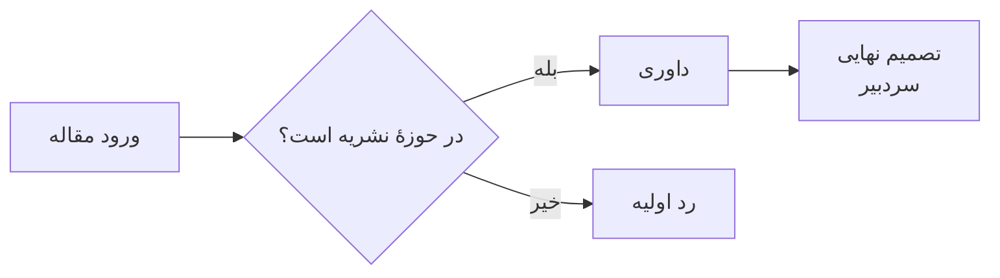
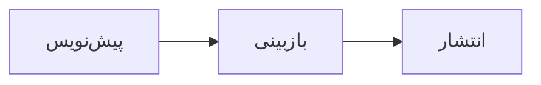

---
# Per-document settings (YAML). Quote any text containing `{`, `:` or `#`.

dir: auto                          # each block follows its own language, whatever config.toml says

header:
  style: line                      # minimal | line | band | double
  start: "قالب پژوهشی دوزبانهٔ Typst"
  center: "{section}"
  end: "صفحه {page} از {pages}"
  dir: auto                        # rtl | ltr | auto
  skip-first-page: false

cover:
  type: "راهنمای کاربر"
  title: "قالب پژوهشی دوزبانهٔ Typst"
  subtitle: "از Markdown تا PDF حروف‌چینی‌شده؛ فارسی و انگلیسی در کنار هم"
  date: "مهر ۱۴۰۵"
  frame: true
  dir: auto

footer:
  style: plain
  end: "— {page} —"
  digits: fa

heading:
  underline: false
  fill: false

---

<toc dir="rtl" break="true" depth="3"></toc>

## مرور کلی

متن را با Markdown بنویسید و PDF حروف‌چینی‌شده تحویل بگیرید. قالب فارسی (راست‌به‌چپ) و انگلیسی (چپ‌به‌راست) را کنار هم مدیریت می‌کند: هر پاراگراف، تیتر، فهرست، جدول، برچسب و شکل جهتش را از اولین حرفش می‌گیرد و لازم نیست هیچ‌وقت جهت را دستی تعیین کنید.

علاوه بر Markdown استاندارد، تگ‌هایی شبیه HTML برای شکل، رسم، درخت فایل‌ها، نمودار داده، هشدار، باکس، چیدمان ستونی، تراز، مراحل، نوار پیشرفت و امتیاز، مزایا و معایب، یادداشت پیش‌نویس، نامهٔ اداری، تمرین و آزمون، فهرست کد، مقایسه تغییرات (diff)، کلید و برچسب، پاورقی، فهرست شکل‌ها، جدول‌ها و کدها، معادلهٔ شماره‌دار، ارجاع به منابع، ارجاع درون‌متنی و بلوک‌های قضیه دارد. صفحهٔ جلد، هدر صفحه، هشت تم رنگی و سه حالت کلی (feel) هم قابل تنظیم‌اند.

```text
doc_fa.md  ──(cmarker)──▶  main.typ + src/  ──(typst)──▶  main.pdf
```

---

## پیش‌نیازها

- نسخهٔ **Typst** ۰٫۱۵ یا جدیدتر (با ۰٫۱۵٫۱ آزموده شده).
- **بسته‌ها** در اولین کامپایل خودکار دانلود می‌شوند:
  - بستهٔ `cmarker` 0.1.10 متن Markdown را رندر می‌کند.
  - بستهٔ `mitex` 0.2.7 ریاضی LaTeX را پردازش می‌کند.
  - بسته‌های `fontawesome` 0.6.2 و `lucide` 0.1.0 آیکون‌ها را فراهم می‌کنند.
  - بستهٔ `cetz` 0.5.2 رسم‌ها را می‌کشد.
  - بستهٔ `lilaq` 0.6.0 نمودارهای داده را می‌کشد.
  - بستهٔ `mmdr` 0.2.2 نمودارهای Mermaid را رندر می‌کند.
- **فونت‌ها** باید روی سیستم نصب باشند. فونت‌های پیش‌فرض هر حالت:

  | حالت | لاتین | فارسی |
  |------|-------|-------|
  | `formal` | New Computer Modern (همراه Typst) | XB Niloofar |
  | `standard` | Inter | IRANSans |
  | `friendly` | Lexend | Pelak |

  کدها همیشه با **Anonymous Pro** نوشته می‌شوند، مگر اینکه `[font] code` فونت دیگری تعیین کند. با `typst fonts` ببینید Typst کدام فونت‌ها را پیدا می‌کند. هر کدام از آن‌ها را می‌توان از طریق `[font]` جایگزین کرد.

---

## فایل‌ها

| فایل | نقش |
|------|-----|
| `doc_en.md` | همین راهنما به انگلیسی. اگر `config.toml` کلید `source` نداشته باشد، همین فایل کامپایل می‌شود. |
| `doc_fa.md` | همین راهنما به فارسی. |
| `main.typ` | نقطهٔ ورود (چند خط). Markdown را از پیش‌پردازنده‌های `src/preprocess/` و تگ‌های `components/` رد می‌کند و رندر می‌کند. |
| `components/<name>.typ` | یک فایل Typst برای هر کامپوننت (تگ‌ها و کد). |
| `src/lib/` | توابع کمکی مشترک بین چند کامپوننت. |
| `tools/` | `build-all.mjs` (همهٔ تم × حالت)، `gen-registry.mjs` (ساخت `components/_registry.typ` از فایل‌های کامپوننت) و `bundle.mjs` (بیلد تک‌فایل، `dist/formatex.typ`) و `export-schema.mjs` (`dist/tags.json`: همهٔ تگ‌ها با ویژگی‌ها و مقدارهای مجاز، برای autocomplete ویرایشگر). |
| `src/core.typ` | بازصادرکنندهٔ `src/core.typ` (تنظیمات، تم، feel، فونت، جهت)، `src/page.typ` (صفحه، سرصفحه، پاصفحه، جلد) و `src/conf.typ` (استایل کد، نقل‌قول، جدول، عنوان). |
| `src/themes.typ` | هشت پالت رنگی. |
| `config.toml` | تنظیمات کل پروژه: فایل ورودی، شماره‌گذاری، تم، حالت، اندازهٔ صفحه، حاشیه، ستون‌ها، فونت‌ها، جدول‌ها، معادله‌ها. هدر، فوتر، جلد و منابع در front matter هر فایل Markdown تعریف می‌شوند. |
| `examples/references.bib` | مدخل‌های BibTeX که `<cite>` و `<bibliography>` از آن‌ها استفاده می‌کنند. |
| `examples/demo.md` | آزمون کامل امکانات: همهٔ کامپوننت‌ها، گزینه‌های جدول، حالت‌های کد، انواع قضیه، ارجاع‌ها و استنادها. با `node tools/build-all.mjs --source examples/demo.md` بسازیدش تا همهٔ تم‌ها و حالت‌ها بررسی شوند. |
| `code-dark.tmTheme` | تم رنگ‌آمیزی کد که روی تم‌های تیره خودکار استفاده می‌شود. |
| `images/` | تصویرها. مسیرها در Markdown نسبت به پوشهٔ ریشهٔ پروژه نوشته می‌شوند. |
| `examples/` | `demo.md` (آزمون همهٔ امکانات) و فایل‌هایی که استفاده می‌کند: کد برای `<code src>`، Markdown برای `<include>` و `references.bib`. |

---

## ساختن خروجی

### یک PDF

از پوشهٔ ریشهٔ پروژه اجرا کنید:

```powershell
typst compile main.typ                                  # -> main.pdf with config.toml settings
typst compile main.typ --input theme=dracula            # override the theme for this build
typst compile main.typ --input feel=friendly            # override the feel
typst compile main.typ --input header-style=band        # override the header style
typst compile main.typ --input page=mobile              # phone-sized pages
typst compile main.typ --input cover=false              # drop (or force with true) the cover page
typst compile main.typ --input todo=hide                # final version: no draft notes
typst compile main.typ --input answers=end              # answers collected under <answers> (or hide / show)
typst compile main.typ demo.pdf --input source=examples/demo.md  # render another Markdown file for this build
typst compile main.typ "page-{p}.png" --ppi 80          # one PNG per page, for quick checks
typst watch main.typ                                    # rebuild on every save
```

گزینه‌های `--input` را می‌شود با هم ترکیب کرد. این گزینه‌ها هم بر `config.toml` و هم بر front matter سند مقدم‌اند و هیچ‌کدام را تغییر نمی‌دهند.

فایل Markdown که کامپایل می‌شود با کلید `source` در بالای `config.toml` تعیین می‌شود (پیش‌فرض `doc_en.md`). برای اینکه فایل دیگری پیش‌فرض شود، همان‌جا عوضش کنید، مثلاً `source = "thesis.md"`. مسیر نسبت به `main.typ` است. گزینهٔ `--input source=...` برای یک بار ساخت همچنان بر آن مقدم است. نام PDF خروجی همیشه از نام فایل `.typ` گرفته می‌شود (`main.pdf`)، مگر اینکه مسیر خروجی بدهید.

### همهٔ تم‌ها و حالت‌ها: `tools/build-all.mjs`

اسکریپت `tools/build-all.mjs` همهٔ ترکیب‌های ۸ تم و ۳ حالت را کامپایل می‌کند، یعنی در مجموع ۲۴ PDF. نام فایل‌ها `<source>-<theme>-<feel>.pdf` است و در `out/` نوشته می‌شوند:

```text
out/doc_fa-paper-formal.pdf   out/doc_fa-paper-standard.pdf   out/doc_fa-paper-friendly.pdf
out/doc_fa-sepia-formal.pdf   ...                             out/doc_fa-dracula-friendly.pdf
```

```powershell
node tools/build-all.mjs                                    # all 24
node tools/build-all.mjs --themes paper                      # paper in all three feels
node tools/build-all.mjs --themes paper,nord --feels formal   # selected combinations only
node tools/build-all.mjs --no-cover                           # without the cover page
node tools/build-all.mjs --source examples/demo.md                    # out/demo-<theme>-<feel>.pdf
node tools/build-all.mjs --out-dir pdfs                       # another output folder
```

| پارامتر | پیش‌فرض | معنا |
|---------|---------|------|
| `--themes` | هر هشت تم | تم‌هایی که ساخته می‌شوند (جدا با کاما). |
| `--feels` | هر سه حالت | حالت‌هایی که ساخته می‌شوند (جدا با کاما). |
| `--source` | کلید `source` در `config.toml` (وگرنه `doc_en.md`) | فایل Markdown ورودی. نامش پیشوند فایل‌های خروجی می‌شود. |
| `--out-dir` | `out` | پوشهٔ خروجی؛ اگر نباشد ساخته می‌شود. |
| `--no-cover` | خاموش | گزینهٔ `cover=false` را می‌فرستد. |

اسکریپت اول به پوشهٔ خودش می‌رود، پس از هر جایی می‌شود اجرایش کرد. برای هر فایل `ok` یا `FAILED` چاپ می‌کند. در پایان ترکیب‌های ناموفق را فهرست می‌کند و اگر خطایی بوده باشد با کد ۱ خارج می‌شود.

اگر ویندوز به‌خاطر execution policy اجازهٔ اجرای اسکریپت را نداد:

```powershell
node tools/build-all.mjs
```

فایل PDFی که در یک نمایشگر باز است ممکن است توسط ویندوز قفل شود و کامپایل روی آن شکست بخورد. اول آن را ببندید.

---

## پیکربندی

تنظیمات از دو جا می‌آیند:

| کجا | دامنه | شامل |
|-----|-------|------|
| `config.toml` | همهٔ سندهای پروژه | تیترها (شماره‌گذاری و ظاهر)، تم، حالت، اندازهٔ صفحه، حاشیه، جهت متن، ستون‌ها، یادداشت‌های پیش‌نویس و پاسخ‌ها، فونت‌ها، پیش‌فرض فهرست‌ها، جدول‌ها، معادله‌ها و گفتگوها |
| بلوک front matter بالای هر `.md` | فقط همان سند | هدر صفحه، فوتر، جلد، منابع و بازنویسی هر چیزی از `config.toml` |

گزینه‌های `--input` در خط فرمان بر هر دو مقدم‌اند.

### تنظیمات هر سند (front matter)

هر فایل Markdown می‌تواند با یک بلوک YAML بین دو خط `---` شروع شود. این بلوک باید دقیقاً اولین چیز فایل باشد:

```yaml
---
theme: ocean                 # overrides config.toml for this document only
feel: friendly

header:
  style: line
  start: "قالب پژوهشی دوزبانهٔ Typst"
  end: "صفحه {page} از {pages}"

cover:
  type: "راهنمای کاربر"
  title: "قالب پژوهشی دوزبانهٔ Typst"
  date: "مهر ۱۴۰۵"
---

## بخش اول
...
```

- **ادغام:**
  - این بلوک روی `config.toml` ادغام می‌شود: جدول‌ها کلید به کلید ادغام می‌شوند و بقیهٔ مقدارها جایگزین می‌شوند.
  - مثلاً `font: {latin: Lexend}` فقط فونت لاتین را عوض می‌کند و بقیهٔ تنظیمات فونت `config.toml` را نگه می‌دارد.
  - بخش `heading:` هم همین‌طور است: هر کدام از کلیدهایش (`numbering`، `number-suffix`، `underline`، `fill`، `max-level`، `color`) را می‌شود برای یک سند تعیین کرد و بقیه از `config.toml` می‌آیند. مقدار خالی (`color:`) یعنی پیش‌فرض.
- **روشن کردن بخش‌ها:** سند فقط وقتی هدر دارد که جدول `header:` داشته باشد، و فقط وقتی جلد دارد که جدول `cover:` داشته باشد. داخل هر کدام، `enabled: false` دوباره خاموشش می‌کند.
- **چاپ نمی‌شود:** این بلوک پیش از رندر حذف می‌شود. سندی که front matter ندارد، به‌سادگی هدر و جلد ندارد.
- **نقل‌قول:**
  - هر متنی که `{` یا `: ` یا ` #` دارد را داخل گیومه بگذارید، مثلاً `end: "صفحه {page} از {pages}"`.
  - بدون گیومه، YAML علامت `{` را شروع جدول و `#` را شروع توضیح می‌خواند.
- **توضیح و فهرست:** علامت `#` توضیح را شروع می‌کند. فهرست‌ها را می‌شود به شکل `["A", "B"]` یا خط‌های `- A` نوشت.
- **نمونه‌ها:** فایل `doc_en.md` (جلد و هدر انگلیسی)، `doc_fa.md` (جلد و هدر فارسی) و `examples/demo.md` (هدر نواری و جلد فارسی).

بقیهٔ این بخش هر تنظیم را توضیح می‌دهد. تنظیمات `config.toml` با نحو TOML نوشته می‌شوند: آن‌جا کلیدهای سطح بالا (`source`، `theme`، `feel`، `page`، `margin`، `columns`، `todo`، `answers`) باید **پیش از** هر `[table]` بیایند. کلید `source` فقط در `config.toml` یا با `--input` تنظیم می‌شود و نه در front matter، چون تعیین می‌کند front matter کدام فایل خوانده شود.

### شماره‌گذاری تیترها

```toml
[heading]
numbering = true
number-prefix = ""    # text before the number
number-suffix = "."   # text after the number
```

- کلید `number-prefix`: متن قبل از شماره: `"("` همراه `number-suffix = ")"` می‌شود «(۱) مقدمه». پیش‌فرض `""` است. مثل پسوند، فقط خود تیترها آن را نشان می‌دهند.
- کلید `number-suffix`: مقدار `""` می‌شود «۱ مقدمه»، `"."` می‌شود «۱. مقدمه» و `" -"` می‌شود «۱ - مقدمه». پیش‌فرض `""` است. فقط روی خود تیترها اعمال می‌شود؛ فهرست مطالب، `<ref>` و `{section-number}` در هدر صفحه شمارهٔ ساده را نشان می‌دهند.
- کلید قدیمی سطح بالای `heading-numbering = true` وقتی `[heading] numbering` تنظیم نشده باشد همچنان کار می‌کند.
- تیترها از `##` شروع می‌شوند. شماره‌گذاری سطح خالی را رد می‌کند، پس تیترها `1` و `1.1` شماره می‌گیرند، نه `0.1`.
- شماره‌گذاری در کل سند پیوسته است.
- تیترهای فارسی رقم فارسی (`۱.۲`) و تیترهای انگلیسی رقم لاتین می‌گیرند.
- وقتی شماره‌گذاری روشن است، **عدد را در تیتر تایپ نکنید**. بنویسید `## مقدمه`، نه `## ۱. مقدمه`.

### ظاهر تیترها

```toml
[heading]
underline = true   # rule below the heading
fill = true        # tinted background
max-level = 2      # levels that get this look
color = ""         # base color: preset, hex, or "" for the theme's heading color
```

| کلید | اثر | پیش‌فرض |
|------|-----|---------|
| `underline` | خطی به رنگ پایه زیر تیتر | `false` |
| `fill` | پس‌زمینهٔ کم‌رنگ از رنگ پایه پشت تیتر | `false` |
| `max-level` | عمیق‌ترین سطحی که این ظاهر را می‌گیرد، مثل شماره‌ها شمرده می‌شود: وقتی تیترها از `##` شروع شوند، `1` یعنی بخش‌ها (`۱`) و `2` یعنی زیربخش‌ها هم (`۱.۱`) | `2` |
| `color` | پایهٔ رنگ متن، خط و پس‌زمینه: `purple`، `blue`، `teal`، `green`، `yellow`، `red`، `pink` یا یک رنگ hex | رنگ `heading` تم |

- با `fill`، تیتر از همهٔ طرف فاصلهٔ داخلی می‌گیرد؛ با `underline` تنها، فقط فاصلهٔ بین متن و خط بیشتر می‌شود.
- بدون بخش `[heading]`، یا وقتی `underline` و `fill` هر دو خاموش‌اند، تیترها مثل قبل‌اند (فقط متن رنگی).
- گردی گوشهٔ پس‌زمینه از حالت پیروی می‌کند (`formal` صاف). وقتی `underline` روشن است، گوشه‌های پایین همیشه صاف‌اند تا خط صاف بماند.
- همهٔ کلیدهای این بخش و بخش شماره‌گذاری تیترها در front matter هر سند قابل بازنویسی‌اند؛ کلیدهایی که نیاورید مقدار `config.toml` را نگه می‌دارند:

  ```yaml
  heading:
    numbering: false
    underline: true
    fill: false
    max-level: 1
    color: teal
  ```

- **برای یک تیتر:** همین کلیدها را در `{...}` انتهای خط تیتر بگذارید، کنار `#id` یا بدون آن، به شکل جفت‌های `key=value` جداشده با فاصله و به هر ترتیبی:

  ```markdown
  ## جمع‌بندی {#sec-summary fill=true underline=false color=purple}
  ## سپاسگزاری {numbering=false}
  ## پیشگفتار {numbering=false toc=false}
  ### یادداشت پیوست {number-suffix="." color="#0f766e"}
  ```

  | کلید | مقدار |
  |------|-------|
  | `numbering` | `true` یا `false`. تیتر بی‌شماره شماره‌ای مصرف نمی‌کند و تیتر بعدی شمارش را ادامه می‌دهد. |
  | `number-prefix` | متن قبل از شماره، اگر فاصله دارد داخل گیومه |
  | `number-suffix` | متن بعد از شماره، اگر فاصله دارد داخل گیومه |
  | `toc` | `true` یا `false`. با `toc=false` این تیتر از `<toc>` (و از `{section}` هدر صفحه) کنار گذاشته می‌شود؛ خود تیتر در متن می‌ماند. |
  | `underline`، `fill` | `true` یا `false`. تعیین هر کدام، این تیتر را حتی پایین‌تر از `max-level` هم قالب‌دار می‌کند. |
  | `color` | یک رنگ آماده یا hex، مثل بالا |

  - بقیهٔ سند تغییری نمی‌کند. فهرست مطالب و هدر صفحه تیتر را با شمارهٔ خودش نشان می‌دهند، مگر اینکه `toc=false` داشته باشد.
  - کلید `max-level` برای یک تیتر معنا ندارد؛ فقط تعیین می‌کند کدام سطح‌ها ظاهر مشترک را بگیرند.
  - کلید یا مقدار ناشناخته خطای کامپایل است. اگر داخل `{...}` چیزی جز `#id` و `key=value` باشد (مثلاً `## مجموعه‌ها {x}`)، به‌عنوان متن در تیتر می‌ماند.

### تم

```toml
theme = "paper"
```

| تم | نوع | ظاهر |
|----|-----|------|
| `paper` | روشن | صفحهٔ سفید، متن زغالی، تیتر سرمه‌ای، رنگ تأکید آبی، خط‌های خاکستری ملایم |
| `sepia` | روشن | صفحهٔ کرم گرم، متن و تأکید قهوه‌ای |
| `ocean` | روشن | صفحهٔ آبی کم‌رنگ، تیتر آبی تیره، تأکید فیروزه‌ای |
| `sage` | روشن | سبز روشن حرفه‌ای: صفحهٔ سفید متمایل به سبز مریمی، تیتر سبز جنگلی، تأکید زمردی |
| `midnight` | تیره | شبیه GitHub تیره، تأکید آبی |
| `nord` | تیره | پالت Nord، تیترهای آبی یخی |
| `zinc` | تیره | زینک Tailwind/shadcn: صفحهٔ تقریباً سیاه، خاکستری‌های خنثی و مثل `paper` فقط رنگ تأکید آبی |
| `dracula` | تیره | پالت Dracula، تیتر بنفش، تأکید صورتی |

هر تم مقدارهای `bg`، `fg`، `heading`، `muted`، `accent`، `secondary`، `rule`، `code-bg` و `code-stroke` را تعریف می‌کند. رنگ `accent` برای چیزهایی است که باید به چشم بیایند (پیوندها، ارجاع‌ها، نوار نقل‌قول). رنگ `secondary` برای ته‌رنگ‌های ملایم پس‌زمینه است: ردیف سرستون جدول‌ها و خط‌های هایلایت‌شدهٔ کد. در همهٔ تم‌ها برابر `accent` است جز `zinc` که خاکستری است. روی تم‌های تیره رنگ‌آمیزی کد خودکار به `code-dark.tmTheme` عوض می‌شود. هفت <a href="#color-presets">رنگ آماده</a> که `<alert>` و `<box>` استفاده می‌کنند از تم فعال ته‌رنگ می‌گیرند، پس با هر تمی جورند. رنگ‌های hex روی تم‌های روشن همان‌طور که داده شده‌اند و روی تم‌های تیره ملایم‌تر استفاده می‌شوند.

### اندازهٔ صفحه

```toml
page = "a4"   # a4 | mobile
```

| اندازه | صفحه | کاربرد |
|--------|------|--------|
| `a4` | ۲۱۰ × ۲۹۷ میلی‌متر، حاشیهٔ قابل تنظیم | چاپ و خواندن روی رایانه |
| `mobile` | ۱۱۰ × ۲۴۵ میلی‌متر، حاشیهٔ کناری ۷ میلی‌متر؛ بخش `center` هدر پنهان می‌شود | خواندن روی گوشی: متن بدون بزرگ‌نمایی صفحه را پر می‌کند |

برای یک بار ساخت با `--input page=mobile` و برای یک سند با `page: mobile` در front matter عوضش کنید.

### حاشیهٔ صفحه

```toml
margin = "narrow"   # narrow | normal | wide
```

| مقدار | دو طرف | بالا و پایین |
|-------|--------|--------------|
| `narrow` | ۱۵ میلی‌متر | ۱۸ میلی‌متر |
| `normal` | حدود ۲۵ میلی‌متر (پیش‌فرض Typst) | حدود ۲۵ میلی‌متر |
| `wide` | ۳۵ میلی‌متر | ۳۰ میلی‌متر |

- فقط برای `a4`؛ صفحهٔ `mobile` حاشیه‌های کوچک خودش را نگه می‌دارد.
- پیش‌فرض `normal` است. برای یک سند با `margin: wide` در front matter و برای یک بار ساخت با `--input margin=wide` عوضش کنید.

### مقیاس

```toml
scale = 100   # percent
```

- همه‌چیز روی صفحه را با هم بزرگ یا کوچک می‌کند: متن، تیترها، ریاضی، کد، جدول‌ها، فاصله‌های داخلی، گردی گوشه‌ها و خط‌ها. اندازهٔ صفحه و حاشیه‌ها ثابت می‌مانند، پس با مقیاس کوچک‌تر مطلب بیشتری در هر صفحه جا می‌شود.
- پیش‌فرض `100` است. مثلاً `90` مطلب بیشتری در هر صفحه جا می‌دهد و `115` درشت‌تر چاپ می‌کند.
- برای یک سند با `scale: 110` در front matter و برای یک بار ساخت با `--input scale=110` عوضش کنید.
- طول‌هایی که با `cm`، `mm` یا `%` می‌دهید (مثلاً اندازهٔ تصویرها) فیزیکی‌اند و تغییر نمی‌کنند. عددهای پوینتی ساده در ویژگی‌ها (`padding="8"`، `radius="6"`) مثل بقیه مقیاس می‌گیرند.

### جهت متن (`dir`) {#dir-setting}

```toml
dir = "auto"   # auto | rtl | ltr
```

| مقدار | اثر |
|-------|-----|
| `auto` | پیش‌فرض. هر پاراگراف، تیتر، فهرست، خانهٔ جدول، نقل‌قول، عنوان، هشدار و برچسب جهتش را از اولین حرف خودش می‌گیرد (بخش <a href="#جهت-متن">جهت متن</a> را ببینید). |
| `rtl` | همه‌چیز راست‌به‌چپ می‌شود، متن انگلیسی هم: پاراگراف‌ها، تیترها (با شمارهٔ فارسی)، فهرست‌ها، جدول‌ها (ترتیب ستون‌ها برعکس می‌شود) و خانه‌هایشان، نقل‌قول‌ها، عنوان شکل و جدول و کد همراه برچسبشان («شکل ۱»)، هشدارها، کادرها، مراحل، برچسب‌ها، مدخل‌های `<toc>`، `<lof>` و `<lot>`، و فهرست منابع. |
| `ltr` | همین، از چپ به راست (رقم لاتین، "Figure 1"). |

- **همیشه چپ‌به‌راست:** بلوک‌های کد و کد درون‌خطی. برچسب‌های رسم `<cetz>`، نمودارهای Mermaid و کلیدهای `<kbd>` جهت خودشان را نگه می‌دارند.
- **هدر، فوتر و جلد:** وقتی `dir` خودشان `auto` باشد از `dir` سند پیروی می‌کنند.
- **ستون‌ها:** در سند چندستونه با `column-dir = "auto"`، ترتیب ستون‌ها هم از `dir` پیروی می‌کند.
- **کجا تنظیم شود:** معمولاً برای هر سند در front matter (`dir: rtl`). گزینهٔ `--input dir=ltr` آن را برای یک بار ساختن تغییر می‌دهد. برای عوض کردن جهت فقط بخشی از سند از <a href="#dir-tag">`<dir>`</a> استفاده کنید.
- هر مقدار دیگری خطای کامپایل است.

### ستون‌ها {#columns}

```yaml
---
columns: 2        # in a document's front matter (or `columns = 2` in config.toml)
column-dir: rtl   # which column fills first
---
```

- متن در همین تعداد ستون جریان پیدا می‌کند.
- کلید `column-dir` ترتیب ستون‌ها را تعیین می‌کند: `rtl` اول ستون راست را پر می‌کند، `ltr` ستون چپ را و `auto` از زبان سند پیروی می‌کند. پیش‌فرض در `config.toml` مقدار `rtl` است. برای یک بار ساخت با `--input column-dir=ltr` عوضش کنید.
- فهرست‌های `<toc>` و `<lof>` و `<lot>` که `break` دارند یک‌ستونه و در صفحه‌های جداگانه می‌مانند. فهرست‌هایی که پشت سر هم نوشته شوند (فقط با خط خالی بینشان) همان صفحه‌ها را با هم شریک می‌شوند. بدون `break` مثل متن عادی در ستون‌ها جریان پیدا می‌کنند.
- صفحهٔ جلد یک‌ستونه می‌ماند و `<docheader>` در بالای صفحهٔ خودش همهٔ ستون‌ها را می‌پوشاند.
- جدول‌های `width=full` و بلوک‌های تمام‌عرض به اندازهٔ یک ستون پهن می‌شوند.
- اندازهٔ `mobile` همیشه یک ستون دارد.
- برای یک بار ساخت با `--input columns=2` عوضش کنید. پیش‌فرض `1` است.

### یادداشت‌های پیش‌نویس و پاسخ‌ها (`todo`، `answers`) {#todo-answers-setting}

```toml
todo = "show"      # show | hide
answers = "show"   # show | hide | end
```

| کلید | مقدار | اثر |
|------|-------|-----|
| `todo` | `show` | پیش‌فرض. همهٔ یادداشت‌های <a href="#todo-section">`<todo>`</a> و فهرست `<todos>` چاپ می‌شوند. |
| | `hide` | همه حذف می‌شوند (یادداشت‌های درون‌خطی، بلوک‌های یادداشت، جای‌نگهدارهای شکل و فهرست `<todos>`): نسخهٔ نهایی. |
| `answers` | `show` | پیش‌فرض. هر <a href="#exercise-section">`<answer>`</a> زیر پرسش خودش در کادری با ته‌رنگ سبز می‌آید (در `formal`: یک خط‌چین و برچسب کم‌رنگ «پاسخ» / "Answer")، و گزینهٔ درست `<choices>` برجسته می‌شود (نشانگر سبز، متن پررنگ). |
| | `hide` | پاسخ‌ها و برجسته‌سازی حذف می‌شوند: برگهٔ سؤال. |
| | `end` | زیر پرسش‌ها چیزی نمی‌آید؛ `<answers></answers>` همهٔ پاسخ‌ها را یک‌جا چاپ می‌کند («پاسخ‌ها» / "Answers"). |

- هر دو کلید سطح بالا هستند: در `config.toml` آن‌ها را پیش از هر `[table]` بگذارید.
- برای یک سند در front matter (`answers: hide`) و برای یک بار ساخت با `--input todo=hide` / `--input answers=end` عوضشان کنید. به این ترتیب از یک فایل هم پیش‌نویس، هم نسخهٔ نهایی، هم برگهٔ سؤال و هم پاسخ‌نامه ساخته می‌شود.
- هر مقدار دیگری خطای کامپایل است.

### حالت (feel)

```toml
feel = "standard"   # formal | standard | friendly
```

حالت، گردی پیش‌فرض گوشهٔ همهٔ اجزای گرد و فونت‌های پیش‌فرض را تعیین می‌کند:

| جزء | `formal` | `standard` | `friendly` |
|-----|----------|------------|------------|
| بلوک کد | 0 | 6pt | 14pt |
| کد درون‌خطی | 0 | 2pt | 4pt |
| برچسب زبان کد و `<badge>` | 0 | 4pt | 9pt |
| کلیدهای `<kbd>` | 0 | 4pt | 4pt |
| هشدار `<alert>` | 0 | 8pt | 16pt |
| بلوک‌های قضیهٔ قاب‌دار | 0 | 6pt | 14pt |
| باکس `<box>` | 0 | 6pt | 14pt |
| تصویر `` | 0 | 6pt | 16pt |
| قاب جلد | 0 | 10pt | 24pt |
| هدر `band` | 0 | 6pt | 14pt |
| پس‌زمینهٔ تیتر (`[heading]`) | 0 | 5pt | 10pt |
| گره‌ها و subgraphهای Mermaid (برچسب یال‌ها مثل badge) | 0 | 6pt | 14pt |
| جدول‌ها | خط‌های آکادمیک (بالا، زیر سرستون، پایین) | قاب گرد ملایم، سرستون پررنگ ته‌رنگ‌دار، خط‌های نازک بین ردیف‌ها | کارت گرد، سرستون پررنگ رنگی، ردیف‌های راه‌راه |
| هدر صفحه | همیشه سبک `line` (خط زیر) | سبک `style` سند | سبک `style` سند |
| نشانگرهای `<steps>` | مربع توخالی، خط نازک | مربع گرد ته‌رنگ‌دار | دایرهٔ ته‌رنگ‌دار، خط نازک (همان رنگ‌های `standard`) |
| نوارهای `<progress>` | نوار نازک گوشه‌تیز با مسیر قاب‌دار، نقطه‌های مربعی | نوار و نقطه با گوشهٔ کمی گرد | نوار ضخیم‌تر قرصی، نقطه‌های دایره‌ای |
| ستون‌های `<compare>` | بدون ته‌رنگ، خطی رنگی بالای هر ستون، ✓ / ✗ ساده | پنل ته‌رنگ‌دار با حاشیهٔ نازک | ته‌رنگ پررنگ‌تر، بدون حاشیه، گوشهٔ گردتر، ✓ / ✗ دایره‌ای |
| نامهٔ `<letter>` | برچسب‌های ساده، خط ساده، بلوک شماره بدون قاب | بلوک شماره در قاب نازک، برچسب‌های رنگ تأکید | بلوک شمارهٔ ته‌رنگ‌دار، خط ضخیم‌تر با سر گرد |
| تمرین `<exercise>` | بدون قاب؛ سرعنوان پررنگ به رنگ تیترها با نقطه در انتها | کارت با ته‌رنگ ملایم رنگ تأکید | همان کارت، گردتر |
| نشانگرهای `<choices>` | متن ساده: «الف)» | حرف در مربع کوچک گوشه‌گرد | حرف در دایره |
| فونت‌ها | New Computer Modern + XB Niloofar | Inter + IRANSans | Lexend + Pelak |

حالت `formal` هیچ گوشهٔ گردی ندارد. در `standard` و `friendly` نوار رنگی کنار بلوک‌های قضیهٔ قاب‌دار به شکل قرص گردی با فاصله از لبه‌ها کشیده می‌شود تا به‌جای بریده شدن، گوشه‌های گرد را دنبال کند. ویژگی صریح `radius` روی یک تگ همیشه بر حالت مقدم است.

### فونت‌ها

```toml
[font]
latin = "Lexend"           # English text (default: the feel's font)
persian = "Ray"            # Persian text (default: the feel's font)
code = "Anonymous Pro"     # code blocks and inline code
```

- کلیدهایی که نباشند مقدار پیش‌فرضشان را می‌گیرند.
- هر نویسه از اولین فونتی گرفته می‌شود که آن را دارد و فونت لاتین پیش از فونت فارسی امتحان می‌شود. پس فونت فارسی‌ای که حروف لاتین هم دارد متن انگلیسی را تغییر نمی‌دهد.

### پاراگراف‌ها

```toml
[paragraph]
justify = false        # true = both edges of every line flush with the margins
letter-spacing = 0     # extra space between letters, % of the font size
line-spacing = 100     # gap between lines, % of the normal gap
word-spacing = 100     # width of spaces, % of the font's normal space
```

| کلید | اثر | پیش‌فرض |
|------|-----|---------|
| `justify` | `true`: هر خط جز خط آخر پاراگراف تمام پهنا را پر می‌کند و از هر دو طرف تراز است. `false`: انتهای خط‌ها ناهموار می‌ماند. جدول‌ها و کدها هیچ‌وقت justify نمی‌شوند. | `false` |
| `letter-spacing` | فاصله‌ای که بین حروف اضافه می‌شود. `2` کمی بازتر و `-2` کمی فشرده‌تر. | `0` |
| `line-spacing` | فاصلهٔ بین خط‌های یک پاراگراف. `150` بازتر و `80` فشرده‌تر. | `100` |
| `word-spacing` | پهنای فاصلهٔ بین کلمه‌ها. `85` متن فشرده‌تری می‌دهد. | `100` |

- **محدودهٔ اثر:** متن اصلی، فهرست‌ها، نقل‌قول‌ها، خانه‌های جدول، عنوان‌ها و تیترها. بلوک کد و کد درون‌خطی فاصله‌های خودشان را نگه می‌دارند و هیچ‌وقت دوطرفه تراز نمی‌شوند.
- **متن فارسی:** با `letter-spacing` حروف چسبیده به هم چسبیده می‌مانند و فاصله فقط جایی می‌آید که حروف خودشان به هم وصل نیستند.
- **مقیاس:** مقدارها نسبت به اندازهٔ قلم‌اند، پس خودبه‌خود از `scale` پیروی می‌کنند.
- **برای یک سند:** هر کلید را می‌شود در front matter عوض کرد:

  ```yaml
  paragraph:
    justify: true
    line-spacing: 120
  ```

  مقدار نامعتبر (مقداری جز `true` و `false` برای `justify`، یا فاصلهٔ غیرعددی) خطای کامپایل است.

### فهرست‌ها (`[list]`)

```toml
[list]
numbers = "auto"   # auto | fa | en | fatxt | rome | abc | abjad | alefba
suffix = "."
```

شماره‌ها، پسوندشان، نشانهٔ گلوله‌ها و تورفتگی همهٔ فهرست‌ها. هر کلید و خط گزینه‌های `{...}` برای یک فهرست در بخش <a href="#lists-section">فهرست‌ها</a> توضیح داده شده‌اند. برای هر سند با `list:` در front matter تغییرشان دهید.

### گفتگوها (`[chat]`)

```toml
[chat]
style = "auto"     # auto | transcript | assistant | bubbles
ai-name = ""       # "" = «هوش مصنوعی» / "AI"
frame = true
```

پیش‌فرض‌های همهٔ تگ‌های `<chat>`: ظاهر، نام‌ها، آیکون‌ها، رنگ‌ها، قاب و پهنای حباب‌ها. هر کلید در بخش <a href="#chat-section">گفتگو با هوش مصنوعی</a> توضیح داده شده است. برای هر سند با نگاشت `chat:` در front matter تغییرشان دهید؛ ویژگی‌های خود تگ `<chat>` بر هر دو مقدم‌اند.

### هدر صفحه (front matter)

```yaml
header:
  style: line                       # minimal | line | band | double
  start: "پژوهش اقیانوس‌شناسی"      # start side (right in RTL)
  center: ""
  end: "صفحه {page} از {pages}"
  dir: auto                         # rtl | ltr | auto (the document's dir, else from the header text)
  skip-first-page: true             # no header on page 1 (default true)
  # logo: images/logo.svg           # shown before the start text
  # enabled: false                  # keep the settings but hide the header
```

| سبک | ظاهر |
|-----|------|
| `minimal` | فقط متن |
| `line` | متن با خطی زیرش |
| `band` | نوار سایه‌دار (گردی گوشه طبق حالت) |
| `double` | نوار رنگی بالا، خط زیر |

حالت `formal` همیشه از `line` استفاده می‌کند، هر چه `style` بگوید؛ پس سندهای رسمی هیچ‌وقت هدر گرد یا سایه‌دار نمی‌گیرند. گزینهٔ `--input header-style=...` برای یک بار ساخت همچنان بر آن مقدم است.

متن‌های `start`، `center` و `end` می‌توانند این جای‌نگهدارها را داشته باشند:

| جای‌نگهدار | مقدار |
|------------|-------|
| `{page}` | شمارهٔ صفحهٔ فعلی |
| `{pages}` | تعداد کل صفحه‌ها (جلد شمرده نمی‌شود) |
| `{section}` | بخش سطح‌بالای فعلی: اولین بخشی که در این صفحه شروع می‌شود، وگرنه آخرین بخش پیش از آن |
| `{section-number}` | شمارهٔ همان بخش (وقتی شماره‌گذاری خاموش است خالی) |

- وقتی سند تیتر شماره‌دار دارد، `{section}` فقط آن‌ها را در نظر می‌گیرد؛ پس عنوان‌های بدون شماره مثل عنوان منابع بخش‌های واقعی را پنهان نمی‌کنند.
- خانه‌ای که `{section}` یا `{section-number}` دارد در صفحه‌های پیش از اولین بخش (مثلاً فهرست مطالب) خالی می‌ماند، به‌جای اینکه یک `.` تنها چاپ کند.
- شمارهٔ صفحه در متن راست‌به‌چپ هدر با رقم فارسی نوشته می‌شود. با `digits: fa` یا `digits: en` یکی از دو نوع رقم اجباری می‌شود.
- خانه‌ای که فقط از جای‌نگهدار ساخته شده جهتش را از عنوان بخش می‌گیرد.
- برای راست‌به‌چپ کردن اجباری یک خانه، آن را با نویسهٔ RLM (U+200F) شروع کنید.

### فوتر صفحه (front matter)

بدون `footer:` هر صفحه یک شمارهٔ ساده وسط پایین دارد. با آن، فوتر مثل هدر و با همان جای‌نگهدارها ساخته می‌شود:

```yaml
footer:
  style: line                 # plain | line (rule above)
  start: "{section}"          # start side (right in RTL)
  center: ""
  end: "— {page} —"
  digits: fa                  # fa | en | auto (Persian when the text is RTL)
  dir: auto                   # rtl | ltr | auto (the document's dir, else from the footer text)
  skip-first-page: false      # no footer on page 1 (default false)
  # enabled: false            # no footer and no page number at all
```

- همهٔ کلیدها اختیاری‌اند؛ `footer: { center: "صفحه {page} از {pages}" }` کافی است.
- خانه‌های `start` و `end` فقط وقتی هر دو تنظیم شده باشند در دو طرف قرار می‌گیرند. وگرنه همه چیز وسط‌چین می‌شود: `end: "— {page} —"` به‌تنهایی یک شمارهٔ صفحهٔ وسط‌چین می‌دهد.
- خانه‌ای که فقط جای‌نگهدار دارد (`"{page}"`) حرفی ندارد، پس برای رقم فارسی `digits: fa` بگذارید.
- جلد هیچ‌وقت فوتر نمی‌گیرد.
- فقط front matter فایل اصلی حساب می‌شود؛ فوتر فایل‌های درج‌شده نادیده گرفته می‌شود.

### صفحهٔ جلد (front matter)

```yaml
cover:
  # logo: images/logo.svg
  institution: "نام دانشگاه"
  faculty: "نام دانشکده"
  department: ""
  type: "گزارش پژوهشی"             # e.g. پایان‌نامه کارشناسی ارشد
  title: "عنوان پژوهش"
  subtitle: ""
  author: "نام نویسنده"             # or a list: ["A", "B"], one per line
  supervisor: "نام استاد راهنما"
  advisor: ""
  date: "مهر ۱۴۰۵"
  frame: true                      # border around the page
  dir: auto                        # rtl | ltr | auto (the document's dir, else from title and institution)
  # enabled: false                 # keep the settings but hide the cover
```

- جلد صفحهٔ جداگانه‌ای است، بدون هدر و بدون شمارهٔ صفحه. صفحهٔ ۱ صفحهٔ بعد از آن است.
- فیلدهای خالی حذف می‌شوند.
- برچسب‌های نویسنده، استاد راهنما و استاد مشاور از جهت جلد پیروی می‌کنند: «نگارش / استاد راهنما / استاد مشاور» در فارسی و "Author / Supervisor / Advisor" در انگلیسی.

### منابع (front matter)

```yaml
bibliography:
  file: references.bib
  style: ieee              # any Typst/CSL style: apa, chicago-author-date, harvard-cite-them-right, ...
  title: "منابع"
  dir: auto                # auto = each entry follows its own language; ltr | rtl
```

- این تنظیمات مال هر سند است، پس فقط در front matter همان سند می‌آید، نه در `config.toml`.
- همهٔ کلیدها اختیاری‌اند. بدون آن‌ها: `examples/references.bib`، `ieee`، «منابع» و `dir` سند (`auto`، مگر اینکه اجباری شده باشد).
- ویژگی‌های تگ `<bibliography>` بر آن‌ها مقدم‌اند.
- مثل هدر، فقط front matter فایل اصلی حساب می‌شود.

---

## جهت متن

به‌طور پیش‌فرض (`dir = "auto"`) جهت **خودکار** است. هر پاراگراف، تیتر، فهرست، خانهٔ جدول، شکل، بلوک قضیه و برچسب رسم جهتش را از **اولین حرفش** می‌گیرد:

- حرف عربی‌نویس (فارسی) آن را راست‌به‌چپ می‌کند و شماره‌گذاری‌اش با رقم فارسی است.
- هر حرف دیگری آن را چپ‌به‌راست می‌کند.
- در پیدا کردن اولین حرف، کد و ریاضی نادیده گرفته می‌شوند.
- محتوایی که هیچ حرفی ندارد (مثلاً فهرستی از فرمول‌ها) جهت بلوک قبلی را به ارث می‌برد.

نشانه‌های جهت نامرئی اولین حرف حساب می‌شوند و بر تشخیص خودکار مقدم‌اند:

| نشانه | اثر |
|-------|-----|
| ‏RLM `U+200F` (یا `&rlm;`)، ALM `U+061C` | راست‌به‌چپ اجباری |
| ‏LRM `U+200E` (یا `&lrm;`) | چپ‌به‌راست اجباری |

پاراگراف یا تیتر فارسی‌ای که با یک کلمهٔ انگلیسی شروع شود چپ‌به‌راست درمی‌آید. برای راست‌به‌چپ ماندن، آن را با RLM شروع کنید: `&rlm;Python در ...` یا `## &rlm;Python و ...`. در آیتم‌های فهرست، نشانه را **بعد از** علامت فهرست بگذارید (`- &rlm;Python ...`)؛ نشانه‌ای که پیش از `-` یا `1.` بیاید فهرست را می‌شکند.

نقل‌قول‌ها نوارشان را سمت شروع متن می‌گذارند. برچسب‌های خودکار از زبان پاراگرافی که در آن هستند پیروی می‌کنند:
- شمارهٔ شکل: «شکل ۱» / "Figure 1"؛
- ارجاع: «قضیه ۲» / "Theorem 2".

برای اینکه یک جهت بر کل سند اعمال شود، <a href="#dir-setting">`dir`</a> را `rtl` یا `ltr` کنید. برای یک بخش، آن بخش را داخل <a href="#dir-tag">`<dir>`</a> بگذارید.

---

## نحو استاندارد Markdown

همهٔ این‌ها مثل همیشه کار می‌کنند:
- تیتر، پررنگ، کج، فهرست، نقل‌قول (`>`) و خط افقی (`---`)؛
- پیوند، کد درون‌خطی و بلوک کد؛
- ریاضی درون‌خطی `$...$` و نمایشی `$$...$$` با نحو LaTeX؛
- جدول.

- **فهرست‌ها** با رقم فارسی (`۱.`) هم شماره می‌خورند و شماره، گلوله و تورفتگی‌شان قابل تنظیم است (بخش <a href="#lists-section">فهرست‌ها</a> را ببینید).
- **جدول‌ها** وسط‌چین‌اند. ستون را با خط جداکننده‌اش تراز کنید: `:---` چپ، `---:` راست، `:---:` وسط. ظاهرشان از حالت پیروی می‌کند و برای هر جدول می‌شود گزینه تعیین کرد (پایین‌تر).
- **بلوک‌های کد** شمارهٔ خط می‌گیرند و خط‌های خالی انتهای بلوک حذف می‌شوند. بلوکی که زبان دارد (` ```python `) در گوشهٔ بالایش برچسبی با نام و آیکون زبان هم می‌گیرد.
  - نام‌های کوتاه مثل `py`، `js`، `ts`، `sh`، `yml` و `md` کار می‌کنند.
  - زبان ناشناخته با نام خودش و یک آیکون عمومی نشان داده می‌شود.
  - برای افزودن زبان، `code-languages` و `code-language-aliases` را در `src/core.typ` گسترش دهید.
  - بلوک ` ```mermaid ` به‌جای کد، نمودار رسم می‌کند (بخش <a href="#mermaid-diagrams">نمودارهای Mermaid</a> را ببینید).
- **کامنت‌ها** `<!-- ... -->` حذف می‌شوند، در یک خط یا چند خط (بخش <a href="#comments">کامنت‌ها</a> را ببینید).
- **استناد** به شکل Pandoc، یعنی `[@key]`، هم کار می‌کند.
- **پاورقی‌ها** هم با نحو استاندارد Markdown (`[^label]` و `[^label]: ...`) و هم با تگ درون‌خطی `<fn>` نوشته می‌شوند (بخش <a href="#footnotes">پاورقی‌ها</a> را ببینید).

### کامنت‌ها {#comments}

`<!-- ... -->` کامنت است: پیش از آنکه هر بخش دیگری متن را بخواند حذف می‌شود و هرگز به PDF نمی‌رسد. برای یادداشت شخصی و برای غیرفعال‌کردن یک بخش کامل بدون پاک‌کردنش به کار می‌رود.

```markdown
یک جملهٔ قابل‌مشاهده <!-- یادداشتی وسط خط --> ادامه پیدا می‌کند.

<!-- یادداشتی در یک خط مستقل. -->

<!--
## بخش پیش‌نویس {#draft}

همه‌چیز تا علامت پایان نادیده گرفته می‌شود: تیتر، جدول، فهرست،
معادله، کامپوننت و خط‌های `<include>`.
-->
```

- **چندخطی:** کامنت از `<!--` تا نخستین `-->` ادامه دارد، هر قدر خط که لازم باشد. کامنت‌ها تو در تو نمی‌شوند و اولین `-->` آن را می‌بندد.
- **کامنت‌کردن امن:** محتوا پیش از `{#id}`، خط‌های گزینهٔ `{...}` و بقیهٔ بازنویسی‌ها حذف می‌شود و `<include src="...">` کامنت‌شده دنبال نمی‌شود (فایلش حتی لازم نیست وجود داشته باشد).
- **خط کامل:** خطی که فقط متن کامنت دارد کاملاً ناپدید می‌شود؛ پس کامنتی میان دو خط یک پاراگراف آن را نمی‌شکند.
- **دست‌نخورده:** `<!--` داخل بلوک کد یا کد درون‌خطی فقط متن است و می‌توان آن را در مثال نشان داد، مثل همین مثال. در متن کامنتی که می‌خواهید بعداً تمام شود `-->` ننویسید.
- **نه برای سرصفحه:** سرصفحهٔ YAML کامنت `#` خودش را دارد (بخش پیکربندی را ببینید).

### پاورقی‌ها {#footnotes}

قالب از هر دو شیوهٔ پاورقی استاندارد Markdown و تگ‌های درون‌خطی `<fn>` به‌صورت کاملاً دوطرفه (فارسی و انگلیسی) پشتیبانی می‌کند.

```markdown
پاورقی معادل اصطلاحات انگلیسی: <fn en="Artificial Intelligence">هوش مصنوعی</fn> و یادگیری ماشین<fn en="Machine Learning"></fn>.
پاورقی توضیحی فارسی برای یک واژه انگلیسی: transformer<fn fa="معماری شبکه عصبی مبتنی بر خودتوجهی"></fn>.
پاورقی با متن دلخواه: <fn text="توضیحات تکمیلی">مفهوم</fn> یا پاورقی مستقل <fn>متن پاورقی</fn>.

پاورقی با نحو استاندارد Markdown: پاورقی فارسی[^fn-fa] و پاورقی انگلیسی[^fn-en].

[^fn-fa]: این یک پاورقی توضیحی به زبان فارسی است.
[^fn-en]: This is an explanatory footnote in English.
```

| نحو / تگ | کاربرد |
|----------|---------|
| `[^label]` + `[^label]: ...` | نحو استاندارد Markdown. تعریف پاورقی می‌تواند در انتهای بخش یا فایل باشد و خطوط ادامه با ۴ فاصله تورفته می‌شوند. |
| `<fn en="...">واژه</fn>` | پاورقی معادل انگلیسی (با جهت LTR و قلم لاتین) برای واژه. متن بدنه اختیاری است. |
| `<fn fa="...">word</fn>` | پاورقی توضیحی فارسی (با جهت RTL و قلم فارسی). متن بدنه اختیاری است. |
| `<fn text="...">واژه</fn>` | پاورقی با متن دلخواه با تشخیص خودکار جهت. |
| `<fn>متن پاورقی</fn>` | درج مستقیم پاورقی (نام مستعار: `<footnote>`). |

- **شماره‌گذاری دوطرفه:** شمارهٔ پاورقی در بافت راست‌به‌چپ به‌طور خودکار فارسی (`۱`، `۲`، ...) و در بافت چپ‌به‌راست لاتین (`1`، `2`، ...) درج می‌شود.
- **تشخیص خودکار جهت متن پاورقی:** متن یادداشت در پایین صفحه جهت خود را به‌صورت خودکار تشخیص می‌دهد؛ بنابراین پاورقی‌های انگلیسی حتی در سند فارسی چپ‌چین و با قلم لاتین می‌آیند و پاورقی‌های فارسی راست‌چین می‌شوند.
- **ویژگی‌های تگ `<fn>`:** شامل `en`، `fa`، `text` و `dir` (`rtl`، `ltr`، `auto`).

### درج فایل‌های Markdown دیگر

سند بلند را به چند فایل تقسیم کنید و هر کدام را جای خودش بیاورید:

```markdown
## مقدمه

<include src="chapters/intro.md"></include>

<include src="chapters/method.md" />
```

- **مثل یک فایل واحد:** پیش از رندر، آن خط با متن فایل جایگزین می‌شود. شماره‌گذاری تیترها، فهرست مطالب، شمارهٔ شکل و جدول و معادله، `{#id}`ها و `<ref>` در همهٔ فایل‌ها پیوسته‌اند و در هر دو جهت کار می‌کنند.
- **بلوک front matter نادیده گرفته می‌شود.** فقط تنظیمات فایل اصلی حساب می‌شود (تم، هدر، جلد، ...). فایل درج‌شده می‌تواند front matter خودش را نگه دارد، مثلاً برای کامپایل جداگانه.
- **مسیرها** مثل مسیر تصویرها نسبت به پوشهٔ ریشهٔ پروژه هستند. مسیری که با `./` یا `../` شروع شود نسبت به فایلی است که `<include>` در آن نوشته شده (`<include src="./part.md">` کنار همان فایل). درج تودرتو کار می‌کند.
- **جایگاه:** تگ باید در خط خودش و با خط خالی قبل و بعد باشد. `<include>` داخل پاراگراف یا فهرست خطای کامپایل است و حلقه هم (`a.md` ← `b.md` ← `a.md`). داخل بلوک کد به‌صورت متن باقی می‌ماند.
- تیترهای فایل درج‌شده جابه‌جا نمی‌شوند: آن‌ها را در همان سطحی بنویسید که باید در سند اصلی داشته باشند.

### معادله‌های شماره‌دار

انتهای معادلهٔ نمایشی `{#id}` بگذارید تا شماره بگیرد و با `<ref>` قابل ارجاع شود:

```markdown
$$e^{i\pi} + 1 = 0$$ {#eq-euler}

$$
\sum_{k=1}^{n} k^2 = \frac{n(n+1)(2n+1)}{6}
$$ {#eq-squares}

طبق <ref to="eq-euler"></ref> ...
```

- شماره در انتهای خط می‌نشیند: در متن فارسی سمت چپ و در متن انگلیسی سمت راست. رقم‌هایش از زبان متن پیش از آن پیروی می‌کنند: «(۱)» یا "(1)".
- ارجاع `<ref>` به شکل «رابطهٔ (۱)» یا "Equation (1)" چاپ می‌شود.
- علامت `{#id}` در خط `$$` پایانی یا به‌تنهایی در خط بلافاصله بعد از آن می‌آید. داخل بلوک کد دست نخورده می‌ماند.
- اینکه کدام معادله‌ها شماره بگیرند در `config.toml` تعیین می‌شود:

  ```toml
  [equation]
  numbering = "labelled"   # labelled (only {#id}) | all | none
  ```

---

### گزینه‌های جدول

یک خط `{...}` درست بالای جدول بگذارید (یک خط خالی بینشان اشکالی ندارد):

```markdown
{width=full caption="فونت‌های هر حالت" #tbl-fonts}
| حالت | لاتین | فارسی |
|------|-------|-------|
| `formal` | New Computer Modern | XB Niloofar |
```

| گزینه | مقدار | پیش‌فرض |
|-------|-------|---------|
| `width` | `auto`: به پهنای محتوا. `full`: تمام پهنای متن. | `[table] width` |
| `align` | `center`، `left`، `right`، `start`، `end`: جای جدولی که پهنایش `auto` است | `<align>` دربرگیرنده، وگرنه `[table] align` |
| `caption` | متنی که بالای جدول نشان داده می‌شود. اگر فاصله دارد داخل گیومه بگذارید. | ندارد |
| `#id` | هدف `<ref>`، با همان قواعد شناسهٔ تیترها | ندارد |
| `span` | `column`: در ستون متن خودش می‌ماند. `all`: در سند چندستونه روی همهٔ ستون‌ها پهن می‌شود. | `[table] span`، وگرنه `column` |
| `head-align` | تراز متن ردیف سرستون: `center`، `left`، `right`، `start`، `end`. دونقطه‌های ردیف جداکننده (`:---`، `---:`) را بازنویسی می‌کند. | دونقطه‌ها، وگرنه پیش‌فرض سبک |
| `body-align` | همین برای بقیهٔ ردیف‌ها. | دونقطه‌ها، وگرنه پیش‌فرض سبک |

- **جدول سرتاسری:** با `span=all` و `columns` بیشتر از ۱، جدول به بالا یا پایین نزدیک‌ترین صفحه‌ای که جا دارد می‌رود، روی همهٔ ستون‌ها، و متن دورش جریان می‌یابد. برای جدول‌هایی که در یک ستون جا نمی‌شوند به کار می‌آید:

  ```markdown
  {span=all caption="قواعد معنایی" #tbl-rules}
  ```

  - در این حالت `width` با کل پهنای متن سنجیده می‌شود، پس `width=full` از حاشیه تا حاشیهٔ صفحه را پر می‌کند.
  - در سند تک‌ستونه (یا صفحهٔ `mobile`) گزینهٔ `span` اثری ندارد.
- **پیش‌فرض همهٔ جدول‌ها** از `config.toml` (یا front matter سند) می‌آید:

  ```toml
  [table]
  width = "full"     # full | auto
  align = "center"   # center | left | right
  span = "column"    # column | all
  ```

  بدون بخش `[table]`، جدول‌ها `auto` و وسط‌چین‌اند و در ستون خودشان می‌مانند.
- **ستون‌های جدول تمام‌عرض** مثل مرورگر اندازه می‌گیرند:
  - اگر محتوا جا شود، هر ستون به نسبت پهنای طبیعی‌اش بزرگ می‌شود.
  - وگرنه ستون‌های باریک پهنایشان را نگه می‌دارند و ستون‌های پهن بقیه را تقسیم می‌کنند و می‌شکنند.
- **شماره‌گذاری:** جدولی که `caption` یا `#id` دارد جدول شماره‌دار می‌شود. برچسب از زبان عنوان پیروی می‌کند: «جدول ۱» یا "Table 1". ارجاع `<ref to="tbl-fonts">` بسته به زبان پاراگراف اطراف «جدول ۱» یا "Table 1" چاپ می‌کند.
- **نحو:**
  - گزینه‌ها جفت‌های `key=value` جداشده با فاصله‌اند، به هر ترتیبی.
  - متن Markdown داخل `caption` پردازش نمی‌شود.
  - گزینه یا مقدار ناشناخته خطای کامپایل است.
- **خط‌های نادیده:** خط `{...}` که جدول یا فهرستی دنبالش نیست (بخش <a href="#lists-section">فهرست‌ها</a> را ببینید) یا داخل بلوک کد است، متن عادی باقی می‌ماند.

### فهرست‌ها {#lists-section}

فهرست‌های گلوله‌ای (`-`، `*`، `+`) و شماره‌دار (`1.`، `1)`) مثل هر Markdown دیگری کار می‌کنند. آیتم‌های شماره‌دار را با رقم فارسی هم می‌شود نوشت: `۱.` یا `۲)` (و رقم عربی `١`) دقیقاً مثل `1.` یک فهرست شماره‌دار واقعی می‌سازند:

```markdown
۱. جمع‌آوری داده
۲. پاک‌سازی داده
۳. تحلیل نتایج
```

نتیجه:

۱. جمع‌آوری داده
۲. پاک‌سازی داده
۳. تحلیل نتایج

- **یکی شدن:** مثل هر Markdown دیگری، دو فهرست شماره‌داری که فقط یک خط خالی بینشان باشد یک فهرست می‌شوند. برای جدا ماندن، یک پاراگراف یا یک خط گزینه‌های `{...}` بینشان بگذارید.
- فقط `.` و `)` بعد از عدد آیتم می‌سازند؛ `۱-` متن عادی است. داخل بلوک‌های کد چیزی تبدیل نمی‌شود.

**تنظیمات همهٔ فهرست‌ها** از `[list]` در `config.toml` می‌آیند:

```toml
[list]
numbers = "auto"              # auto | fa | en | fatxt | rome | abc | abjad | alefba
prefix = ""                   # text before the number
suffix = "."                  # text after the number
marker = "disc,circle,dash"   # bullets, one per nesting level
indent = "1em"                # extra indent of every list
```

| کلید | مقدارها | پیش‌فرض |
|------|---------|---------|
| `numbers` | `auto`: رقم فارسی (۱ ۲ ۳) در فهرست راست‌به‌چپ و رقم لاتین (1 2 3) در فهرست چپ‌به‌راست؛ جهت فهرست از اولین حرفش یا از `dir` اجباری می‌آید. `fa`: ۱ ۲ ۳. `en`: 1 2 3. `fatxt`: عدد به حروف فارسی (یک، دو، سه، … بیست و یک، تا هزارها). `rome`: I II III. `abc`: a b c. `abjad`: الف ب ج د ه و ز … (۲۸ حرف). `alefba`: الف ب پ ت … (۳۲ حرف). بعد از آخرین حرف، `abjad` و `alefba` با رقم فارسی ادامه می‌دهند. | `auto` |
| `prefix` | متن بلافاصله قبل از عدد: `"("` همراه `suffix=")"` می‌شود «(۱)» یا «(الف)» | هیچ |
| `suffix` | متن بلافاصله بعد از عدد: `"."` ← «۱.»، `")"` ← «۱)»، `"-"`، `":"`، یا `""` برای هیچ | `"."` |
| `marker` | گلولهٔ فهرست‌های بی‌شماره: یک نویسه (`"•"`، `"–"`، `"★"`) یا یک نام: `disc` •، `circle` ◦، `square` ▪، `dash` –، `triangle` ‣، `arrow` →، `check` ✓، `star` ★، `none`. چند مقدار جداشده با ویرگول، برای هر سطح تودرتو یکی: `"disc,circle,dash"`. | پیش‌فرض Typst (• ‣ –) |
| `indent` | تورفتگی اضافهٔ همهٔ فهرست‌ها: `"1.5em"`، `"5mm"` یا عدد تنها به پوینت | ندارد |

- مقدارهای `numbers`، `prefix` و `suffix` بر همهٔ سطح‌های تودرتو اعمال می‌شوند.
- برای هر سند در front matter، کلید به کلید، تغییرشان دهید؛ بقیهٔ کلیدها مقدار `config.toml` را نگه می‌دارند:

  ```yaml
  list:
    numbers: abjad
    suffix: ")"
  ```

**گزینه‌های یک فهرست:** یک خط `{...}` درست بالای فهرست بگذارید (یک خط خالی بینشان اشکالی ندارد)، مثل خط گزینه‌های جدول:

```markdown
{numbers=abjad suffix=")" marker=dash indent=2em start=3 caption="مراحل کار" #list-steps}
1. ...
```

| گزینه | اثر |
|-------|-----|
| `numbers`، `prefix`، `suffix`، `marker`، `indent` | مثل `[list]`، برای همین فهرست و فهرست‌های تودرتوی داخلش. |
| `start` | فقط فهرست شماره‌دار: عدد اول. با `start=3` از «۳.»، "c."، «ج» و ... شروع می‌شود. |
| `caption` | عنوان شماره‌دار، وسط‌چین زیر فهرست: «فهرست ۱: ...» / "List 1: ...". اگر فاصله دارد داخل گیومه بنویسید؛ Markdown داخلش پردازش نمی‌شود. |
| `#id` | هدف `<ref>`. حتی بدون عنوان هم فهرست را شماره‌دار می‌کند. |

- **فهرست شماره‌دار:** با `caption` یا `#id` فهرست مثل شکل یک بلوک شماره‌دار می‌شود. فهرست در سمت شروع می‌ماند و می‌تواند میان صفحه‌ها بشکند؛ برچسب از زبان عنوان پیروی می‌کند. `<ref to="list-steps">` بسته به زبان پاراگراف اطراف «فهرست ۱» یا "List 1" چاپ می‌کند.
- **گستره:** گزینه‌ها تا اولین خطی که بعد از یک خط خالی می‌آید و نه تورفته است و نه آیتم فهرست، اعمال می‌شوند. فهرستی که فقط با یک خط خالی بعد از آن بیاید با آن یکی می‌شود و همین گزینه‌ها را می‌گیرد.
- **خطاها:** گزینهٔ ناشناخته خطای کامپایل است، و همین‌طور `start` روی فهرست گلوله‌ای. داخل بلوک‌های کد این خط دست نمی‌خورد.

نتیجهٔ `{numbers=abjad suffix=")"}`:

{numbers=abjad suffix=")"}
1. مقدمه
2. روش پیشنهادی
3. نتایج

نتیجهٔ `{numbers=fatxt start=19}`:

{numbers=fatxt start=19}
1. گام نوزدهم
2. گام بیستم
3. گام بیست و یکم

نتیجهٔ `{caption="مراحل داوری" #list-review}` با یک فهرست گلوله‌ای تودرتو:

{caption="مراحل داوری" #list-review}
1. خواندن مقاله
2. نوشتن گزارش
   - خلاصه
   - نقاط قوت و ضعف
3. ارسال تصمیم

به <ref to="list-review"></ref> هم مثل شکل یا جدول می‌شود ارجاع داد.

---

## قواعد کامپوننت‌ها

این قواعد برای همهٔ تگ‌های زیر برقرارند:

1. **مقدار ویژگی‌ها رشته است:** `radius="6"`، `break="true"`.
2. **خط خالی مهم است.** هر وقت داخل تگ Markdown هست (پاراگراف، پررنگ، فهرست، تیتر)، یک خط خالی بعد از تگ باز و یکی پیش از تگ بسته بگذارید. بدون آن‌ها Markdown به‌صورت متن خام چاپ می‌شود.
3. **طول‌ها:**
   - عدد تنها یعنی پوینت (`"12"`).
   - واحدهای `pt`، `mm`، `cm`، `in` و `em` هم کار می‌کنند و هر جا گفته شده `%` هم پذیرفته می‌شود.
4. **رنگ‌ها** رشتهٔ hex هستند: `"#e0efff"`.
5. **کامپوننت‌ها تودرتو می‌شوند:** `<fig>` داخل `<item>`، `<box>` داخل `<grid>` و مانند این‌ها.

---

## کامپوننت‌ها

### تگ `<docheader>`: بلوک عنوان

```markdown
<docheader title="عنوان اصلی" subtitle="زیرعنوان *اختیاری*" subtitle2="زیرعنوان دوم اختیاری، کوچک‌تر"></docheader>
```

این سه ویژگی میان‌بر برای خط‌های `<title>` با اندازهٔ ۱، ۲ و ۳ هستند. برای تصویر کناری، خط‌های عنوان بیشتر، متن اضافه زیر عنوان‌ها و قاب، سربرگ را با تگ‌ها بسازید:

```markdown
<docheader color="blue" border="lrtb" fill="true">

<main>

<l-img src="images/logo.svg" height="2.5cm" />

<r-img src="images/ocean.svg" width="3cm" />

<title size="1">

*عنوان* اصلی

</title>

<title size="2">

یک زیرعنوان متوسط

</title>

<title size="3">

یک خط کوچک و خاکستری

</title>

</main>

<info>

علی، مریم: *نام دانشگاه*، ۱۴۰۵

هر Markdown معمولی: پاراگراف دوم، فهرست، ریاضی $E = mc^2$.

</info>

</docheader>
```

| تگ | معنی |
|----|------|
| `<main>` | بخش بالا: عنوان‌ها بین دو تصویر. اختیاری است: فرزندانش را می‌توان مستقیم داخل `<docheader>` نوشت. |
| `<l-img src width height radius />` | تصویر لبهٔ **چپ**، و `<r-img>` لبهٔ **راست**. این‌ها سمت فیزیکی‌اند، پس در فارسی و انگلیسی سر جایشان می‌مانند. `width` و / یا `height` بدهید (ارتفاع پیش‌فرض `4em`)؛ `radius` پیش‌فرض گردی تصویر در حالت فعال است. خودبسته. |
| `<title size="1\|2\|3" color>` | یک خط عنوان. خط‌ها به ترتیب نوشتن زیر هم می‌آیند. اندازهٔ `1` بزرگ و پررنگ با رنگ تیتر، `2` متوسط و کم‌رنگ، `3` کوچک و خاکستری‌تر است. `color` رنگ متن را عوض می‌کند. |
| `<info>` | Markdown معمولی زیر عنوان‌ها. وسط‌چین نیست: مثل بقیهٔ سند از جهت متن پیروی می‌کند. برای وسط‌چین کردن، داخل `<info>` آن را در `<align>` بگذارید. |

| ویژگی `<docheader>` | معنی | پیش‌فرض |
|---------------------|------|---------|
| `title`، `subtitle`، `subtitle2` | میان‌بر برای `<title>` با اندازهٔ ۱، ۲، ۳ (Markdown و ریاضی مجاز است). پیش از تگ‌های `<title>` می‌آیند. | |
| `color` | رنگ هم خط و هم پرشدگی: هر نام رنگ Tailwind (`blue`، `orange-300`)، یک <a href="#color-presets">رنگ آماده</a> یا hex. فقط رنگ را تعیین می‌کند و خودش چیزی نمی‌کشد. | رنگ‌های تم |
| `border-color` | رنگ خط؛ جایگزین `color` | `color`، وگرنه رنگ خط تم |
| `fill-color` | رنگ پرشدگی؛ جایگزین `color` | `color`، وگرنه پس‌زمینهٔ کد تم |
| `border` | کدام سمت‌ها خط دارند، با حرف: `l` چپ، `r` راست، `t` بالا، `b` پایین. `lrtb` قاب کامل، `tb` فقط بالا و پایین، `l` فقط لبهٔ چپ | هیچ |
| `fill` | `true` / `false`: ته‌رنگ داخل | `false` |
| `radius` | گردی گوشهٔ قاب | مقدار حالت (در `formal` گوشه‌تیز) |
| `padding` | فاصلهٔ قاب تا محتوا | `1em` |

- **رنگ‌ها از تم پیروی می‌کنند:** پرشدگی و قاب همان ته‌رنگ‌های ملایم `<box>` هستند؛ روی تم روشن روشن و روی تم تیره تیره. بدون رنگ، خط رنگ خط تم و پرشدگی پس‌زمینهٔ کد تم را می‌گیرد.
- **قالب‌بندی داخل عنوان:** عنوانی که در یک خط نوشته شود متن ساده است. برای `*تأکید*` یا `$ریاضی$` تگ باز را در خط جدا بنویسید و داخلش خط خالی بگذارید، مثل مثال بالا. ویژگی‌های `title` / `subtitle` همیشه Markdown را می‌پذیرند.
- **گوشهٔ گرد:** شعاع از حالت (یا `radius`) می‌آید. با فقط پرشدگی هر چهار گوشه گرد است؛ با خط، هر گوشه دقیقاً جایی گرد می‌شود که دو سمت کشیده‌شده به هم برسند (`border="blt"` گوشه‌های بالا-چپ و پایین-چپ را گرد می‌کند و سرِ باز سمت راست را تیز می‌گذارد؛ `lrtb` هر چهار را).
- **صفحهٔ کوچک:** تصویری که از ۳۰٪ عرض خط پهن‌تر باشد کوچک می‌شود تا عنوان‌ها جا داشته باشند.
- **ستون‌ها:** در سند چندستونه کل سربرگ همهٔ ستون‌ها را می‌پوشاند.
- **تصویر ناموجود:** `src` اشتباه خطای کامپایل است.

### تگ `<picHeader>`: سربرگ تصویری

یک تصویر تمام‌عرض با گرادیان مشکی به شفاف از پایین، عنوان بزرگ سفید و زیرعنوان اختیاری. تگ خودبسته است.

```md
<picHeader src="images/ocean.svg" title="عنوان" subtitle="زیرعنوان اختیاری" height="60mm" />
```

| ویژگی | معنی | پیش‌فرض |
|-------|------|---------|
| `src` | مسیر تصویر (الزامی) | |
| `title` | عنوان بزرگ سفید (الزامی) | |
| `subtitle` | زیرعنوان کوچک‌تر زیر عنوان | ندارد |
| `height` | ارتفاع تصویر (`mm`، `cm`، `pt`، ...) | `60mm` |
| `break` | `false`: همان‌جا درج می‌شود. `before`: ابتدای صفحهٔ بعد | `false` |
| `margin-x` | `true`: عرض متن را می‌گیرد. `false`: حاشیه‌های سند را هم می‌پوشاند و گوشه‌ها تیز می‌شوند | `true` |
| `dir` | جهت عنوان و زیرعنوان: `auto` (پیش‌فرض: از جهت سند یا اولین حرف عنوان)، `rtl`، `ltr` | `auto` |
| `margin-y` | فقط با `break="before"`. `true`: در حاشیهٔ بالا می‌نشیند. `false`: به لبهٔ بالای صفحه می‌چسبد و گوشه‌های بالا تیز می‌شوند | `true` |

- جهت عنوان و زیرعنوان از اولین حرف عنوان تعیین می‌شود.
- در حالت چندستونه `margin-x="false"` نادیده گرفته می‌شود (تصویر عرض ستون را می‌گیرد).
- با `margin-y="false"` تصویر روی سرصفحه می‌افتد.

### تگ `<toc>`: فهرست مطالب

```markdown
<toc dir="rtl" break="true"></toc>
```

| ویژگی | مقدار | پیش‌فرض |
|-------|-------|---------|
| `dir` | `rtl` (همهٔ ردیف‌ها راست‌به‌چپ)، `ltr`، `auto` (هر ردیف از تیتر خودش پیروی می‌کند) | `rtl` |
| `title` | هر متنی | `فهرست مطالب` (در `ltr`: `Contents`) |
| `numbers` | `rtl`: همهٔ شماره‌ها فارسی و شمارهٔ بخش‌ها سمت راست. `ltr`: همه لاتین و سمت چپ. `auto`: شمارهٔ هر ردیف از عنوان خودش پیروی می‌کند. شمارهٔ صفحه‌ها هم همان رقم‌ها را می‌گیرند. | `rtl` (در `dir="ltr"`: `ltr`) |
| `depth` | چند سطح تیتر در فهرست بیاید، از بالاترین سطح سند شمرده می‌شود: اگر تیترها از `##` شروع شوند، `1` = فقط بخش‌ها (`۱`)، `2` = زیربخش‌ها هم (`۱.۱`) | همهٔ سطح‌ها |
| `pages` | `true`: نقطه‌چین و شمارهٔ صفحه؛ `false`: فقط عنوان‌ها | `true` |
| `break` | `true` (شکست صفحه قبل و بعد: صفحهٔ جداگانه)، `before`، `after`، `false` | `false` |

```markdown
<toc depth="2" pages="false"></toc>
```

### تگ‌های `<lof>`، `<lot>` و `<lol>`: فهرست شکل‌ها، جدول‌ها و کدها

```markdown
<toc break="true"></toc>

<lof></lof>

<lot></lot>

<lol break="after"></lol>
```

- فهرست `<lof>` همهٔ `<fig>`، `<tree>` و `<chart>`های عنوان‌دار را می‌آورد: «شکل ۱: عنوان ....... ۴». فهرست `<lot>` همهٔ جدول‌های عنوان‌دار و `<lol>` همهٔ `<code>`های عنوان‌دار («کد ۱» / "Listing 1") را می‌آورد.
- شکل‌ها، جدول‌ها و کدهای بدون عنوان در فهرست نمی‌آیند.
- عنوان‌های پیش‌فرض «فهرست شکل‌ها» / "List of Figures"، «فهرست جدول‌ها» / "List of Tables" و «فهرست کدها» / "List of Listings" هستند.

| ویژگی | مقدار | پیش‌فرض |
|-------|-------|---------|
| `dir` | `rtl` (همهٔ ردیف‌ها راست‌به‌چپ)، `ltr`، `auto` (هر ردیف از عنوان خودش پیروی می‌کند) | `rtl` |
| `title` | هر متنی | عنوان فارسی (در `ltr` انگلیسی) |
| `numbers` | `rtl`: «شکل ۱» و شمارهٔ صفحهٔ فارسی. `ltr`: "Figure 1" و شمارهٔ صفحهٔ لاتین. `auto`: هر ردیف از عنوان خودش پیروی می‌کند. | `auto` |
| `pages` | `true`: نقطه‌چین و شمارهٔ صفحه؛ `false`: فقط عنوان‌ها | `true` |
| `break` | `true`، `before`، `after`، `false` (مثل `<toc>`) | `false` |

- هر ردیف جهت عنوان خودش را نگه می‌دارد، پس عنوان‌های انگلیسی در فهرست فارسی درست خوانده می‌شوند.
- برای اینکه فهرست‌ها در یک صفحه بمانند، `break="after"` را روی فهرست آخر بگذارید.
- در سند چندستونه، فهرست‌هایی که `break` دارند یک‌ستونه چیده می‌شوند (<a href="#columns">ستون‌ها</a> را ببینید).

### تگ `<alert>`: هشدار با آیکون

```markdown
<alert type="warning">

**مراقب باشید:** این کار داده‌ها را پاک می‌کند.

</alert>
```

| ویژگی | توضیح |
|-------|-------|
| `type` | `note`، `info`، `tip`، `success`، `warning`، `danger`، `important`. رنگ و آیکون را تعیین می‌کند. |
| `color` | نام یک <a href="#color-presets">رنگ آماده</a> (`"blue"`) یا یک رنگ hex. بر رنگ نوع مقدم است. |
| `icon` | نام یک آیکون Font Awesome. بر آیکون نوع مقدم است. |
| `radius` | شعاع گوشه به پوینت، فقط عدد تنها (`"6"`، نه `"6pt"`). پیش‌فرض: مقدار حالت. |

| نوع | رنگ آماده | آیکون |
|-----|-----------|-------|
| `note` | `purple` | note |
| `info` | `blue` | circle-info |
| `tip` | `teal` | lightbulb |
| `success` | `green` | circle-check |
| `warning` | `yellow` | triangle-exclamation |
| `danger` | `red` | circle-xmark |
| `important` | `pink` | circle-exclamation |

- **رنگ‌ها:** هر هشدار پس‌زمینهٔ ته‌رنگ، حاشیهٔ نازکی از همان رنگ و آیکون رنگی دارد. هر سه از تم فعال ساخته می‌شوند، پس هشدارها روی صفحهٔ روشن و تیره خوانا می‌مانند.
- **بدون نوع:** هشدار خاکستری خنثی است و آیکون ندارد، مگر اینکه `icon` تعیین شود.
- **جای آیکون:** آیکون سمت شروع متن می‌نشیند (در فارسی سمت راست).

### تگ `<box>`: ظرف قالب‌دار

```markdown
<box color="blue">

محتوا در یک باکس آبی که با تم جور است.

</box>

<box color="#e0efff" border="1" border-color="#2b8cc4" radius="6" padding="10pt">

رنگ‌های دقیق.

</box>
```

| ویژگی | پیش‌فرض |
|-------|---------|
| `color` (پس‌زمینه) | نام یک <a href="#color-presets">رنگ آماده</a> یا یک رنگ hex. پیش‌فرض: شفاف. |
| `border` (ضخامت) | با رنگ آماده `0.6`، وگرنه `0` (بدون حاشیه) |
| `border-color` | نام رنگ آماده یا hex. پیش‌فرض: رنگ همان رنگ آماده، وگرنه رنگ خط تم. |
| `radius` | مقدار حالت |
| `padding` | `8pt` |

باکس تمام پهنای موجود را پر می‌کند و ارتفاعش از محتوایش پیروی می‌کند.

#### رنگ‌های آماده {#color-presets}

کل پالت Tailwind: `slate`، `gray`، `zinc`، `neutral`، `stone`، `red`، `orange`، `amber`، `yellow`، `lime`، `green`، `emerald`، `teal`، `cyan`، `sky`، `blue`، `indigo`، `violet`، `purple`، `fuchsia`، `pink` و `rose`. به‌عنوان `color` / `border-color` روی `<box>`، `color` روی `<alert>`، `<badge>`، `<steps>` و تیترها، و رنگ‌های `<div tailwind>` کار می‌کنند. نام تنها همان سایهٔ 500 Tailwind است؛ با افزودن سایه از `50` تا `950` (`blue-200`) همان سایهٔ دقیق را می‌گیرید.

- **ته‌رنگ چطور ساخته می‌شود:**
  - هر رنگ آماده یک فام است که هیچ‌وقت خالص استفاده نمی‌شود.
  - پس‌زمینه حدود ۱۰٪ از آن را با رنگ صفحه مخلوط می‌کند (در تم‌های تیره ۱۶٪).
  - حاشیه حدود ۳۵٪ مخلوط می‌کند (در تم‌های تیره ۴۵٪).
  - آیکون‌ها در تم‌های روشن سایهٔ تیره‌تر و در تم‌های تیره سایهٔ روشن‌تر همان فام را می‌گیرند.
- **عوض کردن تم:** همان `<box color="green">` بدون تغییر روی `paper`، `sepia`، `zinc` یا `dracula` درست دیده می‌شود.
- **رنگ‌های hex** روی تم‌های روشن دقیقاً همان‌طور که داده شده‌اند و روی تم‌های تیره کمی به سمت رنگ صفحه ملایم‌تر استفاده می‌شوند.
- **غلط تایپی:** نام ناشناخته خطای کامپایل است که فهرست رنگ‌های آماده را نشان می‌دهد.

### تگ `<div>`: ظرف با کلاس‌های شبیه Tailwind {#div-section}

```markdown
<div tailwind="p-4 bg-blue rounded-lg border border-blue">

یک کارت آبی با فاصلهٔ داخلی.

</div>

<div tailwind="flex items-center justify-between gap-4 p-3 border-b">

<div tailwind="font-bold">عنوان</div>

<div tailwind="text-sm text-muted">جزئیات</div>

<div tailwind="ml-auto px-2 bg-green rounded">جدید</div>

</div>
```

`tailwind` فهرستی از کلاس‌های کاربردی است که با فاصله جدا می‌شوند، درست مثل Tailwind CSS. `<div>` عرض در دسترس را پر می‌کند؛ برای ساختن ردیف و ستون، `<div>`ها را تودرتو بنویسید. چیدمان flex را خود قالب حساب می‌کند (تایپست flexbox ندارد) و از `dir` پیروی می‌کند: در فارسی ردیف از راست شروع می‌شود.

| گروه | کلاس‌ها |
|------|---------|
| نمایش | `block`، `flex`، `inline-block` / `inline-flex` (به اندازهٔ محتوا)، `hidden` |
| ظرف flex | `flex-row`، `flex-row-reverse`، `flex-col`، `flex-col-reverse`، `flex-wrap`، `flex-wrap-reverse`، `flex-nowrap` |
| محور اصلی | `justify-start`، `-end`، `-center`، `-between`، `-around`، `-evenly` |
| محور متقاطع | `items-start`، `-end`، `-center`، `-stretch` (پیش‌فرض)، `-baseline` (مثل `start`)؛ `content-*` وقتی `h-*` داده شده خط‌های شکسته را پخش می‌کند |
| آیتم flex | `flex-1`، `flex-2`، `flex-3`... (هر عددی: سهم از فضای آزاد)، `flex-auto`، `flex-initial`، `flex-none`، `grow`، `grow-0`، `shrink`، `shrink-0`، `basis-*`، `self-*`، `order-N` / `order-first` / `order-last` |
| فاصله بین آیتم‌ها | `gap-4`، `gap-x-2`، `gap-y-[6pt]`؛ `space-x-N` / `space-y-N` مثل gap کار می‌کنند (و `<div>` ساده را ردیف یا ستون می‌کنند) |
| پدینگ | `p-4`، `px-2`، `py-1`، `pt-` `pb-` `pl-` `pr-` و `ps-` / `pe-` (سمت شروع / پایان) |
| مارجین | `m-4`، `mx-auto`، `my-2`، `mt-` `mb-` `ml-` `mr-` `ms-` `me-`، منفی مثل `-mt-2`؛ `auto` در ردیف flex فضای خالی را می‌گیرد |
| اندازه | `w-24`، `w-1/2`، `w-full`، `w-fit`، `h-32`، `max-w-md` (از `xs` تا `7xl`، و `prose`) |
| پس‌زمینه | `bg-blue`، `bg-blue-200`، `bg-blue/20`، `bg-accent`، `bg-[#e0efff]`، `bg-transparent` |
| رنگ متن | `text-red`، `text-red-700`، `text-muted`، `text-[#333]`؛ `white` رنگ صفحه و `black` رنگ متن است |
| متن | `text-xs` تا `text-9xl`، `text-[14pt]`، `font-bold` (از `thin` تا `black`)، `font-mono`، `italic`، `underline`، `line-through`، `leading-tight`، `tracking-wide`، `text-left` / `center` / `right` / `start` / `end` / `justify` |
| حاشیه | `border`، `border-2`، `border-t`، `border-x-2`، `border-dashed`، `border-dotted`، `border-blue`، `border-b-4`، `border-[#888]` |
| گردی گوشه | `rounded`، `rounded-sm` / `md` / `lg` / `xl` / `2xl` / `3xl` / `full` / `none`، `rounded-t-lg`، `rounded-tl`، `rounded-s`، `rounded-[8pt]` |
| سایر | `overflow-hidden` |
| حالت‌ها | `dark:bg-red`، `light:`، `rtl:`، `ltr:`، `formal:`، `standard:`، `friendly:`؛ مثلاً `friendly:rounded-xl` |

- **واحد فاصله:** هر گام `0.25em` از متن اطراف است (`p-4` برابر `1em`)، پس با `scale` تغییر می‌کند. `[...]` هر طولی می‌پذیرد: `p-[10pt]`، `w-[5cm]`.
- **رنگ‌ها از تم پیروی می‌کنند:** هر نام رنگ Tailwind بدون سایه (`blue`، `orange`، `slate`، ...) همان ته‌رنگ ملایم `<box color>` است. سایه (`bg-blue-100`، `text-blue-900`) دقیقاً رنگ Tailwind است؛ روی تم تیره سایهٔ قرینه به کار می‌رود (`blue-100` می‌شود `blue-900`) تا تضاد جفت‌های روشن و تیره حفظ شود. `/N` همان درصد از رنگ را با رنگ صفحه (برای `text-*` با رنگ متن) مخلوط می‌کند. رنگ‌های تم: `fg`، `heading`، `muted`، `accent`، `secondary`، `rule`، `code`. رنگ `[#hex]` دقیقاً همان‌طور که نوشته شده استفاده می‌شود.
- **گردی گوشه از حالت (feel) پیروی نمی‌کند:** `rounded` برابر 6pt، `rounded-sm` 3pt، `-md` 9pt، `-lg` 12pt، `-xl` 18pt، `-2xl` 24pt، `-3xl` 36pt، `-none` صفر، `rounded-[8pt]` هر طولی، و `rounded-full` قرصی است (روی شکل مربعی دایره)، در همهٔ حالت‌ها از جمله `formal`. برای تغییر به‌ازای هر حالت از حالت‌ها (variant) استفاده کنید: `formal:rounded-none`.
- **آیتم‌های flex:** هر `<div>` تودرتو و هر تکهٔ دیگر از محتوا بین دو خط خالی یک آیتم است. آیتم‌ها از عرض محتوایشان شروع می‌کنند و اگر ردیف تنگ باشد کوچک می‌شوند.
- **ستون‌ها:** `flex-col` بدون `h-*` جریان معمولی است و بین صفحه‌ها شکسته می‌شود. با `h-*`، کلاس‌های `justify-*` و `grow` از ارتفاع اضافه استفاده می‌کنند.
- **اشتباه تایپی:** کلاس ناشناخته خطای کامپایل با نام همان کلاس است. کلاس‌های grid (`grid-cols-*`) و سایه پشتیبانی نمی‌شوند؛ از `<grid>` استفاده کنید.
- **جهت:** صفت `dir` (`auto`، `rtl`، `ltr`) مثل `<grid>` کار می‌کند.

### تگ ``: تصویر

```markdown

```

| ویژگی | توضیح |
|-------|-------|
| `src` | الزامی. مسیر نسبت به پوشهٔ ریشهٔ پروژه. نشانی اینترنتی کار نمی‌کند، پس اول تصویر را دانلود کنید. |
| `alt` | متن جایگزین. |
| `width` | اندازه. |
| `height` | اندازه. |
| `radius` | گردی گوشه (پیش‌فرض: مقدار حالت). مقدار `50%` روی تصویر مربعی دایره می‌سازد. |
| `span` | `column` (پیش‌فرض) یا `all`. در سند چندستونه، `all` تصویر را روی همهٔ ستون‌ها، در بالا یا پایین صفحه، می‌گذارد. داخل `<fig>` آن را روی خود `<fig>` بگذارید. |

تگ `` به‌تنهایی یا داخل `<fig>` کار می‌کند.

### تگ‌های `<fig>` و `<caption>`: شکل شماره‌دار

```markdown
<fig id="fig-ocean" align="center" height="6cm" ratio="16/9">

<caption>متن عنوان.</caption>
</fig>
```

| ویژگی | توضیح |
|-------|-------|
| `id` | هدف `<ref>`. |
| `align` | `center` (پیش‌فرض، یا `<align>` دربرگیرنده)، `left`، `right`، `start`، `end`. |
| `height` | اندازهٔ تصویر یا رسم. |
| `width` | اندازهٔ تصویر یا رسم. پهنای `%` نسبت به پهنای متن است. |
| `ratio` | `16/9`، `16:9` یا `1.5`. تصویر را به آن نسبت برش می‌دهد. با `height`، پهنا برابر ارتفاع × نسبت می‌شود؛ وگرنه `width` (یا تمام پهنا) استفاده می‌شود. فقط برای تصویر. |
| `span` | `column` (پیش‌فرض) یا `all`. در سند چندستونه، `all` شکل را مثل جدول‌های پهن روی همهٔ ستون‌ها، در بالا یا پایین صفحه، می‌گذارد؛ آن‌وقت پهنای `%` نسبت به کل پهنای متن است. در سند تک‌ستونه اثری ندارد. |

تگ `<caption>` اختیاری است و Markdown داخلش پردازش نمی‌شود. شماره‌گذاری از زبان عنوان پیروی می‌کند: «شکل ۱» یا "Figure 1".

تگ `<fig>` به‌جای `` می‌تواند یک رسم `<cetz>`، یک نمودار `<lilaq>` یا یک بلوک ` ```mermaid ` بگیرد (همه در ادامه). رسم `<cetz>` یا نمودار `<lilaq>` داخل `<fig>` هیچ‌وقت از پهنای خط پهن‌تر نمی‌شود؛ اندازهٔ نمودار Mermaid مثل تصویر تعیین می‌شود.

### تگ `<cetz>`: رسم

نمودارها را با [CeTZ](https://typst.app/universe/package/cetz) نسخهٔ 0.5.2 رسم کنید. کد رسم را در یک بلوک کد داخل تگ بگذارید:

````markdown
<fig id="fig-axes" height="4cm">
<cetz unit="1cm">

```typ
line((-1.5, 0), (1.5, 0), mark: (end: ">"))
line((0, -1.5), (0, 1.5), mark: (end: ">"))
circle((0, 0), radius: 1, stroke: theme.accent)
content((1.2, 1.2), [نقطهٔ $P$])
```

</cetz>
<caption>دایره‌ای روی محورها.</caption>
</fig>
````

| ویژگی | توضیح |
|-------|-------|
| `unit` | طول یک واحد مختصات. پیش‌فرض `1cm`. |
| `src` | کد را به‌جای بلوک کد از یک فایل بخوان (`src="diagrams/x.typ"`). |

- **دسترسی‌ها:**
  - همهٔ تابع‌های `cetz.draw` بدون import در دسترس‌اند: `line`، `rect`، `circle`، `arc`، `bezier`، `content`، `grid`، `group`، `set-style` و غیره.
  - خود `cetz` و دیکشنری `theme` فعال هم در دسترس‌اند: `theme.fg`، `theme.bg`، `theme.accent`، `theme.heading`، `theme.muted`، `theme.rule`.
- **کد** در حالت کد Typst اجرا می‌شود، پس `let`، `for`، تابع‌ها، `calc.*`، ریاضی (`$...$`) و `text(...)[...]` همه کار می‌کنند.
- **ریاضی LaTeX در برچسب‌ها:** ریاضی را در رسم هم مثل متن بنویسید، مثلاً `[کاشی‌های $B_r \times B_c$]` یا `content((0, 0), $\frac{a}{b}$)`. ریاضی‌ای که `\` یا `{` دارد خودکار از LaTeX تبدیل می‌شود؛ ریاضی ساده مثل `$x^2$` یا `$P$` در هر دو نحو یکی است. علامت `$` داخل رشته یا توضیح، یا به شکل `\$` در متن، دست نمی‌خورد.
- **عادت‌های Markdown در برچسب‌ها:** `[**ضخیم**]` ضخیم می‌شود و `[صفحهٔ #۰۳]` خود `#` را چاپ می‌کند. علامت `#` فقط پیش از یک نام، `(`، `{` یا `[` کد را شروع می‌کند (`[#text(fill: theme.accent)[...]]`).
- **برچسب داخل کادر:** اگر یک `rect` با اندازهٔ ثابت بکشید و `content` را رویش بگذارید، متن بلند بیرون می‌زند. به‌جایش بگذارید خود برچسب کادرش را بکشد تا با متن بزرگ شود: 
```
content((0, 0), box(width: 3cm, align(center)[جمع سوگیری]), frame: "rect", padding: 0.2, fill: theme.bg, stroke: theme.rule, name: "bias")
```
. پیکان‌ها هم می‌توانند به `"bias.north"`، `"bias.west"` و ... وصل شوند. دادن `height` به `<fig>` کل رسم را، همراه متنش، کوچک می‌کند؛ پس فقط وقتی رسم خیلی بزرگ است از آن استفاده کنید.
- **هماهنگ با تم:**
  - خط‌های پیش‌فرض از `theme.fg` استفاده می‌کنند، پس رسم‌ها روی تم‌های تیره هم دیده می‌شوند.
  - به‌جای مقدارهای hex ثابت از رنگ‌های تم استفاده کنید.
- **جهت برچسب‌ها:** هر برچسب `content(...)` جهتش را از اولین حرف خودش می‌گیرد. بنابراین برچسب‌های فارسی، انگلیسی و ترکیبی با ترتیب درست درمی‌آیند.
- **داخل `<fig>`** رسم مثل تصویر رفتار می‌کند:
  - از `id`، `align` و عنوان پشتیبانی می‌کند.
  - مقدارهای `height` و `width` (مطلق یا `%`) حداکثرند: رسم بزرگ‌تر با حفظ تناسب کوچک می‌شود و رسم کوچک‌تر در اندازهٔ طبیعی‌اش می‌ماند تا متنش هیچ‌وقت بزرگ نشود.
  - رسمی که از پهنای خط پهن‌تر باشد، حتی بدون `width`، تا پهنای خط کوچک می‌شود.
  - ویژگی `ratio` نادیده گرفته می‌شود.
- **بیرون از `<fig>`** رسم در اندازهٔ طبیعی‌اش وسط‌چین می‌شود.

### تگ `<lilaq>`: نمودار داده

برای نمودار داده (محور، تیک، شبکه، ناحیهٔ پرشده، پراکندگی، میله‌ای) به‌جای `<cetz>` از [Lilaq](https://typst.app/universe/package/lilaq) نسخهٔ 0.6.0 استفاده کنید. کد را در یک بلوک کد داخل تگ بگذارید. بلوک کد Typst است و آخرین عبارتش باید `lq.diagram(...)` باشد:

````markdown
<lilaq>

```typ
let xs = range(0, 17).map(i => i * 1000)
let ys = (1.45, 1.45, 0.37, 0.84, 0.92, 1.07, 1.27, 1.14, 1.15, 1.25, 1.4, 1.39, 1.37, 1.36, 1.38, 1.43, 1.45)
lq.diagram(
  title: strong[تأثیر فراخوانی سیستمی بر IPC],
  xlabel: [Time (in cycles)], ylabel: [User-mode IPC],
  width: 11cm, height: 5cm,
  xaxis: (exponent: none),
  lq.fill-between(xs, ys, y2: xs.map(_ => 1.45), fill: theme.accent.transparentize(45%)),
  lq.plot(xs, ys, color: theme.fg, stroke: 1.6pt),
  lq.place(8800, 0.62, [Lost performance], align: left),
)
```

</lilaq>
````

| ویژگی | توضیح |
|-------|-------|
| `src` | کد را به‌جای بلوک کد از یک فایل بخوان (`src="plots/x.typ"`). |

- **دامنهٔ نام‌ها:** `lq` (ماژول Lilaq، با نام `lilaq` هم)، دیکشنری `theme` فعال و `zoom` بدون import در دسترس‌اند. هر چیزی که در [مستندات Lilaq](https://lilaq.org) هست کار می‌کند: `lq.plot`، `lq.scatter`، `lq.bar`، `lq.fill-between`، `lq.hlines`، `lq.place`، `lq.colormesh` و غیره.
- **هماهنگ با تم:** متن، خط محورها و تیک‌ها رنگ متن تم را می‌گیرند و شبکه رنگ خط تم را؛ پس نمودار روی تم تیره هم دیده می‌شود. رنگ‌هایی که خودتان می‌دهید هم از `theme` بیاید (`theme.accent`، `theme.fg`، ...).
- **ریاضی LaTeX در برچسب‌ها** مثل `<cetz>` کار می‌کند: `[$B_r \times B_c$]`.
- **داخل `<fig>`** نمودار مثل یک رسم رفتار می‌کند: `id`، `align` و عنوان (caption) را می‌پذیرد و نمودار پهن‌تر از خط کوچک می‌شود تا جا شود. به‌تنهایی وسط‌چین است.
- **نمودار یا رسم؟** Lilaq داده را با محور واقعی می‌کشد. برای جعبه، فلش و شکل‌هایی که دستی می‌چینید `<cetz>` و برای نمودار سریع میله‌ای، خطی یا دایره‌ای از یک جدول `<chart>` را به کار ببرید.
- **نکته‌ها:** گام در `range` نام‌دار است (`range(0, 10, step: 2)`) و `lq.place(x, y, ...)` مختصات داده را می‌گیرد. Typst پکیج را در اولین ساخت دانلود می‌کند، پس آن ساخت به اینترنت نیاز دارد.

### نمودارهای Mermaid {#mermaid-diagrams}

بلوک کدی که زبانش `mermaid` باشد به‌جای چاپ‌شدن به‌صورت کد، به نمودار تبدیل می‌شود. نمودارها را بستهٔ [mmdr](https://typst.app/universe/package/mmdr) درون خود Typst رسم می‌کند، پس به مرورگر یا Node.js نیازی نیست. بلوک را به‌تنهایی بگذارید، یا برای شکل شماره‌دار داخل `<fig>`:

````markdown
<fig id="fig-review">



<caption>روند بررسی مقالهٔ ارسالی.</caption>
</fig>
````

نتیجه:

<fig id="fig-review">


<caption>روند بررسی مقالهٔ ارسالی.</caption>
</fig>

به <ref to="fig-review"></ref> هم مثل هر شکل دیگری می‌شود ارجاع داد.

- **به‌تنهایی،** نمودار مثل بقیهٔ بلوک‌ها جا می‌گیرد: وسط‌چین، یا در سمت `<align>` دربرگیرنده.
- **گزینه‌های اندازه** در خط آغاز بلوک، بعد از `mermaid`، می‌آیند:

  ````markdown
  ```mermaid width=60%
  ...
  ```

  ```mermaid height="4cm"
  ...
  ```
  ````

  - مقدارهای `width` و `height` همان واحدهای `` را می‌گیرند: `%` از پهنای خط، `cm`، `mm`، `pt`، `em` یا عدد تنها (پوینت، همراه با `scale`).
  - اندازهٔ نمودار درست مثل تصویر تعیین می‌شود: تا آن اندازه، همراه متنش، بزرگ یا کوچک می‌شود. با هر دو، با حفظ تناسب و بدون برش، داخل کادری که می‌سازند جا می‌گیرد.
  - بدون اندازه، نمودار در اندازهٔ طبیعی‌اش می‌ماند (برچسب‌ها ۱۲pt و عنوان نمودار دایره‌ای ۱۵pt، هر دو همراه با `scale`) و اگر از خط پهن‌تر باشد تا پهنای خط کوچک می‌شود.
  - فقط `width` و `height` پذیرفته می‌شوند؛ هر گزینهٔ دیگری خطای کامپایل است.
- **داخل `<fig>`** شکل شماره‌دار می‌شود:
  - از `id`، `align`، `span="all"` و `<caption>` پشتیبانی می‌کند.
  - مقدارهای `width` و `height` خود `<fig>` اندازهٔ نمودار را به همان شکلِ گزینه‌های خط آغاز تعیین می‌کنند و بر آن‌ها مقدم‌اند. ویژگی `ratio` نادیده گرفته می‌شود.
  - پیش و پس از بلوک کد یک خط خالی بگذارید.

نتیجهٔ ` ```mermaid width=45% `:



- **تم:** رنگ‌ها از تم فعال می‌آیند، پس نمودار روی تم‌های روشن و تیره با بقیهٔ سند هماهنگ است:
  - گره‌ها و بازیگرهای نمودار توالی: ته‌رنگ روشنی از رنگ تأکید با حاشیه‌ای به همان رنگ؛
  - خط‌ها و پیکان‌ها: رنگ کم‌رنگ تم؛ زیرگراف‌ها: پس‌زمینهٔ کد با حاشیه‌ای به رنگ خط‌ها؛ یادداشت‌ها: ته‌رنگی از رنگ دوم تم؛
  - برش‌های نمودار دایره‌ای: ته‌رنگ‌هایی از رنگ تأکید و رنگ دوم، با متن به رنگ متن.
  - تنظیم‌های تم خود Mermaid (`%%{init: ...}%%`) با تم قالب جایگزین می‌شوند.
- **برچسب‌های فارسی:**
  - برچسبی را که متن فارسی یا فاصله دارد داخل گیومه بنویسید: `A["ورود مقاله"]`.
  - برچسب‌های بلند خودکار می‌شکنند. هر خط راست‌به‌چپ و با فونت فارسی قالب چیده می‌شود و علامت‌های نگارشی‌اش در انتهای راست می‌مانند؛ خط‌های انگلیسی فونت لاتین می‌گیرند.
  - برای شکستن دستی خط، داخل برچسب گیومه‌دار `<br>` بنویسید: `E["تصمیم نهایی<br>سردبیر"]`.
- **انواع نمودار:** فلوچارت (`flowchart` / `graph`)، `sequenceDiagram`، `classDiagram`، `stateDiagram-v2`، `erDiagram`، `pie`، `gantt`، `mindmap` و بقیهٔ چیزهایی که mmdr پشتیبانی می‌کند.
- **محدودیت‌ها:**
  - چیدمان کار mmdr است، نه mermaid.js: جای گره‌ها و مسیر یال‌ها ممکن است با Mermaid Live Editor فرق کند و همهٔ امکانات Mermaid پشتیبانی نمی‌شوند.
  - نمودارهای پهن، مثل نمودار توالی با شرکت‌کنندگان زیاد یا فلوچارت بلند `LR`، تا پهنای خط کوچک می‌شوند و متنشان ریز می‌شود. از `TD`، برچسب کوتاه‌تر، یا در سند دوستونه از `span="all"` استفاده کنید.
  - برچسب بعضی یال‌ها بدون کادر پس‌زمینه کشیده می‌شود.
  - نمودار mindmap رنگ‌های خود mmdr را نگه می‌دارد.
  - خطای نحوی نمودار گزارش نمی‌شود: نمودار فقط خالی یا ناقص درمی‌آید. خروجی را بررسی کنید.

### تگ `<tree>`: درخت فایل‌ها و پوشه‌ها {#tree-file-and-folder-tree}

تگ `<tree>` ساختار پوشه‌ها را رسم می‌کند. داخل تگ یک بلوک کد (با هر زبانی یا بدون زبان) بگذارید که در هر خطش یک فایل یا پوشه باشد و تودرتویی با تورفتگی مشخص شود:

````markdown
<tree caption="ساختار پروژه" id="fig-tree">

```text
formatex/
  main.typ        # نقطهٔ ورود
  docs/
    doc_fa.md
  images/
    logo.png
  references.bib
```

</tree>
````

نتیجه:

<tree caption="ساختار پروژه" id="fig-tree">

```text
formatex/
  main.typ        # نقطهٔ ورود
  docs/
    doc_fa.md
  images/
    logo.png
  references.bib
```

</tree>

به <ref to="fig-tree"></ref> هم مثل هر شکل دیگری می‌شود ارجاع داد.

- **خط‌ها:**
  - بعد از تگ آغاز و پیش از تگ پایان، دور بلوک کد، یک خط خالی بگذارید.
  - برای گذاشتن یک خط داخل پوشه، آن را زیر پوشه با تورفتگی بنویسید؛ هر tab چهار فاصله حساب می‌شود.
  - نامی که با `/` تمام شود پوشه است. خطی که زیرش خط‌های تورفته دارد هم پوشه است. خود `/` انتهایی نمایش داده نمی‌شود.
  - با `name  # note` یک توضیح کم‌رنگ بعد از نام چاپ می‌شود.
- **خروجی دستور `tree` همان‌طور که هست پذیرفته می‌شود:** خط‌کشی آن (`│`، `├──`، `└──` یا نسخهٔ ASCII یعنی `|`، `+--`، `\--`، `` ` ``) تورفتگی حساب می‌شود.

  ````markdown
  <tree icons="false">

  ```
  src
  ├── app
  │   ├── page.tsx
  │   └── layout.tsx
  └── package.json
  ```

  </tree>
  ````

- **ظاهر:**
  - مثل بلوک کد رسم می‌شود (پس‌زمینهٔ کد، حاشیه، گوشه‌های حالت)، با فونت کد و خط‌های اتصال: گوشهٔ گرد در `standard` / `friendly` و گوشهٔ تیز در `formal`.
  - پوشه‌ها ضخیم‌اند و آیکون پوشه به رنگ تأکید دارند (پوشهٔ باز وقتی زیرمجموعه دارد).
  - فایل‌ها بر اساس پسوند آیکون می‌گیرند: زبان‌های برنامه‌نویسی همان آیکون‌های نشان بلوک کد را دارند؛ تصویرها، PDF، فایل‌های فشرده، CSV، متن / log، `.bib`، `.lock`، ویدئو، صدا و فایل‌های Office آیکون خودشان را دارند؛ فایل‌های `.git*` و `.env*` آیکون چرخ‌دنده می‌گیرند.
  - درخت همیشه مثل کد از چپ به راست چیده می‌شود.

| ویژگی | توضیح |
|-------|-------|
| `src` | فهرست را به‌جای بلوک کد از یک فایل بخوان (`src="layout.txt"`، نسبت به پوشهٔ ریشهٔ پروژه). |
| `icons` | `true` (پیش‌فرض) یا `false`. بدون آیکون، پوشه‌ها با `/` انتهایی نشان داده می‌شوند. |
| `caption` | عنوان شماره‌دار زیر درخت: «شکل ۱: ...» / "Figure 1: ..."، بر اساس زبان عنوان. در `<lof>` می‌آید. Markdown داخلش پردازش نمی‌شود. |
| `id` | هدف `<ref>`. حتی بدون عنوان هم شماره می‌دهد. |
| `span` | `column` (پیش‌فرض) یا `all`. در سند چندستونه، `all` درخت را روی همهٔ ستون‌ها، در بالا یا پایین صفحه، می‌گذارد. در سند تک‌ستونه اثری ندارد. |

### تگ `<chart>`: نمودار داده {#chart-data-charts}

تگ `<chart>` از یک جدول Markdown داخل تگ نمودار میله‌ای، خطی، دایره‌ای یا حلقه‌ای می‌سازد. ستون اول برچسب دسته‌ها، سطر عنوان نام سری‌ها و هر ستون دیگر یک سری است:

````markdown
<chart caption="تعداد دانشجویان ورودی" id="fig-chart-bar" y-title="نفر" values="true">

| رشته | ۱۴۰۲ | ۱۴۰۳ | ۱۴۰۴ |
|------|------|------|------|
| کامپیوتر | ۱۲۰ | ۱۴۵ | ۱۶۰ |
| برق | ۹۰ | ۸۵ | ۹۵ |

</chart>
````

نتیجه:

<chart caption="تعداد دانشجویان ورودی" id="fig-chart-bar" y-title="نفر" values="true">

| رشته | ۱۴۰۲ | ۱۴۰۳ | ۱۴۰۴ |
|------|------|------|------|
| کامپیوتر | ۱۲۰ | ۱۴۵ | ۱۶۰ |
| برق | ۹۰ | ۸۵ | ۹۵ |

</chart>

یک نمودار خطی و یک نمودار حلقه‌ای:

````markdown
<chart type="line" caption="دقت مدل در طول آموزش" x-title="دوره" y-title="دقت" unit="%" values="true">

| دوره | آموزش | اعتبارسنجی |
|------|-------|------------|
| ۱ | ۶۲ | ۶۰ |
| ۲ | ۷۴ | ۷۰ |
| ۳ | ۸۱ | ۷۶ |
| ۴ | ۸۶ | ۷۹ |

</chart>

<chart type="donut" caption="Time spent" values="true" unit="h" dir="ltr">

| Task | Hours |
|------|-------|
| Coding | 14 |
| Writing | 9 |
| Meetings | 4 |

</chart>
````

نتیجهٔ نمودار حلقه‌ای:

<chart type="donut" caption="Time spent" values="true" unit="h" dir="ltr">

| Task | Hours |
|------|-------|
| Coding | 14 |
| Writing | 9 |
| Meetings | 4 |

</chart>

- **داده:**
  - بعد از تگ آغاز و پیش از تگ پایان یک خط خالی بگذارید، وگرنه جدول خوانده نمی‌شود.
  - با `src="data.csv"` همین چیدمان به‌جای جدول از یک فایل CSV خوانده می‌شود (سطر اول = عنوان).
  - عددها می‌توانند رقم فارسی یا عربی، `٫` به‌عنوان ممیز، `,` / `٬` به‌عنوان جداکنندهٔ هزارگان و علامت `%` / `٪` (که نادیده گرفته می‌شود) داشته باشند.
  - خانهٔ خالی یعنی مقدار گم‌شده: آن میله یا نقطه کشیده نمی‌شود.
- **نوع‌ها:**
  - نوع `bar` (پیش‌فرض): یک میله برای هر مقدار؛ با چند سری، میله‌ها کنار هم در هر دسته گروه می‌شوند.
  - نوع `line`: برای هر سری یک خط با نشانگر.
  - نوع‌های `pie` / `donut`: دقیقاً یک ستون مقدار؛ مقدارها نباید منفی باشند و جمعشان باید بیشتر از صفر باشد. برش‌های ۲۲ درجه یا بزرگ‌تر درصدشان را نشان می‌دهند.
- **ظاهر از حالت پیروی می‌کند:**
  - حالت `formal`: رنگ‌بندی رسمی (سایه‌هایی از رنگ اصلی تم یک‌درمیان با خاکستری)، میله‌های گوشه‌تیز، نشانگرهای مربعی توخالی، خط‌های نازک و خط محور عمودی؛ برش‌های دایره‌ای و حلقه‌ای تیز با فاصلهٔ مویی‌اند و درصدها پررنگ نیستند.
  - حالت `standard`: رنگ‌بندی رنگارنگ، سر میله‌ها کمی گرد و نشانگرهای مربعی کوچک؛ برش‌ها با فاصلهٔ کم و گوشه‌های کمی گرد.
  - حالت `friendly`: رنگ‌بندی رنگارنگ، میله‌های گرد، نشانگرهای دایره‌ای و نمونه‌رنگ‌های گرد در راهنما؛ برش‌ها با فاصلهٔ زیاد و گوشه‌های گرد، و حلقهٔ نمودار حلقه‌ای باریک‌تر.
  - رنگ‌ها با تم‌های تیره سازگار می‌شوند، رنگ درصد داخل هر برش برای خوانایی تیره یا روشن انتخاب می‌شود و خط‌های شبکه و برچسب‌ها رنگ‌های تم را می‌گیرند. ویژگی `colors` در هر حالتی رنگ‌بندی را جایگزین می‌کند.
- **جهت:** در نمودار راست‌به‌چپ دسته‌ها از راست به چپ می‌آیند، محور مقدار سمت راست است، رقم‌ها فارسی‌اند (`%` به `٪` تبدیل می‌شود) و برش‌های نمودار دایره‌ای پادساعتگرد چیده می‌شوند. هر برچسب جهت خودش را نگه می‌دارد.

| ویژگی | توضیح |
|-------|-------|
| `type` | `bar` (پیش‌فرض)، `line`، `pie`، `donut`. |
| `src` | فایل CSV با همان چیدمان جدول، نسبت به پوشهٔ ریشهٔ پروژه. |
| `values` | `false` (پیش‌فرض) یا `true`: مقدارها روی میله‌ها / نقطه‌ها چاپ می‌شوند. در `pie` / `donut` راهنما هم مقدارها را نشان می‌دهد و نمودار حلقه‌ای جمع کل را در مرکزش می‌نویسد. |
| `legend` | `auto` (پیش‌فرض: برای `pie` / `donut` یا وقتی بیش از یک سری هست نمایش داده می‌شود)، `true`، `false`. |
| `unit` | پسوند بعد از مقدارها و عددهای محور، مثلاً `%` یا `h`. |
| `width` | طول یا `%` از پهنای خط. پیش‌فرض `100%`. |
| `height` | عدد تنها (پوینت) یا طول. پیش‌فرض برای `pie` / `donut` مقدار `150` و برای بقیه `170`. |
| `x-title`، `y-title` | عنوان محورها (میله‌ای و خطی). عنوان محور عمودی چرخانده می‌شود. |
| `min`، `max` | بازهٔ محور مقدار را ثابت می‌کنند. بدون آن‌ها یک مقیاس رُند خودکار انتخاب می‌شود؛ نمودار میله‌ای همیشه صفر را دربر دارد. |
| `colors` | رنگ‌های جداشده با ویرگول، یکی برای هر سری (در `pie` / `donut` برای هر برش)، که به نوبت تکرار می‌شوند: <a href="#color-presets">رنگ‌های آماده</a>، `accent` یا hex به شکل `#rrggbb`. پیش‌فرض: رنگ تأکید تم، سپس teal، pink، yellow، purple، green، red، blue. |
| `dir` | `auto` (پیش‌فرض: از عنوان، وگرنه از برچسب‌ها؛ از تنظیم `dir` و `<dir>` پیروی می‌کند)، `rtl`، `ltr`. |
| `caption` | عنوان شماره‌دار زیر نمودار: «شکل ۱: ...» / "Figure 1: ...". در `<lof>` می‌آید. Markdown داخلش پردازش نمی‌شود. |
| `id` | هدف `<ref>`. حتی بدون عنوان هم شماره می‌دهد. |
| `span` | `column` (پیش‌فرض) یا `all`، مثل `<tree>`. |

### تگ‌های `<grid>` و `<item>`: ستون‌بندی

```markdown
<grid cols="3" gap-x="12pt" gap-y="12pt">
<item span="2">

به پهنای دو ستون.

</item>
<item>

یک ستون.

</item>
</grid>
```

| ویژگی | روی | پیش‌فرض |
|-------|-----|---------|
| `cols` | grid | `2` |
| `gap-x` / `gap-y` | grid | `1em` |
| `dir` | grid: `rtl`، `ltr`، `auto` | `auto` |
| `span` | grid: `column`، `all` (در سند چندستونه، تمام‌عرض در بالا یا پایین صفحه) | `column` |
| `span` | item: تعداد ستون‌هایی که می‌پوشاند (حداکثر `cols`) | `1` |
| `width` | item: `fill` (جعبه هم‌عرض خانه) یا `auto` (به عرض محتوا) | `fill` |
| `height` | item: `fill` (جعبه هم‌قد ردیف) یا `auto` (به قد محتوا) | `fill` |
| `halign` | item: `start`، `center`، `end` (و `left`، `right`) | تراز اطراف |
| `valign` | item: `start` (بالا)، `center`، `end` (پایین) | `start` |

آیتم‌ها ردیف‌به‌ردیف پر می‌شوند: در راست‌به‌چپ از بالا-راست و در چپ‌به‌راست از بالا-چپ. آیتمی که در باقی ردیف جا نشود به ردیف بعد می‌رود.

- **اندازهٔ جعبه:** `width` و `height` اندازهٔ `<box>` یا `<alert>` داخل آیتم را تعیین می‌کنند. به‌طور پیش‌فرض هر جعبه خانه‌اش را پر می‌کند، پس جعبه‌های کنار هم هم‌قد می‌شوند. با `auto` جعبه اندازهٔ طبیعی خودش را نگه می‌دارد.
- **جای جعبه در خانه:** جعبه‌ای که از خانه‌اش کوچک‌تر است (`auto`) با `halign` و `valign` جا می‌گیرد؛ یعنی نُه حالت. متن داخل جعبه تراز خودش را حفظ می‌کند.

```markdown
<grid cols="2">
<item width="auto" height="auto" halign="center" valign="center">

<box color="blue">

جعبهٔ کوچک وسط خانه.

</box>

</item>
<item>

<box color="green">

جعبهٔ بلندتری که قد ردیف را تعیین می‌کند.

</box>

</item>
</grid>
```

### تگ `<align>`: تراز افقی

هر چیزی را که داخلش است تراز می‌کند. بدون ویژگی وسط‌چین می‌کند:

```markdown
<align>

این پاراگراف وسط‌چین است.

</align>

<align to="left">

چپ‌چین، حتی اگر فارسی باشد.

</align>

<align right>

مقدار را می‌شود به شکل ویژگی تنها هم نوشت.

</align>
```

| مقدار `to` | اثر |
|------------|-----|
| `center` | وسط‌چین (پیش‌فرض) |
| `left`، `right` | همان سمت فیزیکی، فارغ از زبان |
| `start`، `end` | از جهت خود هر پاراگراف پیروی می‌کند: `end` برای فارسی چپ و برای انگلیسی راست است |

- **چه چیزهایی از آن پیروی می‌کنند:** پاراگراف‌ها، تیترها، فهرست‌ها، تصویرها، خانه‌های `<grid>` و متن داخل `<alert>`، `<box>` و بلوک‌های قضیه.
- **جدول‌ها و شکل‌ها:** جدول‌های با پهنای auto، تگ `<fig>`، رسم‌های `<cetz>` مستقل و نمودارهای Mermaid در سمت `<align>` می‌نشینند. تنظیم خودشان (`{align=...}` بالای جدول، `<fig align="...">`) همچنان مقدم است.
- **بلوک‌های کد** چپ‌چین می‌مانند.
- **تودرتو:** تگ‌های `<align>` را می‌شود تودرتو کرد؛ درونی‌ترین برنده است.
- فقط تراز را عوض می‌کند، هیچ‌وقت جهت متن را نه؛ برای جهت از `<dir>` استفاده کنید.

### تگ `<dir>`: جهت متن یک بخش {#dir-tag}

جهت همه‌چیزِ داخلش را، فارغ از زبان، اجباری می‌کند. بدون ویژگی، `auto` است:

```markdown
<dir to="ltr">

این پاراگراف فارسی از چپ به راست چیده می‌شود.

</dir>

<dir rtl>

This English paragraph is laid out right to left.

</dir>
```

نتیجه:

<dir to="ltr">

این پاراگراف فارسی داخل `<dir to="ltr">` است، پس از چپ به راست چیده می‌شود.

</dir>

<dir rtl>

This English paragraph is inside `<dir rtl>`, so it is laid out right to left.

</dir>

| مقدار `to` | اثر |
|------------|-----|
| `auto` | پیش‌فرض. هر بلوک داخلش دوباره از اولین حرف خودش پیروی می‌کند، حتی در سندی با `dir: rtl` یا `dir: ltr` |
| `rtl` | همه‌چیزِ داخلش راست‌به‌چپ است |
| `ltr` | همه‌چیزِ داخلش چپ‌به‌راست است |

- **نوشتن:** مثل `<align>`: تگ در خط خودش، یک خط خالی، محتوا، یک خط خالی، تگ بسته. مقدار را می‌شود به شکل ویژگی تنها هم نوشت: `<dir rtl>`.
- **چه چیزهایی از آن پیروی می‌کنند:** همان‌هایی که از تنظیم <a href="#dir-setting">`dir`</a> سند پیروی می‌کنند: پاراگراف‌ها، تیترها، فهرست‌ها، جدول‌ها و خانه‌هایشان، نقل‌قول‌ها، عنوان‌ها، هشدارها، کادرها، مراحل و برچسب‌ها. کد چپ‌به‌راست می‌ماند؛ برچسب‌های `<cetz>`، نمودارهای Mermaid و کلیدهای `<kbd>` جهت خودشان را نگه می‌دارند.
- **تودرتو:** تگ‌های `<dir>` را می‌شود تودرتو کرد؛ درونی‌ترین برنده است.
- **بی‌اثر روی:** هدر، فوتر و صفحهٔ جلد فقط از `dir` سند پیروی می‌کنند.

### تگ‌های `<cite>` و `<bibliography>`: استناد

```markdown
ترنسفورمرها بر پایهٔ توجه‌اند <cite key="vaswani2017attention"></cite>.
Several sources <cite key="knuth1984texbook, vaswani2017attention"></cite>.
With a page <cite key="knuth1984texbook" page="ص. ۱۲"></cite>.
As <cite key="vaswani2017attention" form="prose"></cite> showed ...

<bibliography></bibliography>
```

| ویژگی | روی | توضیح |
|-------|-----|-------|
| `key` | cite | کلید(های) BibTeX، جداشده با ویرگول. |
| `page` | cite | مکمل داخل کروشه: `[2, ص. ۱۲]`. |
| `form` | cite | `normal` (پیش‌فرض)، `prose`، `author`، `year`، `full`. |
| `file`، `style`، `title`، `dir` | bibliography | بر `bibliography:` در front matter مقدم‌اند. |

- فقط منابعی که به آن‌ها استناد شده فهرست می‌شوند. با `dir="auto"` هر مدخل با جهت زبان خودش چیده می‌شود.
- تگ `<bibliography>` را یک بار، در انتها بگذارید.
- سندی که استناد دارد باید یکی داشته باشد و هر کلید باید در فایل `.bib` وجود داشته باشد.

### تگ `<ref>`: ارجاع متقابل

```markdown
<fig id="fig-ocean"> ... </fig>
<theorem id="thm-main"> ... </theorem>
## مرحله دوم: تطبیق نام دامنه {#nginx-server-name}

طبق <ref to="thm-main"></ref> و <ref to="fig-ocean"></ref>، در <ref to="nginx-server-name"></ref> ...
<ref to="thm-main">این قضیه</ref>
```

- **متن ساخته‌شده** از زبان پاراگراف اطراف پیروی می‌کند: «شکل ۱»، «قضیه ۲»، «بخش ۳» یا "Figure 1"، "Theorem 2"، "Section 3".
- **متن دلخواه:** متن داخل تگ جای متن ساخته‌شده را می‌گیرد و پیوند همچنان به هدف اشاره می‌کند.
- **شناسهٔ تیترها:** انتهای خط تیتر `{#id}` بگذارید.
  - علامت `{#id}` از تیتر چاپی، فهرست مطالب و هدر صفحه حذف می‌شود.
  - همین آکولاد می‌تواند تنظیم ظاهر و شمارهٔ همان تیتر را هم بگیرد: `{#id fill=true numbering=false}` (بخش ظاهر تیترها را ببینید).
  - علامت `{#...}` داخل بلوک‌های کد دست نخورده می‌ماند.
  - این مطمئن‌ترین راه ارجاع به تیتر است، چون با ویرایش متن تیتر از بین نمی‌رود.
- **تیترهای بدون شناسه** را می‌شود با متن دقیقشان (`to="تعریف‌ها و قضیه‌ها"`) یا slug آن‌ها (`to="english-section"`) ارجاع داد.
- **پیوندهای داخل تیتر** در لنگر تیتر حساب نمی‌شوند. به `### پلتفرم Papers With Code ([paperswithcode.com](https://paperswithcode.com))` بدون نوشتن `{#id}` می‌شود با `<ref to="پلتفرم-papers-with-code">`، `<a href="#پلتفرم-papers-with-code">` یا `[...](#پلتفرم-papers-with-code)` پیوند داد. slug کامل، همراه متن پیوند، هم همچنان کار می‌کند.
- **شناسه‌ها:**
  - نویسه‌های مجاز: حرف، رقم و `_ - . :`، بدون فاصله.
  - ویژگی `id` روی `<fig>` و همهٔ بلوک‌های قضیه کار می‌کند.
  - شناسه‌ها باید یکتا باشند و شناسهٔ ناشناخته خطای کامپایل است.
- **ظاهر:** همهٔ ارجاع‌ها و استنادها با رنگ تأکید تم و زیرخط کشیده می‌شوند. در استنادها فقط متن داخل کروشه این ظاهر را می‌گیرد.
- **موارد دیگر قابل ارجاع:** معادله‌های شماره‌دار («رابطهٔ (۱)»)، کدهای `<code>` دارای `id` («کد ۱» / "Listing 1") و مقایسه‌های `<diff>` دارای `id` («تغییرات ۱» / "Diff 1").
- **تکه‌های متن:** یک تکه از متن داخل پاراگراف را با `<span id="term">متن</span>` یا نحو Markdown یعنی `[متن]{#term}` هدف ارجاع کنید. `<anchor id="term">` نام دیگر `<span>` است و به‌جای `id` می‌شود `name` نوشت. `<ref to="term"></ref>` همان متن علامت‌خورده را به‌صورت پیوند چاپ می‌کند (متن دلخواه داخل `<ref>` همچنان مقدم است). `{#...}` داخل بلوک کد دست‌نخورده می‌ماند.
- **هایلایت متن:** `<span highlight="true">متن</span>` یک نوار هایلایت پشت متن می‌کشد؛ `highlight` یکی از این‌ها را می‌گیرد: `true` (زرد)، <a href="#color-presets">رنگ آماده</a>، نام Tailwind یا hex (`highlight="green"`). با `id` یا بدون آن کار می‌کند (`<span id="term" highlight="pink">`)، دنبال شکست خط می‌رود و عبارت بلند یک نوار پیوسته می‌ماند، و داخل متن bold یا italic هم می‌نشیند. `<ref>` به یک span هایلایت‌شده متن ساده را چاپ می‌کند. نحو Markdown هم آن را می‌پذیرد، به‌صورت توکن داخل آکولاد: `[متن]{highlight=green}` و `[متن]{#term highlight=true}`. آکولادی که چیز دیگری داشته باشد متن ساده می‌ماند و کلید ناشناس خطای کامپایل است. برای هایلایت خط‌های کد از `highlight` روی `<code>` استفاده کنید.

### تگ `<def>`: اصطلاح تعریف‌شده، درون‌خطی یا بلوکی

ارجاع به یک عنصر (عنوان، شکل، جدول، معادله، قضیه، کد، diff یا تکه‌ای از متن) را همراه با تعریفش نشان می‌دهد: یک نشان کوچک قاب‌دار وسط جمله، یا یک بلوک عنوان‌دار.

```markdown
ما از <def id="span-ai" color="teal">شبیه‌سازی هوش انسانی توسط سامانه‌های محاسباتی</def> استفاده می‌کنیم.

<def id="fig-ocean" mode="block" title="اقیانوس" color="blue">
این تصویر امواج و نور افق را نشان می‌دهد.
</def>
```

| ویژگی | معنی | پیش‌فرض |
|-------|------|---------|
| `id` | شناسهٔ عنصری که به آن ارجاع می‌شود (`to` هم کار می‌کند). الزامی است؛ شناسهٔ ناشناخته خطای کامپایل است. | |
| `mode` | `inline`: نشان داخل جمله. `block`: آیکن و عنوان بالای متن. | `inline` |
| `title` | متن عنوان پررنگ. Markdown مجاز است (`*bold*`، `` `code` ``، `$math$`). پیش‌فرض: متن ارجاع تولیدشده («شکل ۱» / "Figure 1")، وگرنه خود id. | تولیدشده |
| `color` | نام یک <a href="#color-presets">رنگ آماده</a>، `accent`، `secondary`، `heading`، `muted` یا رنگ hex. | `accent` |
| `icon` | نام یک آیکن Font Awesome. | `circle-question` |
| `dir` | `rtl`، `ltr` یا `auto`. | `auto` (درون‌خطی: جهت پاراگراف؛ بلوکی: از محتوا) |

- عنوان مثل `<ref>` به هدف پیوند می‌دهد.
- نشان درون‌خطی آیکن، عنوان، دونقطه و متن را نشان می‌دهد (اگر تگ خالی باشد دونقطه و متن نمی‌آیند)؛ گوشه‌هایش از feel می‌آید (در `formal` تیز).

### تگ `<code>`: کد از فایل، بازهٔ خط‌ها، برجسته‌سازی

````markdown
<code src="examples/sample.py" lines="6-16" highlight="9-10,15" caption="Fibonacci with a cache" id="code-fib"></code>

<code highlight="2">

```js
const a = 1;
const b = a + 1;
```

</code>
````

| ویژگی | توضیح |
|-------|-------|
| `src` | فایلی که بارگذاری می‌شود، نسبت به پوشهٔ ریشهٔ پروژه. بدون آن، بلوک کد داخل تگ استفاده می‌شود. |
| `lang` | زبان رنگ‌آمیزی. پیش‌فرض: پسوند فایل یا زبان بلوک کد. |
| `lines` | `10-20`: فقط این خط‌ها را نشان بده. شمارهٔ خط‌ها همان شماره‌گذاری فایل را نگه می‌دارد. |
| `highlight` | `3`، `3,7-9`: خط‌هایی که با نوار ته‌رنگ کشیده می‌شوند. از شمارهٔ خط‌های نمایش‌داده‌شده استفاده می‌کند. |
| `caption` | عنوان شماره‌دار بالای کد: «کد ۱: ...» / "Listing 1: ...". به‌عنوان Markdown پردازش نمی‌شود. |
| `id` | هدف `<ref>`. حتی بدون عنوان هم شماره می‌دهد. |
| `span` | `column` (پیش‌فرض) یا `all`. در سند چندستونه، `all` کد را روی همهٔ ستون‌ها، در بالا یا پایین صفحه، می‌گذارد؛ برای کدهای پهن. در سند تک‌ستونه اثری ندارد. |

### کامپوننت `<diff>`: مقایسه تغییرات کد و متن

تگ `<diff>` تغییرات میان دو نسخهٔ کد را کنار هم (`split`) یا به‌صورت یک بلوک کد (`unified`) نشان می‌دهد. تگ‌های درون‌خطی `<del>` / `<ins>` تغییرات را داخل پاراگراف علامت می‌زنند.

#### مقایسهٔ خودکار

نسخهٔ قدیم را در `<before>` (یا `<old>`) و نسخهٔ جدید را در `<after>` (یا `<new>`) بگذارید، هر کدام با یک بلوک کد:

````markdown
<diff caption="مقایسهٔ فاکتوریل بازگشتی و تکراری" id="diff-fact">
<before title="بازگشتی (قدیم)">

```python
def fact(n):
    if n <= 1:
        return 1
    return n * fact(n - 1)
```

</before>
<after title="تکراری (جدید)">

```python
def fact(n):
    res = 1
    for i in range(2, n + 1):
        res *= i
    return res
```

</after>
</diff>
````

- **تغییرات خودکار پیدا می‌شوند:** مقایسهٔ خط‌به‌خط (طولانی‌ترین زیردنبالهٔ مشترک؛ فاصله‌های انتهای خط نادیده گرفته می‌شوند) خط‌ها را به بدون تغییر، حذف‌شده (قرمز) و اضافه‌شده (سبز) تقسیم می‌کند. لازم نیست چیزی را با `+` / `-` علامت بزنید.
- **خط خالی:** بعد از تگ بازکنندهٔ `<before>` / `<after>` و قبل از تگ بسته‌شدن آن یک خط خالی بگذارید (Markdown داخل تگ).
- **کد از فایل:** `<before src="old.py"></before>` / `<after src="new.py"></after>` به‌جای بلوک کد فایل بارگذاری می‌کنند؛ در این صورت زبان از پسوند فایل گرفته می‌شود.
- هر `<diff>` دقیقاً یک `<before>` و یک `<after>` می‌گیرد؛ غیر از این خطای کامپایل است. ورودی وصله (` ```diff `) وجود ندارد: همیشه دو نسخه را بدهید.

#### حالت دوطرفه (پیش‌فرض)

حالت پیش‌فرض `mode="split"` است:

- **یک کادر:** دو نسخه کنار هم در یک کادر قرار می‌گیرند و فقط یک خط جداکنندهٔ نازک میانشان است. هر نیمه شمارهٔ خط خودش را دارد.
- **ردیف‌های هم‌تراز:** هر ردیف در دو طرف هم‌ارتفاع است؛ خط بلند می‌شکند و طرف دیگر هم همراهش بلند می‌شود.
- **رنگ‌ها:** خط‌های حذف‌شده در طرف قدیم ته‌رنگ قرمز و خط‌های اضافه‌شده در طرف جدید ته‌رنگ سبز می‌گیرند. در یک بلوک تغییریافته، خط‌های حذف‌شده و اضافه‌شده ردیف‌های مشترک دارند و طرف کوتاه‌تر با خانه‌های خالی با هاشور کم‌رنگ پر می‌شود.
- **ردیف عنوان:** عنوان‌ها را با علامت − / + نشان می‌دهد. با `title` روی `<before>` / `<after>` تعیین می‌شوند؛ پیش‌فرض بسته به جهت «نسخه قبل» / «نسخه بعد» یا "Before" / "After" است.
- **ترتیب دو طرف:** در سند راست‌به‌چپ نسخهٔ قدیم سمت راست است (اول خوانده می‌شود)؛ در سند چپ‌به‌راست سمت چپ.

#### حالت یکپارچه

افزودن `mode="unified"` به مثال بالا همان دو نسخه را به‌صورت یک بلوک کد نشان می‌دهد:

- ظاهرش مثل یک بلوک کد معمولی است: چپ‌چین، همان پس‌زمینه، برچسب زبان در بالا سمت راست، رنگ‌آمیزی نحوی.
- دو ستون شمارهٔ خط (قدیم، جدید) و یک ستون علامت دارد.
- ردیف‌های حذف‌شده پس‌زمینهٔ قرمز و علامت − و ردیف‌های اضافه‌شده پس‌زمینهٔ سبز و علامت + دارند.

#### نشانگرهای تغییر درون‌خطی

برای نشان دادن حذف و اضافات درون پاراگراف‌های معمولی از `<del>` و `<ins>` استفاده کنید:

```markdown
نسخه سامانه از <del>نگارش ۱٫۴ (قدیمی)</del> به <ins>نگارش ۲٫۰ (بهینه‌شده)</ins> ارتقا یافت.
```

- تگ `<del>` متن را داخل برچسب با ته‌رنگ قرمز و خط روی متن (strikethrough) نمایش می‌دهد.
- تگ `<ins>` متن را داخل برچسب با ته‌رنگ سبز و زیرخط (underline) نمایش می‌دهد.

#### ویژگی‌های کامپوننت `<diff>`

| ویژگی | توضیح |
|-------|-------|
| `mode` | `split` (پیش‌فرض) یا `unified`. هر مقدار دیگر خطای کامپایل است. |
| `lang` | زبان رنگ‌آمیزی. پیش‌فرض: زبان بلوک کد `<before>` (وگرنه `<after>`)، یا پسوند فایل با `src`. |
| `caption` | عنوان شماره‌دار: «تغییرات ۱: ...» / "Diff 1: ...". |
| `id` | هدف `<ref>`: «تغییرات ۱» / "Diff 1". |
| `dir` | `rtl`، `ltr` یا `auto` (پیش‌فرض). ترتیب دو طرف و عنوان‌های پیش‌فرض را تعیین می‌کند. |
| `span` | `column` (پیش‌فرض) یا `all`. در سند چندستونه، `all` مقایسه را روی همهٔ ستون‌ها می‌گذارد. |

#### ویژگی‌های `<before>` / `<after>`

| ویژگی | توضیح |
|-------|-------|
| `title` | عنوان ردیف بالای حالت دوطرفه. پیش‌فرض بسته به جهت: «نسخه قبل» / «نسخه بعد» یا "Before" / "After". |
| `src` | فایلی که به‌جای بلوک کد بارگذاری می‌شود. زبان از پسوند فایل گرفته می‌شود. |

- **گوشه‌ها** از شعاع بلوک کد در حالت کلی سند پیروی می‌کنند (`feel.code`؛ در `formal` تیز).
- **رنگ‌ها** از رنگ‌های آمادهٔ قرمز و سبز تم می‌آیند، پس در تم‌های روشن و تیره درست کار می‌کنند.

### پیوندها و تگ `<a>`

```markdown
[مستندات Typst](https://typst.app/docs) or <https://typst.app>
<a href="https://github.com/typst/typst">مخزن Typst</a>
<a href="#includes">بخش درج فایل‌ها</a>
```

- **پیوندهای وب** (پیوندهای Markdown، نشانی‌های تنهای `<https://...>` و `<a href="https://...">`) با رنگ تأکید تم، زیرخط و یک آیکون پیوند در ابتدا نمایش داده می‌شوند. در همهٔ حالت‌ها یکسان‌اند.
- **پیوند درونی:** `<a href="#id">` به جایی در همین سند پیوند می‌دهد (شناسهٔ تیتر `{#id}`، شکل، جدول، کد یا معادله). مثل `<ref>` رنگی و زیرخط‌دار است، بدون آیکون.
- **بدون متن:** تگ خالی `<a href="..."></a>` خود نشانی را نشان می‌دهد.

### تگ‌های `<kbd>` و `<badge>`: کلیدها و برچسب‌ها

```markdown
برای ذخیره <kbd>Ctrl+S</kbd> را بزنید. Press <kbd>Ctrl+Shift+P</kbd>.
<badge color="green" icon="circle-check">پایدار</badge> <badge color="yellow">beta</badge> <badge>neutral</badge>
```

- تگ `<kbd>` هر کلیدِ جداشده با `+` را به شکل یک دکمهٔ صفحه‌کلید می‌کشد. کل میان‌بر چپ‌به‌راست می‌ماند، پس در جملهٔ فارسی هم «Ctrl + S» خوانده می‌شود.
- تگ `<badge>` یک برچسب کوچک درون‌خطی است.
  - ویژگی `color` یک <a href="#color-presets">رنگ آماده</a> یا hex می‌گیرد؛ بدون آن برچسب خاکستری خنثی است.
  - ویژگی `icon` یک آیکون Font Awesome پیش از متن اضافه می‌کند.
  - ویژگی `size` اندازهٔ متن است: پیش‌فرض `1em` (هم‌اندازهٔ متن اطراف)؛ با `size="0.8em"` کمی کوچک‌تر می‌شود.
- هر دو از تم و گردی گوشهٔ حالت پیروی می‌کنند.

### تگ `<icon>`: آیکون وسط جمله

```markdown
انجام شد <icon name="check" color="green" /> و <icon name="triangle-exclamation" color="orange" size="1.3em" /> هشدار.
```

- ویژگی `name` نام آیکون Font Awesome است (الزامی).
- ویژگی `color` یک <a href="#color-presets">رنگ آماده</a>، نام Tailwind یا hex می‌گیرد؛ بدون آن آیکون رنگ متن اطراف را می‌گیرد.
- ویژگی `size` به‌طور پیش‌فرض `1em` است (هم‌اندازهٔ متن)؛ `solid="true"` سبک توپر را انتخاب می‌کند.
- ارتفاع خط تغییر نمی‌کند، پس آیکون بزرگ‌تر خط‌ها را از هم دور نمی‌کند.

### تگ‌های `<v>` و `<pagebreak>`: فاصلهٔ عمودی و شکستن صفحه

```markdown
<v size="2cm" />

<pagebreak />
<pagebreak to="odd" />
```

- تگ `<v>` یک فاصلهٔ عمودی می‌گذارد، در خط جدا.
  - ویژگی `size` یک طول است (پیش‌فرض `1em`؛ `2cm`، `12pt` و ...).
  - ویژگی `weak="true"` فاصله را بالا و پایین صفحه و کنار فاصله‌های دیگر حذف می‌کند.
- تگ `<pagebreak />` صفحهٔ جدید شروع می‌کند.
  - ویژگی `weak="true"` اگر صفحه همین حالا خالی است شکستی انجام نمی‌دهد.
  - ویژگی `to="odd"` یا `to="even"` در صفحهٔ بعدیِ فرد یا زوج ادامه می‌دهد و ممکن است یک صفحهٔ خالی بماند (برای فصل‌هایی که باید در صفحهٔ راست شروع شوند).

### تگ‌های `<steps>` و `<step>`: مراحل شماره‌دار

```markdown
<steps>
<step title="جمع‌آوری داده">

Body text, lists or code.

</step>
<step title="پاک‌سازی">

...

</step>
</steps>
```

| ویژگی | روی | توضیح |
|-------|-----|-------|
| `title` | step | عنوان پررنگ کنار نشانگر (اختیاری). |
| `start` | steps | شمارهٔ اول، پیش‌فرض `1`. |
| `color` | steps | رنگ آماده یا hex؛ پیش‌فرض رنگ تأکید تم (در `formal` رنگ تیترها). |
| `dir` | steps | `rtl`، `ltr`، `auto` (پیش‌فرض: از روی محتوا). |

- مراحل روی یک خط عمودی آویزان‌اند که نشانگرهای شماره‌دار را به هم وصل می‌کند. نشانگرها سمت شروع متن‌اند: در فارسی راست و در انگلیسی چپ.
- ظاهر از حالت پیروی می‌کند: در `formal` مربع‌های توخالی، در `standard` مربع‌های ته‌رنگ با گوشهٔ گرد و در `friendly` همان نشانگرهای ته‌رنگ و خط نازک `standard` ولی دایره‌ای.
- عنوان، یا اگر عنوانی نباشد خط اول، با نشانگرش هم‌تراز می‌شود.

### تگ `<progress>`: نوار پیشرفت و امتیاز {#progress-section}

تگ `<progress>` نوار پیشرفت، امتیاز ستاره‌ای یا امتیاز نقطه‌ای می‌کشد. داخلش یک فهرست Markdown بگذارید که هر خطش به شکل `برچسب: مقدار` باشد:

```markdown
<progress>

- طراحی: ۱۰۰
- پیاده‌سازی: ۷۰
- آزمون: ۳۵

</progress>

<progress style="stars">

- تایپست: ۴٫۵
- لاتک: ۳

</progress>

<progress value="62" color="pink">پیشرفت کلی</progress>
```

نتیجه:

<progress>

- طراحی: ۱۰۰
- پیاده‌سازی: ۷۰
- آزمون: ۳۵

</progress>

<progress style="stars">

- تایپست: ۴٫۵
- لاتک: ۳

</progress>

<progress value="62" color="pink">پیشرفت کلی</progress>

| ویژگی | توضیح |
|-------|-------|
| `style` | نوع نمایش: `bar` (پیش‌فرض)، `stars`، `dots`. |
| `max` | مقدار کامل. پیش‌فرض برای `bar` عدد `100` و برای `stars` / `dots` عدد `5`. عدد اعشاری هم کار می‌کند: `4.5` یعنی چهار ستاره و نیم، یا نقطه‌ای که نصفش پر است. |
| `value` | برای یک نوار تنها بدون فهرست: مقدار آن. متن داخل تگ برچسب است؛ تگ خالی نوار بدون برچسب می‌دهد. |
| `values` | مقدار `true` (پیش‌فرض) یا `false`: نمایش مقدار در انتهای هر ردیف. نوار با `max` برابر ۱۰۰ درصد نشان می‌دهد («۷۰٪» / "70%")؛ بقیه در راست‌به‌چپ «۴٫۵ از ۵» و در چپ‌به‌راست "4.5/5". |
| `color` | یک <a href="#color-presets">رنگ آماده</a>، `accent` یا رنگ hex. پیش‌فرض: رنگ تأکید تم (در `formal` رنگ تیترها). |
| `dir` | جهت: `auto` (پیش‌فرض: از روی برچسب‌ها)، `rtl`، `ltr`. |

- **ردیف‌ها:** هر آیتم فهرست به شکل `برچسب: مقدار` است؛ مقدار هر چیزی است که بعد از آخرین دونقطه می‌آید و می‌تواند رقم فارسی داشته باشد. برچسب‌ها متن ساده‌اند و در یک ستون هم‌تراز می‌شوند؛ نوارها بقیهٔ خط را می‌گیرند.
- **پر شدن:** از سمت شروع متن پر می‌شود: در فارسی از راست و در انگلیسی از چپ. ستاره‌ها توپُر هستند و ستاره‌های خالی ته‌رنگ کم‌رنگی از همان رنگ‌اند.
- **ظاهر از حالت پیروی می‌کند:** در `formal` نوار نازک گوشه‌تیز با مسیر قاب‌دار و نقطه‌های مربعی، در `standard` کمی گرد، در `friendly` نوارهای ضخیم‌تر قرصی و نقطه‌های دایره‌ای.
- آیتمی که به شکل `برچسب: مقدار` نباشد، مقدار منفی یا `max` برابر صفر خطای کامپایل است.

### تگ‌های `<compare>`، `<pros>` و `<cons>`: مزایا و معایب {#compare-section}

تگ `<compare>` ستون‌های `<pros>` و `<cons>` را کنار هم می‌چیند. داخل هر کدام یک فهرست Markdown می‌آید:

```markdown
<compare>

<pros>

- رایگان و متن‌باز
- کامپایل سریع
- پشتیبانی کامل از فارسی

</pros>

<cons title="محدودیت‌ها">

- بستهٔ کمتر از LaTeX
- نیاز به یادگیری زبان تازه

</cons>

</compare>
```

نتیجه:

<compare>

<pros>

- رایگان و متن‌باز
- کامپایل سریع
- پشتیبانی کامل از فارسی

</pros>

<cons title="محدودیت‌ها">

- بستهٔ کمتر از LaTeX
- نیاز به یادگیری زبان تازه

</cons>

</compare>

| ویژگی | روی | توضیح |
|-------|-----|-------|
| `title` | pros، cons | عنوان ستون. پیش‌فرض «مزایا» / "Pros" و «معایب» / "Cons"، بسته به جهت. |
| `color` | pros، cons | یک <a href="#color-presets">رنگ آماده</a>، `accent` یا رنگ hex. پیش‌فرض `green` برای مزایا و `red` برای معایب. |
| `dir` | compare | جهت: `auto` (پیش‌فرض: از روی محتوا)، `rtl`، `ltr`. |

- **ستون‌ها:** هر `<pros>` / `<cons>` یک ستون است، با هر ترتیب و هر تعداد. ستون‌ها پهنای برابر دارند و هم‌قد بلندترینشان می‌شوند. متنِ بیرون از آن‌ها نمایش داده نمی‌شود.
- **آیتم‌ها:** آیتم‌های فهرست به‌جای گلوله ✓ (مزایا) یا ✗ (معایب) می‌گیرند. هر ستون با آیکون انگشت بالا / پایین و عنوانش شروع می‌شود.
- **جهت:** در راست‌به‌چپ ستون‌ها قرینه می‌شوند، پس ستون اول (معمولاً مزایا) در سمت راست است.
- **ظاهر از حالت پیروی می‌کند:** در `formal` بدون ته‌رنگ، خطی رنگی بالای هر ستون و ✓ / ✗ ساده؛ در `standard` پنل‌های ته‌رنگ‌دار با حاشیهٔ نازک؛ در `friendly` ته‌رنگ پررنگ‌تر، بدون حاشیه، گوشه‌های گردتر و ✓ / ✗ دایره‌ای.
- درون `<compare>`، `<pros>` و `<cons>` خط خالی بگذارید. تگ `<compare>` بدون `<pros>` یا `<cons>` خطای کامپایل است.

### تگ‌های `<todo>` و `<todos>`: یادداشت‌های پیش‌نویس {#todo-section}

یادداشت‌هایی برای خودتان در حین نوشتن. یک تنظیم همه را از PDF نهایی حذف می‌کند.

```markdown
این جمله <todo>منبع اضافه شود</todo> هنوز ناقص است و <todo author="علی">عددها بررسی شوند</todo> هم.

<todo>

این بخش باید با نتایج آزمایش دوم به‌روز شود.

</todo>

<todo type="figure" height="90">نمودار مقایسهٔ زمان اجرا</todo>

<todos></todos>
```

نتیجه (بدون `<todos>`):

این جمله <todo>منبع اضافه شود</todo> هنوز ناقص است و <todo author="علی">عددها بررسی شوند</todo> هم.

<todo>

این بخش باید با نتایج آزمایش دوم به‌روز شود.

</todo>

<todo type="figure" height="90">نمودار مقایسهٔ زمان اجرا</todo>

- **سه شکل:**
  - درون جمله: برچسب زرد کوچکی با آیکون پونز.
  - در خط‌های جداگانه، با خط خالی درون تگ: یادداشتی تمام‌عرض با حاشیهٔ خط‌چین.
  - با `type="figure"`: کادر جای‌نگهدار خط‌چین با آیکون تصویر و توضیح، برای شکلی که هنوز آماده نیست.
- **فهرست `<todos></todos>`** همهٔ `<todo>`های سند را فهرست می‌کند: شماره، متن (همراه نویسنده)، نقطه‌چین و شمارهٔ صفحه؛ هر مدخل پیوندی به یادداشتش است. اگر یادداشتی نباشد «کاری باقی نمانده است.» / "Nothing left to do." چاپ می‌کند.
- **نسخهٔ نهایی:** تنظیم `todo = "hide"` (در `config.toml`، با `todo: hide` در front matter یا با `--input todo=hide`) همهٔ `<todo>`ها و فهرست `<todos>` را حذف می‌کند. بخش <a href="#todo-answers-setting">یادداشت‌های پیش‌نویس و پاسخ‌ها</a> را ببینید.
- گوشه‌ها از حالت پیروی می‌کنند: برچسب درون‌خطی مثل `<badge>`، یادداشت مثل `<alert>` و جای‌نگهدار مثل ``.

| ویژگی | روی | توضیح |
|-------|-----|-------|
| `author` | todo | نامی که پررنگ پیش از متن می‌آید (`علی: ...`). |
| `color` | todo | یک <a href="#color-presets">رنگ آماده</a>، `accent` یا رنگ hex. پیش‌فرض `yellow`. |
| `type` | todo | نوع: `note` (پیش‌فرض) یا `figure`. |
| `width` | todo (figure) | پهنای جای‌نگهدار. پیش‌فرض `100%`. |
| `height` | todo (figure) | ارتفاع جای‌نگهدار؛ عدد تنها یعنی پوینت. پیش‌فرض `120`. |
| `dir` | todo (بلوک یادداشت، figure)، todos | جهت: `auto` (پیش‌فرض)، `rtl`، `ltr`. |
| `title` | todos | عنوان فهرست. پیش‌فرض «کارهای باقی‌مانده» / "To-do list". |

### تگ `<letter>`: نامهٔ اداری {#letter-section}

تگ `<letter>` یک نامهٔ اداری فارسی یا انگلیسی می‌چیند. متن داخل تگ متن نامه است و بقیهٔ اجزا از ویژگی‌ها می‌آیند:

```markdown
<letter heading="بسمه تعالی" org="دانشگاه نمونه" number="۱۲۳/الف/۱۴۰۵" date="۱۴۰۵/۰۷/۱۸" attachment="ندارد" to="مدیر محترم گروه مهندسی کامپیوتر" from="دبیرخانهٔ پژوهشی" subject="درخواست تمدید مهلت پروژه" closing="با تشکر" signer="دکتر مریم احمدی" signer-title="معاون پژوهشی" cc="معاونت آموزشی؛ بایگانی">

احتراماً، به استحضار می‌رساند با توجه به تأخیر در تحویل تجهیزات آزمایشگاهی، خواهشمند است دستور فرمایید مهلت تحویل پروژهٔ کارشناسی دانشجو به مدت دو هفته تمدید شود.

</letter>
```

نتیجه:

<letter heading="بسمه تعالی" org="دانشگاه نمونه" number="۱۲۳/الف/۱۴۰۵" date="۱۴۰۵/۰۷/۱۸" attachment="ندارد" to="مدیر محترم گروه مهندسی کامپیوتر" from="دبیرخانهٔ پژوهشی" subject="درخواست تمدید مهلت پروژه" closing="با تشکر" signer="دکتر مریم احمدی" signer-title="معاون پژوهشی" cc="معاونت آموزشی؛ بایگانی">

احتراماً، به استحضار می‌رساند با توجه به تأخیر در تحویل تجهیزات آزمایشگاهی، خواهشمند است دستور فرمایید مهلت تحویل پروژهٔ کارشناسی دانشجو به مدت دو هفته تمدید شود.

</letter>

| ویژگی | توضیح |
|-------|-------|
| `heading` | خطی در وسط بالای نامه، مثلاً «بسمه تعالی». |
| `logo` | مسیر تصویر آرم (نسبت به پوشهٔ ریشهٔ پروژه)، با ارتفاع ۱٫۶ سانتی‌متر، در سمت شروع. |
| `org` | نام سازمان، در سمت شروع (زیر آرم). |
| `number`، `date`، `attachment` | در سمت پایان، با برچسب‌های «شماره / تاریخ / پیوست» یا "No. / Date / Attachments". |
| `to`، `from`، `subject` | زیر خط، با برچسب‌های «به / از / موضوع» یا "To / From / Subject". موضوع پررنگ است. |
| `greeting` | خطی پیش از متن. پیش‌فرض در نامهٔ فارسی «با سلام و احترام،» و در نامهٔ انگلیسی هیچ؛ `greeting=""` آن را حذف می‌کند. |
| `closing` | بعد از متن در سمت پایان، مثلاً «با تشکر» یا "Sincerely,". |
| `signature` | مسیر تصویر امضا، با ارتفاع ۱٫۴ سانتی‌متر. |
| `signer`، `signer-title` | نام امضاکننده (پررنگ) و سمت او. |
| `cc` | رونوشت‌ها، جداشده با `؛` یا `;`، که زیر «رونوشت» / "CC" با خط تیره فهرست می‌شوند. |
| `dir` | جهت: `auto` (پیش‌فرض: از روی موضوع و متن)، `rtl`، `ltr`. |

- **ترتیب روی صفحه:** خط `heading`؛ آرم و نام سازمان در سمت شروع و بلوک شماره / تاریخ / پیوست در سمت پایان؛ یک خط؛ به / از / موضوع؛ عبارت آغازین؛ متن نامه؛ عبارت پایانی، امضا، نام و سمت امضاکننده در سمت پایان؛ رونوشت‌ها.
- همهٔ ویژگی‌ها اختیاری‌اند و ویژگی خالی حذف می‌شود. بدون `signature`، کمی جا بالای نام امضاکننده برای امضای دستی می‌ماند.
- برچسب‌ها از جهت نامه پیروی می‌کنند و هر مقدار جهت خودش را نگه می‌دارد، پس نام انگلیسی در نامهٔ فارسی درست خوانده می‌شود.
- **ظاهر از حالت پیروی می‌کند:** در `formal` برچسب‌ها و خط ساده؛ در `standard` قاب نازک دور بلوک شماره و برچسب‌های رنگ تأکید؛ در `friendly` بلوک شمارهٔ ته‌رنگ‌دار و خط ضخیم‌تر با سر گرد.
- متن نامه هر نحو Markdown را می‌پذیرد؛ درون تگ خط خالی بگذارید.

### تگ‌های `<exercise>`، `<choices>`، `<answer>` و `<answers>`: تمرین و آزمون {#exercise-section}

تگ `<exercise>` یک پرسش شماره‌دار است. درون آن، `<choices>` یک فهرست Markdown را به گزینه‌های حرف‌دار تبدیل می‌کند و `<answer>` پاسخ را نگه می‌دارد:

```markdown
<exercise points="2" id="ex-limit">

حد زیر را محاسبه کنید: $\lim_{x \to 0} \frac{\sin x}{x}$

<answer>

با قاعدهٔ هوپیتال، حد برابر $1$ است.

</answer>

</exercise>

<exercise title="چندگزینه‌ای" points="1">

کدام زبان برای حروف‌چینی اسناد علمی ساخته شده است؟

<choices correct="3">

- Python
- JavaScript
- Typst
- SQL

</choices>

</exercise>
```

نتیجه:

<exercise points="2" id="ex-limit">

حد زیر را محاسبه کنید: $\lim_{x \to 0} \frac{\sin x}{x}$

<answer>

با قاعدهٔ هوپیتال، حد برابر $1$ است.

</answer>

</exercise>

<exercise title="چندگزینه‌ای" points="1">

کدام زبان برای حروف‌چینی اسناد علمی ساخته شده است؟

<choices correct="3">

- Python
- JavaScript
- Typst
- SQL

</choices>

</exercise>

ارجاع `<ref to="ex-limit"></ref>` چاپ می‌کند: <ref to="ex-limit"></ref>.

برای پاسخ‌نامه در پایان سند، `answers = "end"` را تنظیم کنید و این را بیفزایید:

```markdown
<answers></answers>
```

| ویژگی | روی | توضیح |
|-------|-----|-------|
| `title` | exercise | در پرانتز بعد از شماره می‌آید. |
| `points` | exercise | نمره در سمت پایان سرعنوان: «۲ نمره» / "2 points" ("1 point"). |
| `name` | exercise | جایگزین کلمهٔ «تمرین» / "Exercise"، مثلاً `name="سؤال"`. شماره همچنان از همان شمارنده می‌آید. |
| `id` | exercise | هدف `<ref>`: «تمرین ۱» / "Exercise 1" (یا کلمهٔ `name`). |
| `correct` | choices | شمارهٔ گزینهٔ درست از ۱؛ چند گزینه با ویرگول (`"1,3"`). رقم فارسی هم پذیرفته می‌شود. |
| `numbers` | choices | نشانگر گزینه‌ها: `letters` (پیش‌فرض: «الف ب ج د» در راست‌به‌چپ، a b c d در چپ‌به‌راست) یا `numbers` (۱ ۲ / 1 2). |
| `cols` | choices | تعداد ستون‌ها. پیش‌فرض خودکار: اگر دست‌کم ۴ گزینه باشد و جا شوند ۴ ستون، وگرنه اگر جا شوند ۲، وگرنه ۱؛ پس گزینه‌ها با صفحهٔ `mobile` هم جور می‌شوند. |
| `title` | answers | عنوان فهرست. پیش‌فرض «پاسخ‌ها» / "Answers". |
| `dir` | exercise، choices، answers | جهت: `auto` (پیش‌فرض: از روی عنوان یا محتوا)، `rtl`، `ltr`. |

- **شماره‌گذاری:** همهٔ تمرین‌ها یک شمارندهٔ مشترک دارند، به ترتیب سند؛ کلمه و رقم‌ها از جهت تمرین پیروی می‌کنند.
- **گزینه‌ها:** هر آیتم فهرست (گلوله‌ای یا شماره‌دار) یک گزینه است. تگ `<choices>` بیرون از تمرین هم کار می‌کند، ولی آن‌وقت به `<answers>` اضافه نمی‌شود.
- **پاسخ‌ها** به <a href="#todo-answers-setting">تنظیم `answers`</a> بستگی دارند:
  - مقدار `show` (پیش‌فرض): هر `<answer>` زیر پرسشش در کادری با ته‌رنگ سبز (در `formal` یک خط‌چین و برچسب کم‌رنگ «پاسخ» / "Answer")؛ گزینهٔ درست با نشانگر سبز و متن پررنگ برجسته می‌شود.
  - مقدار `hide`: نه پاسخی، نه برجسته‌سازی: برگهٔ سؤال.
  - مقدار `end`: زیر پرسش‌ها چیزی نمی‌آید؛ `<answers></answers>` برای هر تمرین یک مدخل چاپ می‌کند: «تمرین ۱.» / "Exercise 1." و بعد پاسخ‌هایش، و برای `<choices correct>` عبارت «گزینهٔ ج» / "Option c". تمرینی که هر دو را دارد یک مدخل می‌گیرد. در `show` و `hide` تگ `<answers>` چیزی چاپ نمی‌کند.
- **ظاهر از حالت پیروی می‌کند:** در `formal` بدون قاب، سرعنوان پررنگ به رنگ تیترها با نقطه در انتها و گزینه‌ها با متن ساده («الف)»)؛ در `standard` کارتی با ته‌رنگ ملایم رنگ تأکید و حرف گزینه‌ها در مربع کوچک گوشه‌گرد؛ در `friendly` همان کارت با گوشه‌های گردتر و حرف گزینه‌ها در دایره.
- درون `<exercise>`، `<choices>` و `<answer>` خط خالی بگذارید. تگ `<choices>` بدون فهرست خطای کامپایل است.

### تگ‌های `<chat>`، `<user>` و `<ai>`: گفتگو با هوش مصنوعی {#chat-section}

گفتگویی با یک دستیار هوش مصنوعی: پیام‌های `<user>` (پرسش‌های شما) و `<ai>` (پاسخ‌ها) درون یک `<chat>`.

```markdown
<chat title="مرور ادبیات">

<user>

برای مرور ادبیات پایان‌نامه‌ام از کجا شروع کنم؟

</user>

<ai>

سه قدم اول:

1. **کلیدواژه‌ها** را از سؤال پژوهش دربیاورید.
2. در گوگل اسکالر جستجو کنید و مقاله‌های پراستناد را جدا کنید.
3. منابع آن‌ها را از زوترو به شکل فایل `.bib` بگیرید.

</ai>

</chat>
```

نتیجه:

<chat title="مرور ادبیات">

<user>

برای مرور ادبیات پایان‌نامه‌ام از کجا شروع کنم؟

</user>

<ai>

سه قدم اول:

1. **کلیدواژه‌ها** را از سؤال پژوهش دربیاورید.
2. در گوگل اسکالر جستجو کنید و مقاله‌های پراستناد را جدا کنید.
3. منابع آن‌ها را از زوترو به شکل فایل `.bib` بگیرید.

</ai>

</chat>

| ویژگی | توضیح |
|-------|-------|
| `style` | مقدار `auto` (پیش‌فرض) از حالت پیروی می‌کند: `formal` ← `transcript`، `standard` ← `assistant`، `friendly` ← `bubbles`. ظاهر `transcript`: نوبت‌های نام‌دار با نواری رنگی در سمت شروع متن، و نوبت‌های شما ته‌رنگ. ظاهر `assistant`: پیام شما در حبابی در سمت پایان متن، و پاسخ با تمام پهنا کنار آواتارش. ظاهر `bubbles`: مثل پیام‌رسان‌ها، هر دو طرف در حباب با آواتار، و پیام‌های شما در سمت پایان. |
| `user-name` و `ai-name` | نام‌های بالای پیام‌ها. پیش‌فرض: «شما» / "You" و «هوش مصنوعی» / "AI"، بسته به زبان گفتگو. |
| `user-icon` و `ai-icon` | نام آیکون‌های Font Awesome برای آواتارها. پیش‌فرض: `user` و `robot`. |
| `user-color` و `ai-color` | یک <a href="#color-presets">رنگ آماده</a> یا رنگ hex. پیش‌فرض: رنگ تأکید و رنگ دوم تم. |
| `frame` | مقدار `true` (پیش‌فرض): قابی دور کل گفتگو؛ در `formal` خط‌هایی بالا و پایین، در بقیهٔ حالت‌ها یک قاب گوشه‌گرد. مقدار `false`: بدون قاب. |
| `title` | عنوانی با آیکون گفتگو در بالای آن. پیش‌فرض: بدون عنوان. |
| `width` | بیشترین پهنای یک حباب: درصدی از خط (`"80%"`، پیش‌فرض) یا یک طول (`"12cm"`). حباب پیام‌های کوتاه کوچک‌تر می‌شود. |
| `dir` | `rtl`، `ltr` یا `auto` (پیش‌فرض: از روی پیام اول). |

- **یک پیام:** تگ‌های `<user>` و `<ai>` ویژگی‌های `name="..."` و `icon="..."` را می‌پذیرند که فقط برای همان پیام جای نام و آیکون گفتگو را می‌گیرند.
- **پیش‌فرض‌ها:** همهٔ ویژگی‌ها، جز ویژگی‌های هر پیام، را می‌توان برای کل پروژه در بخش `[chat]` فایل `config.toml`، یا برای یک سند در نگاشت `chat:` در front matter تعیین کرد (`chat: {ai-name: "دستیار پژوهشی"}`). ویژگی‌های خود تگ مقدم‌اند.
- **درون پیام‌ها:** هر نحو Markdown کار می‌کند: پاراگراف، فهرست، بلوک کد و ریاضی. درون هر `<user>` / `<ai>` و درون `<chat>` خط خالی بگذارید. فقط پیام‌ها نمایش داده می‌شوند؛ متنِ بین آن‌ها حذف می‌شود.
- **خطاها:** ویژگی یا `style` ناشناخته، نام رنگ ناشناخته، یا `<chat>` بدون پیام، خطای کامپایل است.

### بلوک‌های قضیه

```markdown
<theorem id="thm-main" title="یکتایی حد">

حد یک دنبالهٔ همگرا یکتاست.

</theorem>

<proof>

برهان ...

</proof>
```

| تگ | برچسب (فارسی / انگلیسی) | شماره‌دار | ظاهر |
|----|-------------------------|-----------|------|
| `<definition>` | تعریف / Definition | بله | باکس ته‌رنگ، نوار رنگ تأکید |
| `<theorem>` | قضیه / Theorem | بله | باکس ته‌رنگ، نوار رنگ تیتر |
| `<lemma>` | لم / Lemma | بله | باکس ته‌رنگ، نوار رنگ تیتر |
| `<corollary>` | نتیجه / Corollary | بله | باکس ته‌رنگ، نوار رنگ تأکید |
| `<example>` | مثال / Example | بله | نوار کناری خط‌چین |
| `<remark>` | نکته / Remark | بله | نوار کناری خط‌چین |
| `<proof>` | اثبات / Proof | خیر | ساده، با ∎ در انتها |

| ویژگی | توضیح |
|-------|-------|
| `title` | اختیاری، در پرانتز بعد از برچسب نمایش داده می‌شود. |
| `id` | هدف `<ref>`. |
| `dir` | `rtl`، `ltr` یا `auto` (پیش‌فرض: از روی عنوان، وگرنه متن). |

- هر نوع شمارندهٔ خودش را دارد.
- نوع‌های باکس‌دار بین صفحه‌ها شکسته نمی‌شوند.
- گوشه‌های باکس و نوار کناری از حالت پیروی می‌کنند.

---

## اشتباهات رایج

| نشانه | علت |
|-------|-----|
| متن Markdown داخل تگ خام چاپ می‌شود | خط خالی بعد از تگ باز یا پیش از تگ بسته جا افتاده است. |
| شمارهٔ تیترها دوبار آمده (`1. 1. Intro`) | شماره‌ها دستی در تیترها نوشته شده‌اند در حالی که `[heading] numbering = true` است. |
| پاراگراف فارسی چپ‌به‌راست چیده شده | با یک کلمهٔ انگلیسی شروع شده است؛ ابتدایش RLM بگذارید. |
| فهرست بعد از افزودن RLM می‌شکند | نشانه پیش از `-` / `1.` گذاشته شده، نه بعد از آن. |
| تصویر پیدا نمی‌شود | مسیر باید نسبت به پوشهٔ ریشهٔ پروژه باشد؛ نشانی اینترنتی و مسیر مطلق کار نمی‌کند. |
| تگ `<alert radius="2mm">` خطا می‌دهد | تگ `<alert>` فقط عدد تنها می‌پذیرد. |
| خطای کامپایل روی `<cite>` | کلید در `references.bib` نیست، یا `<bibliography>` وجود ندارد. |
| خطای کامپایل روی `<ref>` | شناسهٔ ناشناخته، یا یک شناسه دوبار استفاده شده است. |
| بک‌تیک‌های خام در عنوان | داخل `<caption>` متن Markdown پردازش نمی‌شود. |
| دو فهرست شماره‌دار یکی شده‌اند | فقط یک خط خالی بینشان است و Markdown آن‌ها را یکی می‌کند. یک پاراگراف یا یک خط گزینه‌های `{...}` بینشان بگذارید. |
| آیتم `۱- متن` فهرست نمی‌شود | فقط `.` یا `)` بعد از عدد آیتم می‌سازد: `۱. متن`، `۱) متن`. |
| خطای کامپایل روی خط `{...}` بالای فهرست | گزینهٔ ناشناخته، یا `start` روی فهرست گلوله‌ای. |
| خطای کامپایل روی `<chat>` | ویژگی، `style` یا نام رنگ ناشناخته، یا نبودن هیچ پیام `<user>` / `<ai>` درون آن. |
| خطای کامپایل روی `<progress>` | آیتمی از فهرست به شکل `label: value` نیست، یا نه فهرستی هست و نه `value`. |
| تگ `<answers>` چیزی چاپ نمی‌کند | تنظیم `answers` برابر `end` نیست. |
| یادداشت‌های پیش‌نویس در PDF نهایی مانده‌اند | تنظیم `todo = "hide"` (یا `--input todo=hide`) را بگذارید. |
| خطای `os error 1224` هنگام کامپایل | فایل PDF در نمایشگری باز است که قفلش کرده؛ آن را ببندید یا در فایل دیگری بنویسید. |

---

## گسترش قالب

- **تم رنگی جدید:** در `src/themes.typ` یک ورودی با هر ده کلید (`dark`، `bg`، `fg`، `heading`، `muted`، `accent`، `secondary`، `rule`، `code-bg`، `code-stroke`) اضافه کنید و سپس `theme = "<name>"` را تنظیم کنید. اگر باید در ساخت کامل باشد، آن را به پیش‌فرض `--themes` در `tools/build-all.mjs` هم اضافه کنید.
- **حالت جدید:** در `feels` داخل `src/core.typ` یک ورودی با شعاع گوشه‌ها و فونت‌های پیش‌فرض اضافه کنید و سپس آن را به پیش‌فرض `--feels` در `tools/build-all.mjs` اضافه کنید.
- **کامپوننت جدید:** یک فایل `components/<name>.typ` بسازید که `<name>-tags = (tag: (attrs, body) => ...)` را export می‌کند؛ سپس `node tools/gen-registry.mjs` را اجرا کنید (`tools/build-all.mjs` خودش اجرا می‌کند) تا تگ در دسترس باشد، بدون هیچ تغییری در `main.typ`. این تابع `(attrs, body)` را می‌گیرد که `body` محتوای از پیش رندرشده است. تگ‌های والد و فرزند (مثل `<fig>` و `<caption>`) از طریق `tag(...)`، `untag(...)` و `find-tagged(...)` با هم ارتباط دارند.
- **برچسب زبان کد جدید:** `code-languages` و `code-language-aliases` را در `src/core.typ` گسترش دهید.

مهارت ویرایشگر در `skills/typst-formatex-dev/` جزئیات درونی را مفصل‌تر توضیح می‌دهد (`reference.md`). فایل `extending.md` در همان‌جا راهنمای افزودن تم، حالت و کامپوننت است، بدون اینکه جهت، تراز یا تم‌های دیگر خراب شوند. پیش از گسترش قالب آن را بخوانید (یا یک عامل هوش مصنوعی را به آن ارجاع دهید). قاعدهٔ اولش: هر چیز جدید باید با هر سه حالت جور باشد و `formal` همه‌جا گوشهٔ تیز دارد.

اگر می‌خواهید یک هوش مصنوعی فقط **سند بنویسد** (Markdown و `config.toml`) و به خود قالب دست نزند، به‌جای آن پوشهٔ `skills/bilingual-document-authoring/` را به آن بدهید: این مهارت همهٔ کامپوننت‌ها و تنظیمات را از دید نویسنده و بدون جزئیات درونی شرح می‌دهد.
