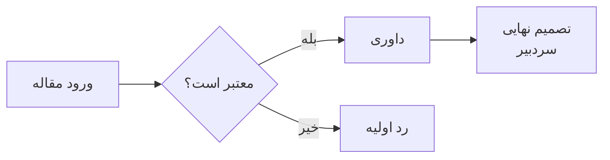

# Components reference

Every component is an HTML-like tag inside the Markdown. General rules (repeated from SKILL.md):

1. Always close tags: `<toc></toc>`, `<ref to="x"></ref>`. (`` and `<include ... />` are the exceptions shown below.)
2. Attribute values are quoted strings: `radius="6"`, `break="true"`.
3. When a tag contains Markdown (paragraphs, bold, lists, math blocks, headings), leave a blank line after the opening tag and before the closing tag.
4. Lengths: bare number = points (`"12"`); `pt`, `mm`, `cm`, `in`, `em` allowed; `%` only where noted.
5. Colors: a preset name or a hex string (see [Color presets](#color-presets)).
6. Tags nest freely.

Contents: [Standard Markdown](#standard-markdown) · [Footnotes](#footnotes-fn-and-markdown-footnotes) · [Tables](#tables) · [Lists](#lists) · [Numbered equations](#numbered-equations) · [Heading ids](#heading-ids-and-options) · [docheader](#docheader-title-block) · [picHeader](#picheader-picture-header) · [toc / lof / lot / lol](#toc-lof-lot-lol-contents-and-lists) · [alert](#alert-callout) · [box](#box-container) · [div](#div-container-with-tailwind-style-classes) · [Color presets](#color-presets) · [img](#img-image) · [fig + caption](#fig--caption-numbered-figure) · [cetz](#cetz-drawing) · [lilaq](#lilaq-data-plots) · [Mermaid diagrams](#mermaid-diagrams) · [tree](#tree-file-and-folder-tree) · [chart](#chart-data-chart) · [grid + item](#grid--item-columns) · [align](#align-alignment) · [dir](#dir-text-direction-of-a-part) · [cite + bibliography](#cite--bibliography-citations) · [ref](#ref-cross-reference) · [span / def](#marking-text-and-defining-terms-span-anchor-def) · [code](#code-code-listing) · [diff](#diff-code-and-text-comparison) · [a and links](#links-and-a) · [kbd + badge](#kbd--badge) · [steps + step](#steps--step-numbered-procedure) · [chat + user + ai](#chat--user--ai-ai-conversation) · [Theorem blocks](#theorem-blocks) · [include](#include-split-into-files)

---

## Standard Markdown

- Headings `##` to `######` (sections start at `##`), **bold**, *italic*, lists (`-`, `1.`), block quotes (`>`), horizontal rules (`---`), links, inline code, fenced code blocks, tables, inline math `$...$`, display math `$$...$$`.
- Block quotes get a colored bar on the start side (right for Persian).
- Fenced code blocks get line numbers. With a language (` ```python `) they also get a badge with the language name and icon. Aliases like `py`, `js`, `ts`, `sh`, `yml`, `md` work; an unknown language still shows its name.
- A ` ```mermaid ` block is not shown as code: it is drawn as a diagram (see [Mermaid diagrams](#mermaid-diagrams)).
- Numbered list items may use Persian digits (`۱.`, `۲)`); see [Lists](#lists).
- Pandoc-style citations `[@key]` also work, but prefer `<cite>`.
- Footnotes can be written using standard Markdown syntax or inline `<fn>` tags.
- Comments: `<!-- note -->` is removed before any other processing. It may sit mid-line or span lines (ends at the first `-->`; no nesting), so wrap a whole section in `<!--` … `-->` to switch it off: headings with `{#id}`, tables, components and `<include>` lines inside are ignored. A line holding only a comment disappears (a paragraph is not split). `<!--` inside fenced or inline code is plain text. Never write `-->` inside a comment you want to keep open. Use `<!--` for notes in the Markdown body; `#` comments belong to the YAML front matter only.

## Footnotes: `<fn>` and Markdown footnotes

```markdown
پاورقی معادل انگلیسی: <fn en="Artificial Intelligence">هوش مصنوعی</fn> و یادگیری ماشین<fn en="Machine Learning"></fn>.
پاورقی توضیحی فارسی: transformer<fn fa="معماری شبکه عصبی بر پایه خودتوجهی"></fn>.
پاورقی با متن دلخواه: <fn text="توضیحات تکمیلی">مفهوم</fn> یا پاورقی مستقل <fn>متن پاورقی</fn>.

پاورقی استاندارد Markdown: پاورقی فارسی[^fn-fa] و پاورقی انگلیسی[^fn-en].

[^fn-fa]: این یک پاورقی به زبان فارسی است.
[^fn-en]: This is an explanatory footnote in English.
```

| Tag / Syntax | Notes |
|--------------|-------|
| `[^label]` + `[^label]: ...` | Standard Markdown footnote. Definition appears at the bottom or anywhere in the file; multi-line continuations indented with 4 spaces or tab. |
| `<fn en="...">word</fn>` | Translation footnote in English (set LTR with Latin font). Body is optional. |
| `<fn fa="...">word</fn>` | Explanatory footnote in Persian (set RTL with Persian font). Body is optional. |
| `<fn text="...">word</fn>` | Footnote with arbitrary text, detecting direction automatically. Body is optional. |
| `<fn>body</fn>` | Direct inline footnote (alias: `<footnote>`). |

| Attribute | On | Values | Default |
|-----------|----|--------|---------|
| `en` | fn | English footnote text | none |
| `fa` | fn | Persian footnote text | none |
| `text` | fn | Custom footnote text | none |
| `dir` | fn | `rtl`, `ltr`, `auto` | `auto` |

- **Bidirectional numbers:** Footnote numbers automatically render with Persian digits (`۱`, `۲`, ...) in RTL context and Latin digits (`1`, `2`, ...) in LTR context.
- **Direction detection:** Footnote entries at the bottom of the page detect their own content direction, so English entries are left-aligned and Persian entries are right-aligned regardless of document direction.

## Tables

A plain Markdown table. Optionally, one `{...}` line directly above it (a blank line in between is allowed):

```markdown
{width=full caption="مقایسهٔ روش‌ها" #tbl-compare}
| روش | دقت | زمان |
|:----|:---:|----:|
| الف | ۹۵٪ | ۱۲ |
```

| Option | Values | Default |
|--------|--------|---------|
| `width` | `auto` = as wide as the content; `full` = the full text width | from `config.toml` `[table] width` |
| `align` | `center`, `left`, `right`, `start`, `end`: where an `auto`-width table sits | enclosing `<align>`, else `[table] align` |
| `caption` | Text above the table, quoted if it has spaces. Markdown and math inside it are not processed. | none |
| `#id` | Id for `<ref>` | none |
| `span` | `column` = stays in its text column; `all` = in a multi-column document, floats to the top or bottom of a page across all columns | `[table] span`, else `column` |
| `head-align` | Text alignment of the header row (`center`, `left`, `right`, `start`, `end`); overrides the `:---` / `---:` colons | the colons |
| `body-align` | The same for all other rows | the colons |

- Options are space-separated, in any order. Unknown options or values are errors.
- A table with `caption` or `#id` is numbered: «جدول ۱» or "Table 1", following the caption's language. Captioned tables appear in `<lot>`.
- Column alignment comes from the separator row: `:---` left, `---:` right, `:---:` center.
- Full-width tables size columns like a browser: narrow columns keep their width, wide ones share the rest and wrap.
- In cells: don't write a literal `|` (in math use `\mid`). For tall math like fractions use `$\displaystyle\frac{a}{b}$`.
- The table look (rules, frame, stripes) comes from the feel; you don't style tables.

## Lists

Bulleted (`-`, `*`, `+`) and numbered (`1.`, `1)`) Markdown lists. Numbered items may be written with Persian (or Arabic-Indic) digits; `۱.` and `۲)` make a real numbered list, exactly like `1.`:

```markdown
۱. جمع‌آوری داده
۲. پاک‌سازی داده
```

- Only `.` and `)` after the number make an item; `۱- item` is plain text.
- Two numbered lists separated only by a blank line merge into one (standard Markdown). Put a paragraph or a `{...}` line between them to keep them apart.
- How every list is numbered and bulleted comes from `[list]` in `config.toml` or front matter `list:` (numbers, prefix, suffix, marker, indent; see config.md). Default: Persian digits in a Persian list, Latin in an English one.

Optionally, one `{...}` line directly above a list (a blank line in between is allowed) sets options for that list:

```markdown
{numbers=abjad suffix=")" caption="مراحل داوری" #list-review}
1. خواندن مقاله
2. نوشتن گزارش
   - خلاصه
   - نقاط قوت و ضعف
3. ارسال تصمیم
```

| Option | Values | Default |
|--------|--------|---------|
| `numbers` | `auto`, `fa` (۱ ۲ ۳), `en` (1 2 3), `fatxt` (یک، دو، سه), `rome` (I II III), `abc` (a b c), `abjad` (الف ب ج د), `alefba` (الف ب پ ت) | `[list] numbers`, else `auto` |
| `prefix` | Text before the number: `"("` with `suffix=")"` gives «(۱)» | `[list] prefix`, else none |
| `suffix` | Text after the number: `"."`, `")"`, `"-"`, `":"`, `""` | `[list] suffix`, else `"."` |
| `marker` | Bullet: a character or `disc`, `circle`, `square`, `dash`, `triangle`, `arrow`, `check`, `star`, `none`; comma-separated = one per nesting level | `[list] marker` |
| `indent` | Extra indent: `2em`, `5mm` | `[list] indent` |
| `start` | First number (numbered lists only): `start=3` → «۳.», «ج)» | `1` |
| `caption` | Numbered caption below the list, quoted if it has spaces; Markdown inside is not processed | none |
| `#id` | Id for `<ref>`; numbers the list even without a caption | none |

- Options are space-separated, in any order, and also apply to lists nested inside. Unknown options, and `start` on a bulleted list, are compile errors.
- A list with `caption` or `#id` is a numbered block: «فهرست ۱: مراحل داوری» or "List 1: ...", following the caption's language. The list stays on the start side and can break across pages. `<ref to="list-review"></ref>` prints «فهرست ۱» / "List 1".
- The options cover the list up to the first line, after a blank line, that is neither indented nor a list item. A numbered list following after only a blank line merges into it and takes the same options.

## Numbered equations

```markdown
$$e^{i\pi} + 1 = 0$$ {#eq-euler}

$$
\sum_{k=1}^{n} k = \frac{n(n+1)}{2}
$$ {#eq-sum}

طبق <ref to="eq-euler"></ref> ...
```

- `{#id}` goes on the line with the closing `$$`. The number «(۱)» / "(1)" sits at the line end; `<ref>` prints «رابطهٔ (۱)» / "Equation (1)".
- Whether unlabelled equations are numbered too is a config setting (`[equation] numbering`).

## Heading ids and options

```markdown
## روش پیشنهادی {#sec-method}
## سپاسگزاری {numbering=false}
## جمع‌بندی {#sec-summary fill=true underline=false color=purple}
```

- `{#id}` at the end of the heading line gives it an id; it's not printed anywhere.
- Other keys override the heading look for that heading only: `numbering` (`true`/`false`), `number-prefix` / `number-suffix` (quoted text before / after the number), `underline` (`true`/`false`), `fill` (`true`/`false`), `color` (preset or hex). An unnumbered heading does not use up a number.
- Braces that contain anything other than `#id` and `key=value` stay in the title as text.
- A heading without `{#id}` can still be referenced by its automatic anchor (slug: lowercase, punctuation removed, spaces → `-`). Links inside the heading are left out of it: `### پلتفرم Papers With Code ([paperswithcode.com](https://paperswithcode.com))` → `<ref to="پلتفرم-papers-with-code">`, `<a href="#پلتفرم-papers-with-code">` or `[...](#پلتفرم-papers-with-code)`. The full slug, link text included, also works.

## `<docheader>`: title block

```markdown
<docheader title="عنوان اصلی *با تأکید*" subtitle="زیرعنوان یا نام نویسندگان" subtitle2="زیرعنوان دوم، کوچک‌تر"></docheader>
```

The attributes are shortcuts for `<title>` of size 1, 2, 3 (Markdown and `$math$` allowed). For side images, more lines, extra text and a frame use the tags:

```markdown
<docheader color="blue" border="lrtb" fill="true">

<main>

<l-img src="images/logo.svg" height="2.5cm" />

<r-img src="images/ocean.svg" width="3cm" />

<title size="1">

عنوان *اصلی*

</title>

<title size="2">

زیرعنوان

</title>

<title size="3">

خط کوچک‌تر و خاکستری‌تر

</title>

</main>

<info>

نویسنده — دانشگاه — ۱۴۰۵

</info>

</docheader>
```

| Tag / attribute | Notes |
|-----------------|-------|
| `<main>` | Optional wrapper for the titles and images; its children may sit directly in `<docheader>`. |
| `<l-img src width height radius />` / `<r-img ... />` | Image at the physical left / right edge (same in Persian and English). Default height `4em` when no width. Self-closing. |
| `<title size="1\|2\|3" color>` | One line; lines stack in order. `1` large + heading color, `2` medium + muted, `3` small + more gray. A one-line title is plain text; for Markdown or math write the tag on its own line with blank lines inside. |
| `<info>` | Ordinary Markdown below the titles, not centered (follows the text direction); put `<align>` inside it to center. |
| `color` (on `<docheader>`) | Tailwind color name, preset or hex for both line and fill (theme-aware). Only picks the color; nothing is drawn by it. `border-color` / `fill-color` override it separately. |
| `border` | Sides with a line, letters of `lrtb` (left, right, top, bottom); default none. Corners are rounded only with all four sides or no line. |
| `fill` | `true` / `false`; default `false`. |
| `radius`, `padding` | Frame rounding (the feel's value, square in `formal`) and inner space (`1em`). |

Use it once, at the top of the body, when there is no cover page (or in addition to it). In a multi-column document it spans all columns. Images wider than 30% of the line shrink on small pages.

## `<picHeader>`: picture header

A full-width image with a black-to-transparent gradient rising from the bottom, a large white title and an optional subtitle. Self-closing.

```md
<picHeader src="images/ocean.svg" title="Title" subtitle="Optional subtitle" height="60mm" />
```

| Attribute | Meaning | Default |
|-----------|---------|---------|
| `src` | Image path (required) | |
| `title` | Large white title (required) | |
| `subtitle` | Optional smaller line under the title | none |
| `height` | Height of the picture (`mm`, `cm`, `pt`, ...) | `60mm` |
| `break` | `false`: placed where it is written. `before`: starts a new page | `false` |
| `margin-x` | `true`: spans the text width. `false`: bleeds across the page margins, corners become square | `true` |
| `dir` | Direction of the title and subtitle: `auto` (default: the document's setting, else the title's first letter), `rtl`, `ltr` | `auto` |
| `margin-y` | Only with `break="before"`. `true`: sits at the top margin. `false`: sticks to the top edge of the page, top corners become square | `true` |

- Title and subtitle follow the direction of the title's first letter.
- With several columns, `margin-x="false"` is ignored (the picture fills its column).
- With `margin-y="false"` the picture covers the page header.

## `<toc>`, `<lof>`, `<lot>`, `<lol>`: contents and lists

```markdown
<toc depth="2" break="true"></toc>

<lof></lof>

<lot></lot>

<lol break="after"></lol>
```

| Attribute | Values | Default |
|-----------|--------|---------|
| `dir` | `rtl` (all entries RTL), `ltr`, `auto` (each entry follows its own title) | `rtl` |
| `title` | Any text | `<toc>`: «فهرست مطالب» (`Contents` when `dir="ltr"`); `<lof>`: «فهرست شکل‌ها» / "List of Figures"; `<lot>`: «فهرست جدول‌ها» / "List of Tables"; `<lol>`: «فهرست کدها» / "List of Listings" |
| `numbers` | `rtl` = Persian digits (lists: «شکل ۱»), numbers on the right; `ltr` = Latin digits ("Figure 1") on the left; `auto` = each entry follows its title / caption | `<toc>`: `rtl` (`ltr` when `dir="ltr"`); lists: `auto` |
| `depth` | `<toc>` only: number of heading levels listed, counted from the document's top level (headings from `##`: `1` = sections, `2` = + subsections) | all levels |
| `pages` | `true` = dot leaders + page numbers, `false` = titles only | `true` |
| `break` | `true` (own page), `before`, `after`, `false` | `false` |

- `<toc>` lists the headings. `<lof>` lists figures (`<fig>`, `<tree>`, `<chart>`) that have a caption; `<lot>` tables that have a caption; `<lol>` `<code>` listings that have a caption.
- For an English document use `<toc dir="ltr"></toc>`.
- To keep the lists together on their own page(s): `break="true"` on `<toc>` (or `before` on the first), nothing on the middle ones, `break="after"` on the last.

## `<alert>`: callout

```markdown
<alert type="warning">

**توجه:** این کار داده‌ها را پاک می‌کند.

</alert>
```

| Attribute | Notes |
|-----------|-------|
| `type` | `note` (purple, note icon), `info` (blue, circle-info), `tip` (teal, lightbulb), `success` (green, circle-check), `warning` (yellow, triangle-exclamation), `danger` (red, circle-xmark), `important` (pink, circle-exclamation). Without a type: neutral gray, no icon. |
| `color` | Preset name or hex; overrides the type's color. |
| `icon` | A Font Awesome icon name (e.g. `rocket`, `heart`); overrides the type's icon. |
| `radius` | Corner radius as a **plain number** (`"6"`, not `"6pt"`). Default from the feel. |

The icon sits on the start side. Background, border and icon colors adapt to the theme.

## `<box>`: container

```markdown
<box color="blue">

متن داخل یک کادر آبی.

</box>

<box color="#e0efff" border="1" border-color="#2b8cc4" radius="6" padding="10pt">

Exact colors.

</box>
```

| Attribute | Default |
|-----------|---------|
| `color` | Background: preset or hex. Default transparent. |
| `border` | Border width: `0.6` when `color` is a preset, otherwise `0` (none). |
| `border-color` | Preset or hex. Default: the preset's hue, else the theme's rule color. |
| `radius` | Corner radius. Default from the feel. |
| `padding` | Inner spacing. Default `8pt`. |

A box takes the full available width; its height follows the content.

## `<div>`: container with Tailwind-style classes

```markdown
<div tailwind="p-4 bg-blue rounded-lg border border-blue">

متن داخل یک کارت آبی.

</div>

<div tailwind="flex items-center justify-between gap-4 p-3 border-b">

<div tailwind="font-bold">عنوان</div>

<div tailwind="ml-auto px-2 bg-green rounded">جدید</div>

</div>
```

`tailwind` is a space-separated list of Tailwind-like classes. Block syntax: opening tag on its own line, blank lines inside. A `<div>` fills the available width; nest `<div>`s for rows and columns. Optional `dir="auto|rtl|ltr"` as on `<grid>`.

| Group | Classes |
|-------|---------|
| Display | `block`, `flex`, `inline-block`, `inline-flex` (shrink to content), `hidden` |
| Flex container | `flex-row`, `flex-row-reverse`, `flex-col`, `flex-col-reverse`, `flex-wrap`, `flex-wrap-reverse`, `flex-nowrap` |
| Alignment | `justify-start/end/center/between/around/evenly`, `items-start/end/center/stretch/baseline`, `content-*` (wrapped lines, needs `h-*`), `self-*` |
| Flex item | `flex-1`, `flex-auto`, `flex-initial`, `flex-none`, `grow`, `grow-0`, `shrink`, `shrink-0`, `basis-*`, `order-N`, `order-first`, `order-last` |
| Gap | `gap-N`, `gap-x-N`, `gap-y-N`, `space-x-N`, `space-y-N` |
| Padding / margin | `p-N`, `px-`, `py-`, `pt-` `pb-` `pl-` `pr-` `ps-` `pe-`; same with `m-`; `-mt-2`; `mx-auto`, `ml-auto` |
| Size | `w-N`, `w-1/2`, `w-full`, `w-fit`, `h-N`, `max-w-md` (`xs` to `7xl`, `prose`) |
| Colors | `bg-*`, `text-*`, `border-*` with a preset (`blue`), shade (`blue-200`), percent (`blue/20`), theme color (`accent`, `muted`, `secondary`, `rule`, `fg`, `heading`, `code`) or `[#hex]` |
| Text | `text-xs`..`text-9xl`, `text-[14pt]`, `font-thin`..`font-black`, `font-mono`, `italic`, `underline`, `line-through`, `leading-*`, `tracking-*`, `text-left/center/right/start/end/justify` |
| Border / rounding | `border`, `border-2`, `border-t/b/l/r/x/y/s/e`, `border-dashed`, `border-dotted`, `rounded`, `rounded-sm/md/lg/xl/2xl/3xl/full/none`, `rounded-t-lg`, `rounded-tl`, `rounded-s`, `rounded-[8pt]`, `overflow-hidden` |
| Variants | `dark:`, `light:`, `rtl:`, `ltr:`, `formal:`, `standard:`, `friendly:` before any class |

- Spacing is `0.25em` per step (`p-4` = `1em`) and follows `scale`; `[...]` takes any length (`p-[10pt]`).
- A color name without a shade is the same theme-aware tint as `<box color>`; a shade (`bg-blue-100`) is exactly Tailwind's color (the mirrored shade on a dark theme); `/N` mixes that percent into the page color (text color for `text-*`). `white` is the page color, `black` the text color.
- Rounding scales the feel's box radius, so `formal` stays square whatever the class says.
- Every nested `<div>` and every run of content between blank lines is one flex item. Items start at their content width and shrink when the row is too narrow; `flex-col` without `h-*` is normal flow and breaks across pages.
- An unknown class is a compile error naming it. Grid classes and shadows are not supported; use `<grid>`.
- In a `flex-col` text lines stack with no extra leading, so add `gap-1` or more between text items.

## Color presets

The whole Tailwind palette: `slate`, `gray`, `zinc`, `neutral`, `stone`, `red`, `orange`, `amber`, `yellow`, `lime`, `green`, `emerald`, `teal`, `cyan`, `sky`, `blue`, `indigo`, `violet`, `purple`, `fuchsia`, `pink` and `rose`. A name alone is the 500 shade; a shade (`blue-200`, `50` to `950`) names that exact one (only `<div tailwind>` uses it as is, on a dark theme the mirrored shade). Accepted by `color` / `border-color` on `<box>`, `color` on `<alert>`, `<badge>` and `<steps>`, and by heading `color`. Presets are tinted to match the active theme (light or dark), so they always look right; hex colors are used as given on light themes and softened on dark ones. An unknown name is an error.

## ``: image

```markdown

```

| Attribute | Notes |
|-----------|-------|
| `src` | Required. Path relative to the project folder. No URLs. PNG, JPG or SVG. |
| `alt` | Alternative text. |
| `width`, `height` | Size (length or `%`). |
| `radius` | Corner rounding. Default from the feel. `50%` on a square image makes a circle. |
| `span` | `column` (default) or `all`: in a multi-column document, across all columns at the top or bottom of a page. Inside a `<fig>`, put it on the `<fig>`. |

`` needs no closing tag. Use it alone or inside `<fig>`. Markdown image syntax `` also works for a plain image.

## `<fig>` + `<caption>`: numbered figure

```markdown
<fig id="fig-arch" height="6cm">

<caption>معماری کلی سامانه.</caption>
</fig>
```

| Attribute | Notes |
|-----------|-------|
| `id` | Id for `<ref>`. |
| `align` | `center` (default, or the enclosing `<align>`), `left`, `right`, `start`, `end`. |
| `width`, `height` | Size of the image or drawing. `%` width is relative to the text width. |
| `ratio` | `16/9`, `16:9` or `1.5`: crops the image to that ratio (images only). |
| `span` | `column` (default) or `all`: in a multi-column document, the figure goes across all columns, at the top or bottom of a page; a `%` width is then relative to the full text width. Use it for wide figures in two-column papers. |

- Instead of ``, a `<fig>` can hold a `<cetz>` drawing or a ` ```mermaid ` block (with blank lines around the block). A `<cetz>` drawing in a `<fig>` is never wider than the line and `width` / `height` only shrink it; a Mermaid diagram is sized like an image (enlarged or shrunk).
- `<caption>` is optional; Markdown inside it is not processed. The label follows the caption's language: «شکل ۱» / "Figure 1". Captioned figures appear in `<lof>`.
- Two figures side by side: put each `<fig>` in an `<item>` of a `<grid cols="2">`.

## `<cetz>`: drawing

Draws a diagram from CeTZ drawing code placed in a ` ```typ ` fenced block inside the tag, usually inside a `<fig>`:

````markdown
<fig id="fig-axes" height="4cm">
<cetz unit="1cm">

```typ
line((-1.5, 0), (1.5, 0), mark: (end: ">"))
line((0, -1.5), (0, 1.5), mark: (end: ">"))
circle((0, 0), radius: 1, stroke: theme.accent)
content((1.2, 1.2), [نقطهٔ $P$])
```

</cetz>
<caption>یک دایره روی محورها.</caption>
</fig>
````

| Attribute | Notes |
|-----------|-------|
| `unit` | Length of one coordinate unit. Default `1cm`. |
| `src` | Load the drawing code from a file instead of the block. |

- Available without imports: `line`, `rect`, `circle`, `arc`, `bezier`, `content`, `grid`, `group`, `set-style`, and the rest of the CeTZ drawing functions, plus `let`, `for`, `calc.*`, `$math$` and `text(...)[...]`.
- Math in labels is written in **LaTeX**, as in the text: `content((0.7, 0.3), [کاشی‌های $B_r \times B_c$])`, `content((0, 0), $\frac{a}{b}$)`. Use `\$` for a literal dollar sign in a label.
- Label text is Typst markup, but Markdown habits are accepted: `[**bold**]` is bold, `[صفحهٔ #۰۳]` prints the `#`. Use `#name(...)` only to call a function, e.g. `[#text(fill: theme.accent)[...]]`.
- Labelled boxes: don't put a `content` on top of a fixed-size `rect`; long text spills out. Let the label draw its own frame so it grows with the text, and connect arrows to its anchors:
  ```typ
  content((0, 1.6), box(width: 2.8cm, align(center)[ضرب ماتریسی]), name: "mm",
    frame: "rect", padding: (x: 0.2, y: 0.15), fill: theme.bg, stroke: 0.8pt + theme.rule)
  content((0, 0), box(width: 2.8cm, align(center)[جمع سوگیری]), name: "bias",
    frame: "rect", padding: (x: 0.2, y: 0.15), fill: theme.bg, stroke: 0.8pt + theme.rule)
  line("mm.south", "bias.north", mark: (end: ">", fill: theme.fg))
  ```
  Several lines in one frame: `box(width: 5cm, stack(spacing: 0.8em, align(center)[...], align(center)[...]))`.
- Persian diagrams read right to left: put the first step on the right and point arrows leftwards.
- Don't give `height` to a `<fig>` that holds a drawing unless it is too big: it shrinks the whole drawing, text included. Size the drawing with `unit` and its coordinates instead.
- Colors: use `theme.fg`, `theme.bg`, `theme.accent`, `theme.heading`, `theme.muted`, `theme.rule` rather than fixed hex, so drawings work on dark themes. Default strokes already use `theme.fg`.
- Each `content(...)` label gets its own direction from its first letter.
- Inside `<fig>`, `width`/`height` are maximums (a large drawing shrinks to fit; a small one keeps its size). Outside `<fig>` it is centered at natural size.
- Use drawings only for real diagrams; for an existing picture use ``. For standard diagram types (flowchart, sequence, class, state, ER, pie), a Mermaid block is usually quicker.

## `<lilaq>`: data plots

For plots of data (axes, ticks, grid, filled areas, scatter, bars) use [Lilaq](https://typst.app/universe/package/lilaq) 0.6.0 instead of `<cetz>`. Put the code in a fenced code block inside the tag. The block is Typst code and its last expression must be an `lq.diagram(...)`:

````markdown
<lilaq>

```typ
let xs = range(0, 17).map(i => i * 1000)
let ys = (1.45, 1.45, 0.37, 0.84, 0.92, 1.07, 1.27, 1.14, 1.15, 1.25, 1.4, 1.39, 1.37, 1.36, 1.38, 1.43, 1.45)
lq.diagram(
  title: strong[Syscall impact on user-mode IPC],
  xlabel: [Time (in cycles)], ylabel: [User-mode IPC],
  width: 11cm, height: 5cm,
  xaxis: (exponent: none),
  lq.fill-between(xs, ys, y2: xs.map(_ => 1.45), fill: theme.accent.transparentize(45%)),
  lq.plot(xs, ys, color: theme.fg, stroke: 1.6pt),
  lq.place(8800, 0.62, [Lost performance], align: left),
)
```

</lilaq>
````

| Attribute | Notes |
|-----------|-------|
| `src` | Load the code from a file (`src="plots/x.typ"`) instead of the code block. |

- **Scope:** `lq` (the Lilaq module, also `lilaq`), the active `theme` dictionary and `zoom` are available without importing. Everything in the [Lilaq documentation](https://lilaq.org) works: `lq.plot`, `lq.scatter`, `lq.bar`, `lq.fill-between`, `lq.hlines`, `lq.place`, `lq.colormesh` and so on.
- **Theme-aware:** text, axis lines and ticks use the theme's text color, the grid uses its rule color, so plots stay visible on dark themes. Colors you pass yourself should come from `theme` too (`theme.accent`, `theme.fg`, ...).
- **LaTeX math in labels** works as in `<cetz>`: `[$B_r \times B_c$]`.
- **Inside `<fig>`** a plot behaves like a drawing: it supports `id`, `align` and a caption, and a plot wider than the line is shrunk to fit. On its own it is centered.
- **Plot or drawing?** Lilaq draws data with real axes. For boxes, arrows and hand-placed shapes use `<cetz>`; for a quick bar, line or pie chart from a table use `<chart>`.
- **Gotchas:** `range` takes a named step (`range(0, 10, step: 2)`), and `lq.place(x, y, ...)` uses data coordinates. Typst fetches the package on the first build, so that build needs internet access.

## Mermaid diagrams

A fenced ` ```mermaid ` block anywhere in the document is drawn as a diagram. Inside a `<fig>` it becomes a numbered figure:

````markdown
<fig id="fig-review">



<caption>روند بررسی مقاله.</caption>
</fig>
````

- **Alone:** placed like other blocks, centered (or on the side of the enclosing `<align>`).
- **Size options** on the fence line: ` ```mermaid width=60% ` or ` ```mermaid height="4cm" ` (same units as ``: `%` of the line width, `cm`, `mm`, `pt`, `em`, bare number = points). The diagram is sized exactly like an image, enlarged or shrunk, text included; with both it fits inside that box, keeping its proportions, no cropping. Only `width` and `height` are allowed; anything else is an error.
- **Without a size:** natural size (labels 12pt, pie title 15pt, both follow `scale`), shrunk to the line width if wider.
- **In `<fig>`:** `id`, `align`, `span="all"` and `<caption>` work as for images. The `<fig>`'s `width` / `height` size the diagram the same way as the fence options and win over them; `ratio` is ignored. Leave a blank line before and after the code block.
- **Corners** follow the feel: square in `formal`, slightly rounded in `standard`, clearly rounded in `friendly` (nodes, subgraphs, actors; edge labels like badges). Round `A(...)` and stadium `A([...])` nodes keep their own shape.
- **Colors** come from the theme automatically (nodes = light accent tint, lines = muted, subgraphs = code background, notes = secondary tint, pie slices = accent/secondary tints). `%%{init: ...}%%` theme settings are replaced by the template theme, so leave them out; also avoid fixed colors (`style`, `classDef`), which don't adapt to dark themes.
- **Persian labels:** quote any label with Persian text or spaces (`A["ورود مقاله"]`, edge labels `-->|بله|`). Long labels wrap automatically, each line right to left in the Persian font. `<br>` inside a quoted label forces a break.
- **Types:** `flowchart` / `graph` (`TD`, `LR`, ...), `sequenceDiagram`, `classDiagram`, `stateDiagram-v2`, `erDiagram`, `pie`, `gantt`, `mindmap` and the rest of what the renderer (mmdr) supports.
- **Limitations:**
  - The layout is mmdr's, not mermaid.js's; positions differ from the Mermaid Live Editor and not every Mermaid feature works.
  - Wide diagrams (long `LR` chains, sequence diagrams with many participants) shrink to the line width and their text gets small: prefer `TD`, short labels, or `span="all"` in two-column documents.
  - Some edge labels have no background box; mindmaps keep their own colors.
  - Syntax errors are not reported: the diagram comes out empty or incomplete. Keep the syntax simple and standard.

## `<tree>`: file and folder tree

Draws a folder structure from a fenced code block (any language or none) inside the tag, one file or folder per line, nested by indentation:

````markdown
<tree caption="ساختار پروژه" id="fig-tree">

```text
formatex/
  main.typ        # نقطهٔ ورود
  docs/
    doc_fa.md
  images/
    logo.png
  references.bib
```

</tree>
````

| Attribute | Notes |
|-----------|-------|
| `src` | Read the listing from a file (path relative to the project folder) instead of the code block. |
| `icons` | `true` (default) or `false`. Without icons, folders show a trailing `/`. |
| `caption` | Numbered caption below: «شکل ۱» / "Figure 1" by the caption's language. Listed in `<lof>`. No Markdown inside. |
| `id` | Id for `<ref>` (numbered even without a caption). |
| `span` | `column` (default) or `all`: across all columns in a multi-column document. |

- Blank lines around the code block (after the opening tag, before the closing tag).
- Indentation nests a line under the line above; a tab = 4 spaces. A name ending in `/` is a folder, and so is any line with indented children; the `/` is not printed.
- `name  # note` adds a muted note after the name.
- Output pasted from the `tree` command works unchanged: the `│ ├── └──` drawing (or ASCII `|`, `+--`, `\--`, `` ` ``) counts as indentation.
- Looks like a code block (code background, border, feel corners), code font, connector lines (rounded elbows, square in `formal`). Folders are bold with an accent folder icon (open when it has children); files get an icon by extension (programming languages, images, PDF, archives, CSV, text, `.bib`, `.lock`, video, audio, Office; `.git*` / `.env*` get a gear). Always laid out left to right, like code.

## `<chart>`: data chart

Draws a bar, line, pie or donut chart from a Markdown table inside the tag: the first column holds the category labels, the header row the series names, each other column is one series:

```markdown
<chart caption="تعداد دانشجویان ورودی" id="fig-chart-bar" y-title="نفر" values="true">

| رشته | ۱۴۰۲ | ۱۴۰۳ | ۱۴۰۴ |
|------|------|------|------|
| کامپیوتر | ۱۲۰ | ۱۴۵ | ۱۶۰ |
| برق | ۹۰ | ۸۵ | ۹۵ |

</chart>

<chart type="donut" caption="Time spent" values="true" unit="h" dir="ltr">

| Task | Hours |
|------|-------|
| Coding | 14 |
| Writing | 9 |
| Meetings | 4 |

</chart>
```

| Attribute | Notes |
|-----------|-------|
| `type` | `bar` (default), `line`, `pie`, `donut`. Pie / donut take exactly one value column; values ≥ 0, total > 0. |
| `src` | CSV file with the same layout (first row = header) instead of the table. |
| `values` | `false` (default) / `true`: print values on bars and points; on pie / donut also in the legend, and a donut shows the total in its centre. Slices of 22° or more always show their percentage. |
| `legend` | `auto` (default: shown for pie / donut or more than one series), `true`, `false`. |
| `unit` | Suffix for values and axis ticks (`%`, `h`, ...). In RTL charts `%` becomes `٪` and digits are Persian. |
| `width` | Length or `%`. Default `100%`. |
| `height` | Bare number (points) or length. Default `150` for pie / donut, `170` otherwise. |
| `x-title`, `y-title` | Axis titles (bar / line); the y title is rotated. |
| `min`, `max` | Fix the value axis range; otherwise a round scale is chosen (bar charts always include 0). |
| `colors` | Comma-separated presets, `accent` or hex `#rrggbb`, one per series (per slice on pie / donut), cycled. Default: theme accent, teal, pink, yellow, purple, green, red, blue. |
| `dir` | `auto` (default: from the caption, else the labels; follows the `dir` setting and `<dir>`), `rtl`, `ltr`. In RTL categories run right to left and pies go counter-clockwise. |
| `caption` | Numbered caption below: «شکل ۱» / "Figure 1". Listed in `<lof>`. No Markdown inside. |
| `id` | Id for `<ref>` (numbered even without a caption). |
| `span` | `column` (default) or `all`. |

- **Blank line after the opening tag and before the closing tag**, or the table is not parsed.
- Numbers may use Persian / Arabic digits, `٫` decimals, `,` / `٬` thousands separators and `%` / `٪` (stripped). An empty cell is a missing value (skipped).
- The look follows the feel: `formal` uses a sober palette (accent shades alternating with greys), square bars, outlined square markers, thin lines, a y-axis line, and sharp pie/donut slices with hairline gaps; `standard` uses the colorful palette, slightly rounded bar tops, small square markers, and slices with small gaps and slightly rounded corners; `friendly` uses the colorful palette, rounded bars, round markers and legend swatches, and slices with wide gaps, rounded corners and a thinner donut ring. Colors adapt to dark themes; slice percentages pick dark or light text for contrast; `colors` overrides the palette in any feel.
- Use a chart for real numeric data; for flowcharts and other diagrams use Mermaid, for a plain table of numbers keep the Markdown table.

## `<grid>` + `<item>`: columns

```markdown
<grid cols="2" gap-x="12pt">
<item>

ستون اول.

</item>
<item>

ستون دوم.

</item>
</grid>
```

| Attribute | On | Default |
|-----------|----|---------|
| `cols` | grid | `2` |
| `gap-x`, `gap-y` | grid | `1em` |
| `dir` | grid: `rtl`, `ltr`, `auto` | `auto` (from the content) |
| `span` | grid: `column`, `all` (multi-column documents: across all columns, at the top or bottom of a page) | `column` |
| `span` | item: number of columns it covers | `1` |
| `width` | item: `fill` (the box is as wide as the cell) or `auto` (as wide as its content) | `fill` |
| `height` | item: `fill` (the box is as tall as the row) or `auto` (as tall as its content) | `fill` |
| `halign` | item: `start`, `center`, `end` (also `left`, `right`) | surrounding alignment |
| `valign` | item: `start` (top), `center`, `end` (bottom) | `start` |

Items fill row by row, starting top-right in RTL and top-left in LTR. An item that doesn't fit the rest of a row moves to the next row.

- `width`, `height`, `halign` and `valign` act on the `<box>` or `<alert>` inside the item. By default boxes fill their cells, so boxes side by side get equal height; that is usually what you want.
- `halign` / `valign` only matter with `auto` (a box smaller than its cell): 3 × 3 positions. The text inside the box keeps its own alignment.
- Example: `<item width="auto" height="auto" halign="center" valign="center">` puts a small box in the middle of its cell.

## `<align>`: alignment

```markdown
<align>

این پاراگراف وسط‌چین است.

</align>

<align to="left">

Left-aligned, even if it is Persian.

</align>
```

- `to`: `center` (default), `left`, `right` (physical sides), `start`, `end` (follow each paragraph's direction). The value may also be a bare attribute: `<align right>`.
- Affects paragraphs, headings, lists, images, grid cells, the text inside alerts, boxes and theorem blocks, auto-width tables and figures. Code blocks stay left-aligned. It never changes text direction (use `<dir>` for that).

## `<dir>`: text direction of a part

```markdown
<dir to="ltr">

این پاراگراف فارسی از چپ به راست چیده می‌شود.

</dir>

<dir rtl>

This English paragraph is laid out right to left.

</dir>
```

- `to`: `auto` (default), `rtl`, `ltr`. The value may also be a bare attribute: `<dir rtl>`.
- `rtl` / `ltr` force that direction on everything inside, whatever its language: paragraphs, headings, lists, tables and cells, quotes, captions, alerts, boxes, steps, badges. Code stays LTR; `<cetz>` labels, Mermaid diagrams and `<kbd>` keep their own direction.
- `auto` brings back per-block detection (first letter) inside a document whose `dir` setting is `rtl` or `ltr` (config.md).
- Write it like `<align>`: tag on its own line, blank line, content, blank line, closing tag. Tags nest; the innermost wins.
- The page header, footer and cover are not affected; they follow only the document's `dir`.
- For a single paragraph, rephrasing or an RLM/LRM mark is usually enough; use `<dir>` for longer parts, e.g. a Persian section full of lines that start with English terms (`<dir rtl>`), or an English abstract inside a `dir: rtl` document (`<dir ltr>` or `<dir auto>`).

## `<cite>` + `<bibliography>`: citations

```markdown
ترنسفورمرها بر پایهٔ توجه‌اند <cite key="vaswani2017attention"></cite>.
چند منبع <cite key="knuth1984texbook, vaswani2017attention"></cite>.
با شمارهٔ صفحه <cite key="knuth1984texbook" page="ص. ۱۲"></cite>.
As <cite key="vaswani2017attention" form="prose"></cite> showed ...

<bibliography></bibliography>
```

| Attribute | On | Notes |
|-----------|----|-------|
| `key` | cite | BibTeX key(s), comma-separated. Must exist in the `.bib` file. |
| `page` | cite | Text added inside the brackets: `[2, ص. ۱۲]`. |
| `form` | cite | `normal` (default, e.g. `[2]` in IEEE style), `prose` (author name in the sentence), `author`, `year`, `full`. |
| `file`, `style`, `title`, `dir` | bibliography | Override the front matter `bibliography:` settings for this list. |

- Exactly one `<bibliography></bibliography>`, at the end of the document. Only cited entries are listed.
- If you write the `.bib` file too: standard BibTeX (`@article`, `@inproceedings`, `@book`, `@misc` with `url`, ...). Keys are free-form, e.g. `hewitt1977viewing`.

## `<ref>`: cross-reference

```markdown
طبق <ref to="thm-main"></ref> و <ref to="fig-arch"></ref>، در <ref to="sec-method"></ref> ...
<ref to="thm-main">این قضیه</ref>
```

- Targets: headings with `{#id}`, `<fig id>`, tables with `#id`, lists with `#id`, equations with `{#id}`, `<code id>`, `<diff id>`, theorem blocks with `id`.
- Printed text follows the language of the surrounding paragraph: «شکل ۱», «جدول ۲», «فهرست ۱», «رابطهٔ (۳)», «بخش ۴», «قضیه ۵», «کد ۱», «تغییرات ۱» or "Figure 1", "Table 2", "List 1", "Equation (3)", "Section 4", "Theorem 5", "Listing 1", "Diff 1".
- Text inside the tag replaces the generated label; the link still works.
- A heading without an id can be referenced by its exact text (`to="روش پیشنهادی"`), but an id is more robust.

## Marking text and defining terms: `<span>`, `<anchor>`, `<def>`

```markdown
یک <span id="term-ai">هوش مصنوعی</span> یا [شبکه‌های پیچیده]{#term-net} داخل پاراگراف. ارجاع: <ref to="term-ai"></ref>.

ما از <def id="term-ai" color="teal">شبیه‌سازی هوش انسانی</def> استفاده می‌کنیم.

<def id="fig-ocean" mode="block" title="اقیانوس" color="blue">
توضیح تعریف در یک بلوک.
</def>
```

- `<span highlight="true">text</span>` highlights text (`highlight` = `true` for yellow, a color preset, Tailwind name or hex; works with or without `id`; follows line breaks; the Markdown form takes it too: `[text]{highlight=green}`, `[text]{#x highlight=true}`). `<span id="x">text</span>` and the Markdown form `[text]{#x}` mark a piece of text inside a paragraph as a reference target; `<anchor id="x">` is the same (`name` works instead of `id`). `<ref to="x"></ref>` then shows that text as a link. `{#...}` inside fenced code is left alone.
- `<def>` shows a reference to any element with an id (heading, figure, table, equation, theorem, listing, diff, text fragment) together with a definition: `mode="inline"` (default) is a small badge inside the sentence, `mode="block"` is an icon and title above the body. An unknown `id` is a compile error.

| Attribute | Notes |
|-----------|-------|
| `id` (or `to`) | Required. The element it refers to. |
| `mode` | `inline` (default) or `block`. |
| `title` | Bold title; Markdown allowed. Default: the generated reference text («شکل ۱»), else the id. |
| `color` | Color preset, `accent` (default), `secondary`, `heading`, `muted` or hex. |
| `icon` | Font Awesome name; default `circle-question`. |
| `dir` | `rtl`, `ltr` or `auto` (default). |

## `<code>`: code listing

````markdown
<code src="examples/sample.py" lines="6-16" highlight="9-10,15" caption="فیبوناچی با حافظه" id="code-fib"></code>

<code highlight="2" caption="تعریف یک بازیگر" id="code-actor">

```python
class Actor:
    def receive(self, msg): ...
```

</code>
````

| Attribute | Notes |
|-----------|-------|
| `src` | File to load (relative to the project folder). Without it, the fenced block inside the tag is used. |
| `lang` | Highlighting language. Default: the file extension or the fence language. |
| `lines` | `10-20`: show only these lines; line numbers keep the file's numbering. |
| `highlight` | `3` or `3,7-9`: lines drawn with a tinted band (shown line numbers). |
| `caption` | Numbered caption above: «کد ۱: ...» / "Listing 1: ...". Not processed as Markdown. |
| `id` | Id for `<ref>`; numbers the listing even without a caption. |
| `span` | `column` (default) or `all`: in a multi-column document, across all columns at the top or bottom of a page. Use it for long code lines in two-column papers. |

A plain fenced block is enough for code that needs no caption, number, range or highlight.

## `<diff>`: code and text comparison

Give the two versions; the template finds the changes itself:

````markdown
<diff caption="مقایسهٔ فاکتوریل بازگشتی و تکراری" id="diff-fact">
<before title="بازگشتی (قدیم)">

```python
def fact(n):
    if n <= 1:
        return 1
    return n * fact(n - 1)
```

</before>
<after title="تکراری (جدید)">

```python
def fact(n):
    res = 1
    for i in range(2, n + 1):
        res *= i
    return res
```

</after>
</diff>

متن با تغییرات درون‌خطی: این مقدار <del>قدیمی</del> به <ins>جدید</ins> تغییر یافت.
````

- **Automatic diff:** `<before>` (alias `<old>`) and `<after>` (alias `<new>`) each hold a fenced code block, or `src="file"` (language from the extension). A line-by-line LCS diff (trailing spaces ignored) finds unchanged, removed (red) and added (green) lines. Never mark lines with `+` / `-`; there is no ```` ```diff ```` patch input. Exactly one `<before>` and one `<after>` (otherwise a compile error).
- **Blank lines** after the `<before>` / `<after>` opening tag and before its closing tag (Markdown inside a tag).
- **`mode="split"`** (default): side by side in one frame, halves joined by a thin divider, each with its own line numbers. Rows are equally tall on both sides (long lines wrap, the other side grows). Removed lines tinted red on the old side, added green on the new side; a changed block's removed and added lines share rows, the shorter side padded with empty, faintly hatched cells. Header row: titles with − / +. RTL: old version on the right (read first); LTR: on the left.
- **`mode="unified"`:** looks like an ordinary code block (left-aligned, same background, language badge top right, highlighting) with two line-number columns (old, new) and a sign column; removed rows red with −, added rows green with +.
- **Inline:** `<del>` = red tinted badge with strikethrough; `<ins>` = green tinted badge with underline.

| Attribute | On | Values | Default |
|-----------|----|--------|---------|
| `mode` | diff | `split`, `unified` (other values: compile error) | `split` |
| `lang` | diff | Highlighting language; overrides the fence/extension | fence of `<before>`, else `<after>` |
| `caption` | diff | Numbered caption «تغییرات ۱: ...» / "Diff 1: ..." | none |
| `id` | diff | Id for `<ref>` («تغییرات ۱» / "Diff 1") | none |
| `dir` | diff | `rtl`, `ltr`, `auto`: side order and default titles | `auto` |
| `span` | diff | `column`, `all` (across all columns) | `column` |
| `title` | before, after | Header title (split mode) | «نسخه قبل» / «نسخه بعد» or "Before" / "After", by direction |
| `src` | before, after | File to compare; language from its extension | none |

- Corners follow the feel's code-block radius (`feel.code`; square in `formal`). Colors come from the theme's red/green presets (light and dark themes).

## Links and `<a>`

```markdown
[مستندات Typst](https://typst.app/docs) یا <https://typst.app>
<a href="https://github.com/typst/typst">مخزن Typst</a>
<a href="#sec-method">بخش روش</a>
```

- Web links are colored, underlined and get a link icon.
- `<a href="#id">` links to an id in the document (heading, figure, table, code, equation), styled like `<ref>`.
- An empty `<a href="..."></a>` shows the address.

## `<kbd>` + `<badge>`

```markdown
برای ذخیره <kbd>Ctrl+S</kbd> را بزنید.
<badge color="green" icon="circle-check">پایدار</badge> <badge color="yellow">beta</badge> <badge>خنثی</badge>
```

- `<kbd>`: each `+`-separated key is drawn as a key cap; the shortcut always reads left to right.
- `<badge>`: small inline label. `color` = preset or hex (default neutral gray); `icon` = Font Awesome name; `size` = text size (default `1em` = same as the sentence, `0.8em` = a little smaller).

## `<icon>`

```markdown
انجام شد <icon name="check" color="green" /> و <icon name="triangle-exclamation" color="orange" size="1.3em" /> هشدار.
```

- Font Awesome icon inside a sentence. `name` (required); `color` = preset, Tailwind name or hex (default: surrounding text color); `size` (default `1em`); `solid="true"` for the solid style. The line height never changes.

## `<v>` + `<pagebreak>`

```markdown
<v size="2cm" />

<pagebreak />
<pagebreak to="odd" />
```

- `<v size="1em" weak="false" />`: vertical gap, on its own line. `size` is a length; `weak="true"` drops it at a page edge and next to other spacing.
- `<pagebreak weak="false" to="" />`: new page. `weak="true"` skips it on an empty page; `to="odd"` / `"even"` continues on the next odd or even page (may leave a blank one).

## `<steps>` + `<step>`: numbered procedure

```markdown
<steps>
<step title="جمع‌آوری داده">

داده‌ها از سه منبع گردآوری می‌شوند.

</step>
<step title="پاک‌سازی">

رکوردهای تکراری حذف می‌شوند.

</step>
</steps>
```

| Attribute | On | Notes |
|-----------|----|-------|
| `title` | step | Bold title next to the marker (optional). |
| `start` | steps | First number. Default `1`. |
| `color` | steps | Preset or hex. Default from the theme. |
| `dir` | steps | `rtl`, `ltr`, `auto` (default, from the content). |

Markers sit on a vertical line on the start side. A step body may contain lists, code, alerts.

## `<chat>` + `<user>` + `<ai>`: AI conversation

```markdown
<chat title="مرور ادبیات">

<user>

برای مرور ادبیات پایان‌نامه‌ام از کجا شروع کنم؟

</user>

<ai>

سه قدم اول:

1. **کلیدواژه‌ها** را از سؤال پژوهش دربیاورید.
2. منابع را با `Zotero` مدیریت کنید.

</ai>

</chat>
```

| Attribute | On | Values | Default |
|-----------|----|--------|---------|
| `style` | chat | `auto`, `transcript` (named turns with a bar on the start side), `assistant` (ChatGPT-like: your message in a bubble at the end side, the answer full width beside an avatar), `bubbles` (messenger: both sides in bubbles with avatars) | `auto` = from the feel: `formal` → `transcript`, `standard` → `assistant`, `friendly` → `bubbles` |
| `user-name` / `ai-name` | chat | Name over the messages | «شما» / "You", «هوش مصنوعی» / "AI" (by the chat's language) |
| `user-icon` / `ai-icon` | chat | Font Awesome name | `user` / `robot` |
| `user-color` / `ai-color` | chat | Preset or hex | Theme accent / secondary color |
| `frame` | chat | `true`, `false` | `true` (rules above and below in `formal`, a rounded panel otherwise) |
| `title` | chat | Heading with a chat icon above the messages | none |
| `width` | chat | Widest a bubble gets: `"80%"` of the line or a length (`"12cm"`) | `80%` |
| `dir` | chat | `rtl`, `ltr`, `auto` | `auto` = from the first message |
| `name` / `icon` | user, ai | Overrides the name / icon for this message only | the chat's |

- Every `<chat>` attribute can also be set in `[chat]` in `config.toml` or a `chat:` map in front matter (see config.md); attributes on the tag win.
- Messages hold any Markdown (lists, code blocks, math), with blank lines inside every tag. Put everything in `<user>` / `<ai>`: text between messages is not shown.
- Unknown attributes, styles or color names, and a `<chat>` without messages, are compile errors.

## Theorem blocks

```markdown
<definition id="def-actor" title="بازیگر">

بازیگر واحدی از محاسبه است که ...

</definition>

<theorem id="thm-main" title="یکتایی حد">

حد یک دنبالهٔ همگرا یکتاست.

</theorem>

<proof>

برهان ...

</proof>
```

| Tag | Label (fa / en) | Numbered |
|-----|-----------------|----------|
| `<definition>` | تعریف / Definition | yes |
| `<theorem>` | قضیه / Theorem | yes |
| `<lemma>` | لم / Lemma | yes |
| `<corollary>` | نتیجه / Corollary | yes |
| `<example>` | مثال / Example | yes |
| `<remark>` | نکته / Remark | yes |
| `<proof>` | اثبات / Proof | no, ends with ∎ |

| Attribute | Notes |
|-----------|-------|
| `title` | Optional, shown in parentheses after the label. |
| `id` | Id for `<ref>`. |
| `dir` | `rtl`, `ltr`, `auto` (default: from the title, else the body). |

Each kind is numbered separately. The label language follows the block's direction.

## `<include>`: split into files

```markdown
## مقدمه

<include src="chapters/intro.md"></include>

<include src="chapters/method.md" />
```

- The tag is replaced by that file's content. Numbering, ids and references continue across files.
- The tag must be alone on its line with blank lines around it. Paths are relative to the project folder; a path starting with `./` or `../` is relative to the file containing the tag.
- Included files' front matter is ignored; only the main file's settings count. Write headings in included files at their final level.
